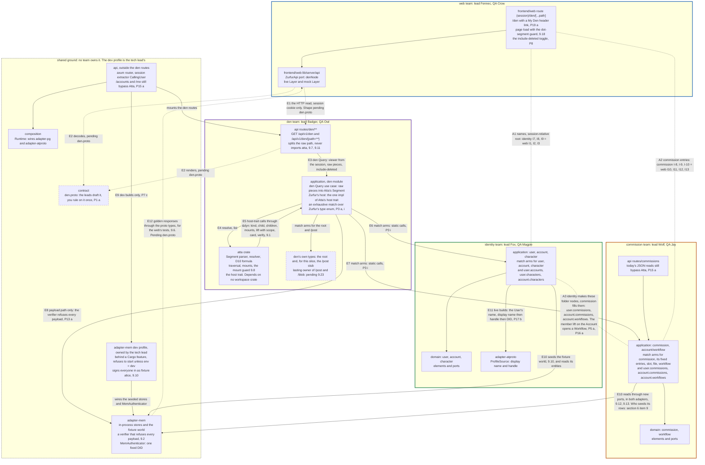
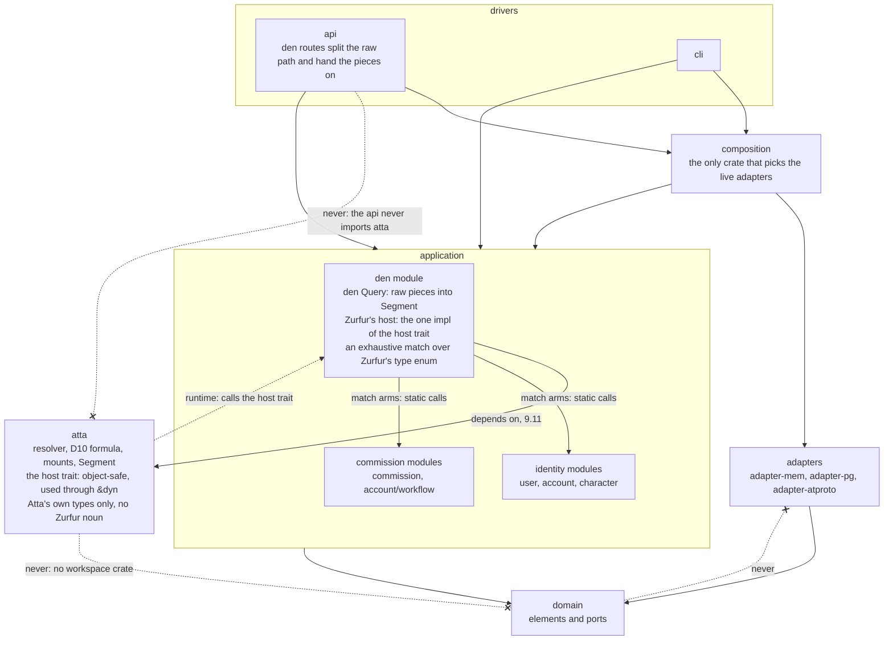
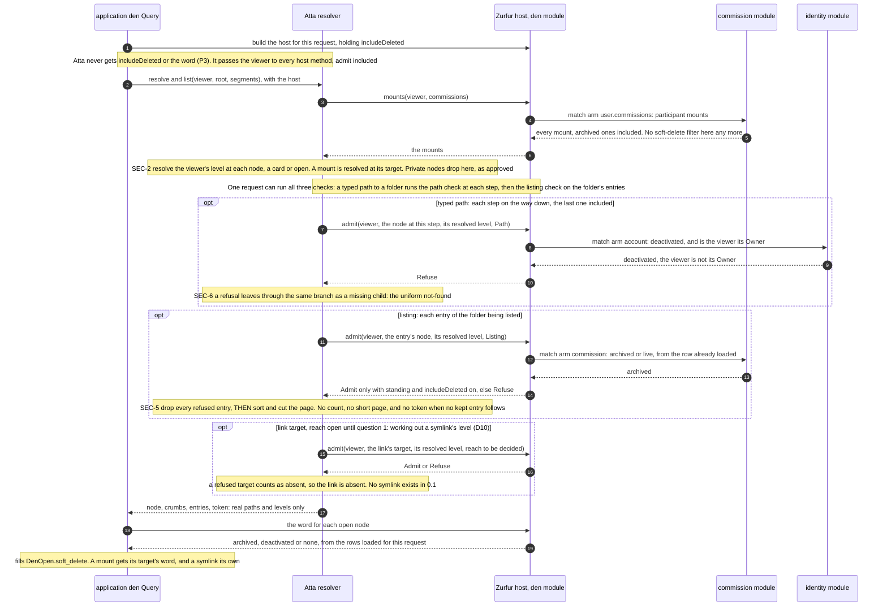

# My Den, read-only: architecture diagrams

2026-10-06 · drawn by the Designer for the tech lead (`claude`) · **revised 2026-10-07 to show the ruled design** · read-only study: no repo file changed except this one.

These diagrams show "My Den, read-only" as you have now ruled it. Check them before any code is written. They draw only what these sources say:

- your answers on the question sheet, `.understand/20261006-my-den-question-sheet.md`, cited as "P1"…"P40" with the option you chose ("P5 (a)"), and the tech lead's answers in its section 9, cited as "9.n" for its 25 numbered answers (also "sheet finding n" for its §5);
- the team files `den.md`, `identity.md`, `commission.md` and `web.md` (in the session scratchpad under `den-ask/`), for detail only. Where a ruling and a team file differ, the ruling wins;
- the Den DD 2026093001 (D1–D28; its Worked example);
- the code layout from `just nodes tree`.

## What changed since the draft

Diagram numbers in brackets.

1. Atta is a library that `application` consumes. The three side-by-side layer options are gone (P3 (a)) [2].
2. Reads reach Zurfur's types through one host trait. Its one implementation sits in `application`'s den module as an exhaustive `match`, and each arm calls the owning team's module. The runtime-registry routing is gone (P3 (i); 9.11) [1, 2, 3].
3. The API never imports `atta`. It splits the raw path and hands the pieces to the den Query, which parses them into Atta's `Segment`. The old CONFLICT edge from the API to Atta is removed (P3; 9.11) [1, 2, 3].
4. Atta no longer calls team code directly. Its host-trait calls land in the den module, which calls the team modules (P3 (i)) [1].
5. Den owns the API route group `api/src/routes/den/**` and `application`'s den module (9.7) [1].
6. The `adapter-mem` dev profile is the tech lead's shared ground: behind a Cargo feature, refusing to start unless the environment is `dev`, and signing everyone in as alice (P7 (c); 9.10) [1].
7. My Den lives at `/den` inside today's web app, with a header link (P19 (a)) [1, 3].
8. Not-found is a 404 with a problem document of one type. The gate is one shape; timing is re-tested at the first PostgreSQL read (9.16; 9.9) [3].
9. Only metadata is served. The mem verifier refuses every payload, and D25 is recorded as not exercised (P13 (a); 9.2) [1, 3].
10. An entry shows its resolved level, plus its own level only to viewers who can open it (P4 (c)) [3, 4].
11. Standing covers the real subtree and never crosses a mount. "Each node answers alone" is noted as the backup (P5 (a), (b)) [3, 4].
12. Names come from metadata. A User's is the display name, then the handle, then the DID (P17 (b)). A commission's is its title (P11 (a)). A mount may carry the viewer's custom title, defaulting to the canonical name (P24 (b)). Type names stay provisional (P10) [3, 4].
13. Archiving is the soft delete. Archived commissions and soft-deleted Accounts are left out unless the request sets `include-deleted`, which a UI toggle sends (P8) [1, 3, 4].
14. Tombstoned characters are hidden (P38) [4].
15. A commission has a fifth fixed entry, `participants`, born Private (P34 (b)) [4].
16. An Account's `characters` holds a member mount for each Character the Account administers. It is empty in this slice (P26 (a)) [4].
17. A Workflow is born Private, opens for members through the Account's standing, lists nothing and carries "content not shown yet" (P16 (a); 9.11, 9.24) [4].
18. The "content not shown yet" flag is in (P9 (a)) [4].
19. Listing order is name, then segment, with no special case (9.10) [3].
20. The changelog is a file in the interface, kept in a table so it can page (P12) [4].
21. Atta refuses a mount whose target isn't directly under a top-level directory (9.8) [1, 3].
22. `Cache-Control: private, no-store` ships first as its own fix, and logs carry route templates only (9.19, 9.20) [3].
23. Golden responses are generated through the proto types. Card fixtures are hand-written but built through them (P18 (a); 9.6) [1, 4].
24. Abco and Ember are Public only if the mem fake models their repos, else Private (9.22) [4].
25. The slot-to-character edge, a later slice, now appears only in the crosswalk. Under the ruled routing its path runs through Atta, not straight to identity (identity I12) [1].
26. Pending marks are cut to the `den.proto` shape (P1 (a); 9.17), the owner of `/post` and `/blob` (9.23), and the open items in §6 [all].
27. §6 marks each trouble resolved or open, and adds items 14–22: the places where the rulings didn't fit together when drawn [6].

## How to read and approve

| # | Diagram | What it answers |
| --- | --- | --- |
| 1 | Components and seams | Which team owns which crate or module, and which interface crosses which team line |
| 2 | Layers | Where Atta sits, how its reads reach Zurfur's types, and the dependency rule |
| 3 | The main request | What happens when a signed-in viewer opens a folder in My Den, and where each security check sits |
| 4 | The fixture world | The seed as a Den tree: real parents versus mounts, and what alice and bob each see |
| 5 | State diagrams | Skipped, with the reason |
| 6 | Where the drawing found trouble | Each earlier trouble, resolved or open, and what the rulings left unjoined |

**To approve:** under each diagram is an `**Engineer:**` line. "Approve" means the picture is a faithful record of your rulings and of what is still pending. "Change" means: name what is wrong.

**Conventions**

- **Solid** box or line: ruled, by your answer on the sheet or by a tech-lead answer in its section 9 (which you can overturn in review).
- **Dashed** box or line: still open, named in its label.
- **Terms.** These are the sheet's terms: Atta, standing, lift, mount, card. Three more:
  - A **Den path** is relative to the viewer's own root, like `~`. The web URL and the API take it.
  - A **real path** is where a node actually lives under `/`.
  - The **host** is the code that answers Atta's questions about Zurfur's types: one implementation, in `application`'s den module.
- **Validation.** Every Mermaid block was parsed with `mermaid.parse()` from mermaid 11.17.2 under jsdom 25.0.1. No `mmdc` or browser is installed here, so parsing was checked but rendering was not.

---

## 1. Components and seams

Who owns what, and which interfaces cross a team line. In this diagram an arrow means "calls" or "data flows to". Diagram 2 shows compile-time dependencies.



**Legend**

- Four team boxes (colored borders), plus one grey dashed box for shared ground: `contract`, the rest of `api`, `composition` and `adapter-mem`. The dev profile inside it is the tech lead's, built by a Spawn (9.10).
- **`api` and `application` are each one crate, owned by module.** Den owns the `api` route group `routes/den/**` and `application`'s den module (9.7). The rest of `api` stays shared. Commission's Workflow code lives under `application/src/account/workflow/` today, inside the Account namespace, though commission owns Workflow nodes (identity I11).
- **E5 to E7 are the ruled routing.** Atta calls its host trait through `&dyn`. The one implementation, in the den module, matches on Zurfur's type enum and calls the owning team's function (9.1, 9.11).
- **E1 to E12** are calls or data flows that cross a team line. **A1 to A3** (dotted, no arrowhead) are agreements, not calls:
  - A1 and A2 ride on the HTTP read. The web never calls identity or commission directly.
  - A3: identity makes the folder node and commission fills it. Neither calls the other: the host's match routes each folder's type to its owner.
- **The reads that bypass Atta** (`/accounts`, `/me` and the commission JSON routes) stay for now. Their follow-up is owned by identity and commission, and is due before the first Den slice that reads from PostgreSQL (P15 (a); 9.3).
- **The dev profile.** The api runs on it only in dev builds. Which crate carries the Cargo feature isn't named in 9.10; that is a build detail.
- `adapter-pg` is left out: it is not on this slice's read path. Every new read port still lands in both adapters, with no stubs (9.12, 9.13).

**Interface crosswalk.** Each row is one agreed topic, with every file's own id for it. "—" means that file has no row for the topic.

| Topic | den | identity | commission | web | Ruled by |
| --- | --- | --- | --- | --- | --- |
| The read: one Query, two route bindings, a Den-relative path | I-W1, I-W11 | I7 | — | I4 | P3 (a); 9.7, 9.11. Wire: den.proto, **pending** |
| Response: node, crumbs, listing or card, paths as segment lists | I-W2 | — | — | I5 | den.proto, **pending** (P1 (a)) |
| One uniform not-found; a Listed node answers with its card | I-W3 | G3 | R-11 | I6 | 9.9, 9.16 |
| Mounts keep the Den path; symlinks don't open | I-W4 | — | — | I7 | P29 (a), for when links open |
| Which level an entry shows | I-F4, I-W-B5, I-W5 | I6 | I-11 | I5 | P4 (c) |
| A mount has no level of its own | I-F12 | TL8 | — | Q1 | P4 (c) |
| One `Segment` type, parsed in `application`; the web's dot-segment guard | I-W6 | — | — | I9 | P3; 9.11, 9.18 |
| Type strings are opaque working names | I-W7, I-W-B4 | I8 | I-3 | — | P10 |
| Seed world and fixtures across tiers | I-F11, I-W8, I-W12 | I16 | §1 item 6 | I8, I16 | P7 (c); 9.6, 9.10, 9.22 |
| The "content not shown yet" flag | I-W10 | — | Q0 | I14 | P9 (a) |
| Pagination after the viewer filter | I-W13 | — | — | I17 | 9.7 |
| Root holds three folder nodes plus the `posts` mount | I-F3, I-W14 | I5, I14 F-d | — | I3 | P2 (1) |
| Keys are segments, unique within the real parent | I-F1, I-W-B3 | I1 | I-2 | gap 3 | P6 (a) |
| Host reads and routing by type | I-F2, I-W-B4, I-W-g | I2, I3, I4, I15 | I-3, I-14 | I4 | P3 (a), (i); 9.1, 9.11. Commission I-14's registry reading is retired |
| Standing covers the real subtree, never across a mount | I-W-B1, I-W-c | I3, I11 | I-1, I-6 | — | P5 (a); (b) is the backup |
| Participant mounts | I-W-B2, I-W-b | I10 | I-4 | — | P2 (5); P39 (no mount for an invitation) |
| Account folders: `commissions` empty, `workflows` listed | I-W-e, I-W-f | I11 | I-5 | I13 | P2 (2), P16 (a); 9.11, 9.24. Later: P20 (b) |
| No payload in this slice | I-W-B6 | I13, TL9 | I-12 | — | P2 (5), P13 (a) |
| D25 in this slice | I-F5 | I13 | — | — | P13 (a); 9.2 |
| Names: User, Account, Character, commission | I-F6, I-W-a | I8 | I-8 | I2, I10 | P10, P11 (a), P17 (b), P24 (b) |
| Node-name validation | I-W-h | — | T7 | gap 12 | 9.15 |
| Archived commissions, soft-deleted Accounts, tombstones | I-F9, I-W-i | I14 F-e, PM8, PM16 | I-9, Q10 | I11 | P8, P38 |
| `/account/<did>` is Private | I-F7 | I14 F-b | — | — | D12; P25 (a) keeps a public profile a derived view |
| Keeper mounts; the Account's `characters` | I-F8 | I14 F-c, PM7 | — | — | P26 (a) |
| A character's `art` is omitted | I-F10 | I14 F-f | — | — | P2 (3) |
| The Class B MAC binds the real path | I-F13 | PM11 | R-3 | — | P6 (a); not exercised (P13 (a)) |
| Inside a commission | 1.5 table | — | I-10 | I12 | P2 (4), P12, P34 (b) |
| Dotfiles | I-W9 | — | T7 | Q5, I15 | P30 (c); 9.15 |
| A live session always has a root | — | I9 | — | I3 | — |
| Slot to Character card (later) | — | I12 | I-7 | — | not this slice |
| View grants (later) | I-W-d | I10, PM13 | Q2, Q3 | — | P21 (a), P22 (a) |

**Pending**

- `den.proto`: the leads draft it, and you rule on it once (P1 (a)). The entry shape `oneof access { open { own_level } | card {} }` goes into that draft (9.17).
- 9.23: who owns `/post` and `/blob`. A team-structure call for you.
- §6 item 9: who seeds the commission rows.

**Engineer:** approved (2026-10-07, all four pictures, on the rendered page https://claude.ai/artifact/NKK8wefjJ4aYC282NkPC49)

---

## 2. Layers

Atta is a library under `application`, reached through one host trait and an exhaustive `match` (P3 (a), (i); 9.11). Solid arrows are compile-time dependencies. The one dotted arrow is a runtime call: Atta calls its host trait, whose one implementation lives in the den module.



**Legend**

- **The dependency rule.** These hold (11763713 *Layers*; the `atta/Cargo.toml` comment; 9.11):
  - adapters depend on `domain`, and `domain` never depends on an adapter;
  - `composition` is the only crate that picks the live adapters;
  - `atta` depends on no workspace crate (a guard test, den 1.5 item 4);
  - the api never imports `atta`. It hands raw path pieces to the den Query.
- **The host trait (9.1).** Object-safe and used through `&dyn`. It speaks only Atta's own value types: `Segment`, `NodeName`, `Level`, `Metadata` and an opaque type key, never a Zurfur type. It is async through `async-trait`, with `Send` futures. A later browser build (`?Send`) will be a `cfg` variant.
- **Zurfur's type enum and its match** live in the den module, never in Atta (den G5).
- **Edges left out to keep the picture readable:** `shared` and `application-macros`, and the drivers' direct edges to `domain`.
- **The `cli`** would get the Den read through the same use case (den Q4). Nothing in this slice builds that.
- **Rejected, in one line:** Atta above `application` (b) or as a layer of its own (c), because Atta "is a library ... completely decoupled and should not speak Zurfur's language" (your P3 answer); and a runtime registry (ii) or separate traits (iii), in favor of (i), which keeps the static call graph that 55836674 asks for ("No mediator, no handler registry").

**Pending**

- Nothing in this diagram. Two numbers come at build time: the segment cap, which must fit the longest DID, and the `NodeName` display cap. The den lead cites both with their sources (9.4).

**Engineer:** approved (2026-10-07, all four pictures, on the rendered page https://claude.ai/artifact/NKK8wefjJ4aYC282NkPC49)

---

## 3. The main request: alice opens a folder in My Den

alice, signed in, opens `/den/commissions/01a0ef9c…/attachments`. That is the `attachments` folder of a commission she takes part in, reached through her own mount.

```mermaid
sequenceDiagram
  autonumber
  actor B as alice's browser
  participant W as web load (session)/den/[...path]
  participant P as ZurfurApi port denNode
  participant A as api den routes GET /api/v1/den/{path=**}
  participant Q as application den Query
  participant T as Atta resolver
  participant H as Zurfur host, den module
  participant I as identity module
  participant C as commission module
  participant M as adapter-mem, dev profile or tests

  B->>W: GET /den/commissions/01a0ef9c.../attachments
  Note over W: (session) gate sends an anonymous load to /login. UX only: the backend 401 is the guard
  Note over W: SEC-1a refuse empty, dot and dot-dot segments, raw or percent-encoded, before any URL is built (9.18). Failure gives the not-found page
  W->>P: denNode(RequestedDenPath segments), include-deleted only if the toggle is on (P8)
  P->>A: GET /api/v1/den/commissions/01a0ef9c.../attachments, session cookie only
  Note over A: SEC-0 viewer = session principal (CallingUser). The root is /user/viewer-DID, never a DID from the path (P2 note)
  Note over A: SEC-1b split the raw path on slash first, then percent-decode each piece. The api never imports atta (9.11)
  A->>Q: den Query(viewer, raw pieces, include-deleted)
  Note over Q: SEC-1c parse each piece into Atta's Segment. Refuses empty, dot, dot-dot, slash, NUL, control and over-long, at most 16 pieces (9.4). A failed parse is the uniform not-found
  Note over Q,H: include-deleted reaches the host, never Atta: Atta knows no deleted state (P3)
  Q->>T: resolve and list(viewer, root /user/viewer-DID, segments), with the host and its caps
  Note over T: walks / and /user: traverse-only, never listed (D5)
  T->>H: child(/user, viewer DID), lift(viewer, user node)
  H->>I: match arm user
  I->>M: UserStore find, the profile for the name
  I-->>H: user node, own level Private. Name: display name, else handle, else DID (P17 b). Self lift, subtree (P5 a)
  H-->>T: the node and its lift
  T->>H: child(user node, commissions), mounts(viewer, user node)
  H->>I: match arm user: folder node commissions, type user.commissions. Its one mount is posts
  I-->>H: the folder node
  H-->>T: the folder node, no mount at this segment
  Note over T: SEC-3 a segment naming both a real child and a mount fails closed (den 1.3)
  T->>H: child(commissions, 01a0ef9c...), mounts(viewer, commissions)
  H->>C: match arm user.commissions: participant mounts
  C->>M: CommissionStore participant listing (new port, in both adapters, 9.12)
  Note over C: archived commissions, which are soft-deleted (P8), are left out unless include-deleted is set
  C-->>H: no real child. Mount 01a0ef9c... with target /commission/01a0ef9c... Name: her custom title, else the canonical name (P24 b). Custom titles aren't built yet
  H-->>T: the mount
  Note over T: SEC-7 the target must sit directly under a top-level directory, else fail closed (9.8)
  Note over T: the mount re-anchors at the target's real path. /commission is traverse-only. Self standing on /user/alice does not cross the mount (P5 a)
  T->>H: child(/commission, 01a0ef9c...), lift(viewer, commission node)
  H->>C: match arm commission
  C->>M: CommissionStore find, is_participant
  C-->>H: commission node, own level Private, name = its title (P11 a). Participant lift, subtree (P5 a)
  H-->>T: the node and its lift
  T->>H: child(commission, attachments), lift(viewer, attachments)
  H->>C: match arms commission and commission.attachments
  C-->>H: fixed folder attachments. No stored level, so Private (9.14). No lift of its own
  H-->>T: the folder node
  Note over T: SEC-2 viewer level = highest of own level and the lifts on the real path from the mount target down (D10, P5 a). The Participant lift opens attachments. Backup, if P5 a fails: each node answers alone (P5 b)
  T->>H: children(attachments), mounts(viewer, attachments)
  H->>C: match arm commission.attachments: file listing (new port), names from a metadata-only FileStore read (9.13)
  C->>M: list files, FileStore metadata: key and name, no bytes
  C-->>H: file nodes keyed by FileKey (P6 a), no stored level so Private, name = FileName
  H-->>T: the entries
  Note over T: SEC-4 no payload is served, so the verifier is not reached. Metadata goes out unverified and D25 is recorded as not exercised. A payload would meet the mem verifier, which refuses every one (P13 a, 9.2)
  Note over T: SEC-5 drop Private entries, Listed ones become cards, open ones open. Each open entry carries its own level, here Private (P4 c). Sort by name, then segment (9.10). Cut the page AFTER the filter, never a count. The page token is opaque and holds no names (9.7)
  alt every segment opens
    T-->>Q: node, crumbs, entries, next-page token
    Q-->>A: a flat Output of values
    A-->>P: 200, den.proto response. Shape pending: the leads draft it, you rule once (P1 a)
    P-->>W: DenNode. Tolerant reader: an unset access case renders as a card (9.17)
    W-->>B: crumbs and listing. Files are listed, not opened. Cache-Control private, no-store (9.19)
  else the last segment is Listed for this viewer
    T-->>Q: its card: name, type, resolved level, from metadata only. Never the own level (P4 c)
    Q-->>A: a flat Output of values
    A-->>P: 200 with the card
    P-->>W: DenNode with a card
    W-->>B: the card. No seed produces one: hand-written fixtures prove it (P18 a, 9.6)
  else absent, nonexistent, inside an unopenable node, or a failed parse, at any segment
    Note over A,T: SEC-6 one uniform not-found: same status, body and headers for every case. Timing is not a gate yet (9.9)
    A-->>P: 404 with a problem document of one type (9.16)
    P-->>W: not-found
    W-->>B: one not-found page, one copy
  end
```



**Where each security check sits**

| Check | Where | What | Source | Status |
| --- | --- | --- | --- | --- |
| SEC-0 | api den routes, through `CallingUser` | The viewer and the root come from the session principal only, never from a DID in the path. A user reads only their own root | sheet finding 12; P2 note; web I1 | ruled |
| SEC-1a | web load | Refuse empty, `.` and `..` segments, raw or percent-encoded, before any URL is built: `fetch`'s URL parser resolves `..` before the backend sees it | finding 1; web I9 | ruled: input sanitizing, not a visibility decision (9.18) |
| SEC-1b | api den routes | Split the raw path first (axum decodes `%2F` in a wildcard), then decode each piece. Hand the raw pieces on; no `atta` import | finding 3; P3; 9.11 | ruled |
| SEC-1c | application den Query | Parse each piece into Atta's `Segment`. At most 16 pieces; a segment cap that fits the longest DID | den I-W6; 9.4, 9.11 | ruled; the den lead cites the exact segment cap at build |
| SEC-2 | Atta, per node | The viewer's level is the highest of the own level and the lifts (D10). Standing covers the real subtree and never crosses a mount | D10; P5 (a), backup (b); P4 (c) | ruled |
| SEC-3 | Atta, per segment | A segment naming both a real child and a mount fails closed | finding 19; den 1.3 | agreed |
| SEC-4 | Atta, payload path | No payload is served. The mem verifier refuses every payload, and D25 is recorded as not exercised | finding 19; P13 (a); 9.2 | ruled |
| SEC-5 | Atta, listing | Filter first, then cut the page. Never a count. Opaque page tokens without names | finding 8; D26; 9.7 | ruled |
| SEC-6 | Query, Atta, api, web | Absent, nonexistent, inside an unopenable node, failed parse: one not-found, a 404 with one problem type | finding 7; D8, D9; 9.9, 9.16 | ruled; timing is re-tested at the first PostgreSQL read (9.9) |
| SEC-7 | Atta, per mount | A mount whose target isn't directly under a top-level directory fails closed | 9.8 | ruled |
| SEC-8 | web | `Cache-Control: private, no-store` on the `(session)` group, shipped before the slice as its own fix. Logs carry route templates only, never Den paths, segments or page tokens | findings 10, 11; 9.19, 9.20 | ruled |
| SEC-9 | dev profile | Behind a Cargo feature, and refuses to start unless the environment is `dev`, because it signs everyone in as alice | finding 18; 9.10 | ruled |
| Names | `NodeName` (den), `FileName` and titles (commission) | Refuse control and format characters, bidi overrides included, plus empty names and `/` | finding 9; 9.15 | ruled |

**Security reviews (9.5).** One short review before code, on the path-segment design (SEC-1a, 1b and 1c). One full review at the end of the slice, with the sheet's 19 findings as its checklist, plus the bypassing reads and the existing account-delete traversal shape.

**Legend**

- **The root read.** The API path is relative to the session's root, so `/den` alone reads the root through the second binding, `GET /api/v1/den` (axum's catch-all doesn't match an empty path; web I4, den I-W11).
- **Two ways to run it (P7 (c)).** The web's mock Layer answers at `P` from golden responses (9.6). The dev profile runs the whole path on `adapter-mem`, signed in as alice (9.10).
- **Returns.** Each team function returns to the host, and the host returns to Atta.
- **The verifier is a note, not a call.** No payload is served, so the verifier isn't reached on this path. Only a test that asks for a payload sees it refuse.
- **Not drawn:**
  - the root layout's `/me` call (it runs before the load);
  - the reads that bypass Atta (P15 (a));
  - file opening, which this slice doesn't do: only folders open;
  - a maturity gate: there is none in your own Den yet (P36 (c)).

**Pending**

- `den.proto`: the response, the card, the not-found body, and how `include-deleted` travels (P1 (a); 9.17).
- §6 item 10: what the read returns for a typed path to a file this slice doesn't open.
- §6 items 15 and 20: how far P8's filter reaches, and the web page's own not-found status.

**Engineer:** approved (2026-10-07, all four pictures, on the rendered page https://claude.ai/artifact/NKK8wefjJ4aYC282NkPC49)

---

## 4. The fixture world as a Den tree

**Format:** two annotated text trees, not Mermaid, in the style of the DD's Worked example.

**Fixture sources:**

- identity seeds the fixture world (9.10): alice, bob, the Account Supreme Arts, Abco, Ember and the Private "Kael-sona" (identity I16 = den I-F11);
- the commission subtree as commission.md §1 maps it. commission.md names **no** fixture rows. The commission `01a0ef9c…`, its participants, files and slot names come from the DD's Worked example "as far as today's code can hold it" (web I8; den 1.5 item 3). See §6 item 9.

### 4a. The stored tree: real parents only, and what each viewer sees there

```text
Marks:  *  undeletable system folder   ⇢  mount (per viewer, never stored)   ->  symlink (none here)
        A: / B:   what alice / bob see at that node
                  open · absent · "—" = the node is Public but not in that viewer's Den (no mount reaches it,
                  and this slice reads only Den paths, web I4)
        (Pn), (9.n)   the ruling it follows        [open: …]  still open

/                                 Public · system · traverse-only                 A,B: traversed, never listed (D5)
├── account                       traverse-only                                   never listed (D5)
│   └── did:plc:t7ne…             "Supreme Arts" · Private (D12, P25 a)          A: open (member, Owner)   B: absent
│       ├── characters *          Private (9.14) · a member mount per Character the Account administers (P26 a):
│       │                         none modeled, so empty                          A: open (member lift)     B: absent
│       ├── commissions *         Private · empty this slice (P2) · "not shown yet" (P9 a)
│       │                                                                         A: open (member lift)     B: absent
│       └── workflows *           Private · one entry per Workflow                A: open (member lift)     B: absent
│           └ ┄ no Workflow in the seed [open: §6 item 7]. One would be born Private (P16 a),
│               open for members, list nothing and say "not shown yet" (9.11)
├── blob                          not in this slice · lasting owner [open: 9.23]
├── character                     traverse-only                                   never listed (D5)
│   ├── did:plc:a6hw…             "Abco" · keeper bob · Public if the mem fake models its repo, else Private (9.22)
│   │                                                                             A: — if Public, absent if Private
│   │                                                                             B: open (keeper)
│   │   └ art                     omitted this slice (P2)
│   ├── did:plc:e3qk…             "Ember" · keeper alice · Public or Private, the same rule (9.22)
│   │                                                                             A: open (keeper)
│   │                                                                             B: — if Public, absent if Private
│   │   └ art                     omitted this slice (P2)
│   └── <Kael-sona DID>           "Kael-sona" · Private, keeper alice             A: open (keeper)          B: absent
├── commission                    traverse-only                                   never listed (D5)
│   └── 01a0ef9c…                 "Untitled": its title as metadata name (P11 a) · Private
│       │                         participants: alice [owner], bob                A: open (Participant)     B: open (Participant)
│       ├── attachments *         Private (9.14)                                  A,B: open (Participant lift, P5 a)
│       │   ├── <FileKey>         "ref-abco.png" · file · Private                 A,B: listed, not opened this slice
│       │   └── <FileKey>         "sketch-01.png" · file · Private                A,B: listed, not opened this slice
│       ├── changelog *           a file in the interface, kept in a table so it can page (P12)
│       │                                                                         A,B: listed, not opened this slice
│       ├── participants *        born Private (P34 b) · file or folder, and its contents [open: §6 item 14]
│       │                                                                         A,B: open by the Participant lift
│       ├── products *            Private · empty (no Product in code)            A,B: open (P5 a)
│       └── slots *               Private                                         A,B: open (P5 a)
│           ├── <ElementId>       "Abco" · OPEN (code slots have no occupant)     A,B: open, empty
│           ├── <ElementId>       "Ember" · OPEN                                  A,B: open, empty
│           ├── <ElementId>       "Kael" · OPEN (the worked example's off-platform Kael, not Kael-sona)
│           └── <ElementId>       "Open slot" · OPEN                              A,B: open, empty
├── post                          traverse-only · lasting owner [open: 9.23]      never listed (D5)
│   ├── did:plc:c5vz…             alice's posts · Public stub, empty (den makes it this slice)
│   │                                                                             A: open (her posts mount)   B: —
│   └── did:plc:m2xf…             bob's posts · Public stub, empty                A: —   B: open (his posts mount)
└── user                          traverse-only                                   never listed (D5)
    ├── did:plc:c5vz…             alice · Private (D13) · name: display name, else handle, else DID (P17 b)
    │                                                                             A: open (self): "My Den"
    │                                                                             B: absent, and he can't name it (P2 note)
    │   ├── accounts *            Private (9.14) · soft-deleted Accounts left out unless include-deleted (P8)
    │   │                                                                         A: open (self lift)       B: absent
    │   │   └── did:plc:t7ne… ⇢ /account/did:plc:t7ne…                            A: open                   B: absent
    │   ├── characters *          Private · tombstoned characters hidden (P38)    A: open (self lift)       B: absent
    │   │   ├── did:plc:e3qk… ⇢ /character/did:plc:e3qk…                          A: open                   B: absent
    │   │   └── <Kael-sona DID> ⇢ /character/<Kael-sona DID>                      A: open                   B: absent
    │   ├── commissions *         Private · archived commissions left out unless include-deleted (P8)
    │   │                                                                         A: open (self lift)       B: absent
    │   │   └── 01a0ef9c… ⇢ /commission/01a0ef9c…                                 A: open                   B: absent
    │   └── posts ⇢ /post/did:plc:c5vz…   a mount at a fixed segment (P2) · lists empty, "not shown yet" (P9 a)
    │                                                                             A: open                   B: absent
    └── did:plc:m2xf…             bob · Private · the same naming rule            A: absent, can't name it  B: open (self): "My Den"
        ├── accounts *            Private · empty (bob belongs to no Account)     A: absent                 B: open
        ├── characters *          Private                                         A: absent                 B: open
        │   └── did:plc:a6hw… ⇢ /character/did:plc:a6hw…                          A: absent                 B: open
        ├── commissions *         Private                                         A: absent                 B: open
        │   └── 01a0ef9c… ⇢ /commission/01a0ef9c…                                 A: absent                 B: open
        └── posts ⇢ /post/did:plc:m2xf…   lists empty, "not shown yet" (P9 a)     A: absent                 B: open
```

### 4b. The same world as My Den lists it: Den path, then real path, then what the entry shows

Each entry shows its resolved access (open or card). Every entry here opens, so each also shows the node's own level (P4 (c)). A mount has no level of its own, so it shows its target's. Entries sort by name, then segment (9.10).

```text
alice's Den   (the dev profile signs in as alice, 9.10)
Den path                            real path                              entry
/den                                /user/did:plc:c5vz…                    crumb "My Den" · open · own Private
├── accounts                        …c5vz…/accounts                        folder · open · own Private
│   └── did:plc:t7ne…   (mount)     /account/did:plc:t7ne…                 "Supreme Arts" · open · own Private
│       ├── characters              /account/…t7ne…/characters             open · own Private · empty
│       ├── commissions             /account/…t7ne…/commissions            open · own Private · "not shown yet"
│       └── workflows               /account/…t7ne…/workflows              open · own Private · empty: no Workflow in the seed
├── characters                      …c5vz…/characters                      folder · open · own Private
│   ├── did:plc:e3qk…   (mount)     /character/did:plc:e3qk…               "Ember" · open · own Public or Private (9.22)
│   └── <Kael-sona DID> (mount)     /character/<Kael-sona DID>             "Kael-sona" · open · own Private
├── commissions                     …c5vz…/commissions                     folder · open · own Private
│   └── 01a0ef9c…       (mount)     /commission/01a0ef9c…                  "Untitled" (canonical: no custom title, P24 b) · open · own Private
│       ├── attachments             /commission/01a0ef9c…/attachments      open · own Private · 2 file entries, not opened
│       ├── changelog               /commission/01a0ef9c…/changelog        file · open by the formula, not opened this slice
│       ├── participants            /commission/01a0ef9c…/participants     open · own Private · contents [open: §6 item 14]
│       ├── products                /commission/01a0ef9c…/products         open · own Private · empty
│       └── slots                   /commission/01a0ef9c…/slots            open · own Private · 4 slots, each opens empty
└── posts               (mount)     /post/did:plc:c5vz…                    open · own Public · empty, "not shown yet"

bob's Den   (shown by tests and golden fixtures: the dev profile signs everyone in as alice)
/den                                /user/did:plc:m2xf…                    crumb "My Den" · open · own Private
├── accounts                        …m2xf…/accounts                        folder · open · own Private · empty
├── characters                      …m2xf…/characters                      folder · open · own Private
│   └── did:plc:a6hw…   (mount)     /character/did:plc:a6hw…               "Abco" · open · own Public or Private (9.22)
├── commissions                     …m2xf…/commissions                     folder · open · own Private
│   └── 01a0ef9c…       (mount)     /commission/01a0ef9c…                  "Untitled" · open · own Private
│       └── (the same five entries alice sees: both are Participants)
└── posts               (mount)     /post/did:plc:m2xf…                    open · own Public · empty, "not shown yet"

bob types /den/accounts/did:plc:t7ne…  →  his accounts folder has no such child or mount  →  the uniform not-found (404).
bob can't name alice's root at all: every Den path starts at the reader's own root (P2 note).
With include-deleted on, both Dens look the same: the seed holds no archived commission, no soft-deleted Account
and no tombstoned character.
```

**Legend**

- **Mounts versus real parents.** Every mount re-anchors at its target's real path:
  - Supreme Arts lives at `/account/…`, never inside alice;
  - the commission lives at `/commission/…`, and alice and bob each reach it through their own mount at the same segment;
  - standing on a Den root never crosses a mount (P5 (a)).
- **Who opens what.** Everything below a mount opens by a lift at the mount's target:
  - member, on Supreme Arts;
  - keeper, on a character;
  - Participant, on the commission.

  Under the backup, P5 (b), each fixed folder and file would need standing of its own.
- **No card appears anywhere,** because every node either viewer reaches sits under a lift. Cards are built and tested from hand-written fixtures, marked as such (P18 (a); 9.6).
- **A user sees only their own root (P2 note).** Den paths start at the reader's own root, and this slice has no read by real path. When links open and a real-path read arrives (P29 (a)), another user's root must answer the uniform not-found there too.
- **Absent, and "—".** "Absent" means the uniform not-found if that viewer asked for it. "—" marks a Public node that simply isn't in that viewer's Den.
- **Per-Character keys (P40 (a)).** Ember's and Kael-sona's keys differ, so the public PLC log can't tie alice's two characters together through a shared key.
- **What the fixture does not exercise:**
  - the `include-deleted` filter (P8) and tombstones (P38): no seed row is archived, soft-deleted or tombstoned;
  - grants (P21, P22), Account bring-in (P20, P23) and symlinks (P29): later slices;
  - dotfiles (P30): none in the seed;
  - a Workflow (§6 item 7).
- **Not drawn:** the always-public profile directory that P37 (a) adds to the top level. It isn't named yet and isn't in this slice.
- **Recorded mismatch:** the placeholder handles that today's `Presence::Public` needs never reach the wire (den QA 18).

**Pending**

- 9.23: who owns `/post` and `/blob`. Den makes the empty `/post/<did>` stub for this slice.
- §6 item 7: a Workflow in the seed.
- §6 item 9: who seeds the commission rows, and whether the commission team confirms them.
- §6 item 14: what `participants` is and holds.

**Engineer:** approved (2026-10-07, all four pictures, on the rendered page https://claude.ai/artifact/NKK8wefjJ4aYC282NkPC49)

---

## 5. State diagrams: skipped

The slice is read-only, so no lifecycle moves. It reads three states as facts but transitions none of them:

- archive, which is a commission's soft delete (P8);
- soft delete (an Account);
- tombstone (a Character);
- plus a mount appearing or disappearing as access starts and ends (D11).

How those states *display* is ruled: hidden by default, with `include-deleted` for the first two (P8) and tombstones hidden (P38). Both are display rules, not lifecycles. A state diagram belongs with the first slice that writes.

**Engineer:** approved (2026-10-07, all four pictures, on the rendered page https://claude.ai/artifact/NKK8wefjJ4aYC282NkPC49)

---

## 6. Where the drawing found trouble

Items 1–13 come from the first draft. Items 14–22 are new: places where the rulings didn't fit together when drawn.

1. **Routing.** **Resolved:** one host trait and an exhaustive `match` in `application`'s den module (P3 (i); 9.11). Commission I-14's registry reading is retired.
2. **The api and Atta's `Segment` type.** **Resolved:** the API never imports `atta`, and the den Query parses raw pieces into `Segment` (P3; 9.11).
3. **The changelog.** **Resolved:** a file in the interface, kept in a table so it can page (P12). It is listed and not opened in this slice. D15's "four fixed folders" still needs wording through design-sync, now with five fixed entries (item 14).
4. **A Workflow's own level.** **Resolved:** born Private, opened by members through the Account's standing (P16 (a)).
5. **Whether a Workflow opens.** **Resolved:** it opens, lists nothing and says "not shown yet" (9.11, 9.24).
6. **Listing order.** **Resolved:** name, then segment, with no special case. The web may group system folders visually (9.10).
7. **No fixture Workflow.** **Open.** No file seeds a Workflow under Supreme Arts, so `workflows` lists empty, and the seed can't show P16's level or 9.11's flag on a board. Seeding one is a commission-team fixture choice.
8. **Card fixtures versus recorded fixtures.** **Resolved:** card fixtures are hand-written, built and validated through the proto types, and marked as hand-written (P18 (a); 9.6).
9. **Commission fixture rows.** **Open.**
   - The commission team hasn't confirmed the set drawn here, which comes from the DD's Worked example. It now needs a `participants` entry too.
   - 9.10 says "Identity seeds the fixture world", while den 1.5 item 3 has each team seed its own entities. Who writes the commission rows is unsaid.
10. **Opening a file by its Den path.** **Open, for the `den.proto` draft.** The response's content is `oneof { listing | card }` (web I5). A file the viewer *can* open by the formula, but that this slice doesn't open, has neither. The draft must say what a typed path to such a file (or to the changelog) returns, and whether the web links file entries at all.
11. **Timing in the uniform not-found.** **Resolved:** the gate is one shape. Timing is re-tested at the first PostgreSQL read (9.9).
12. **What D25 means here.** **Resolved:** metadata only, D25 recorded as not exercised, and a mem verifier that refuses every payload (P13 (a); 9.2). The verifier is never reached on this slice's ordinary path, so only a test that asks for a payload exercises its refusal.
13. **Readability, not a conflict.** identity's Private character "Kael-sona" (keeper alice) and the worked example's off-platform slot "Kael" are different things. In this slice the slot is OPEN and names no character.
14. **P2 (4) versus P34 (b).** **Open.**
    - P2 confirms a commission shows exactly four entries; P34 (b) adds a fifth, `participants`. Drawn with five, as the tech lead read it.
    - P34 doesn't say whether it is a file or a folder, what it lists, or whether it opens in this slice.
    - It can't list each participant as a mount of their `/user/<did>`: each root opens only to its own user (P2 note), and standing doesn't cross a mount (P5 (a)). So nothing would show. Its contents need a shape of their own.
    - D15 needs amending as well.
15. **Where P8's filter runs, and how far it reaches.** **Open.**
    - Atta knows no "deleted" state (P3: it doesn't speak Zurfur's language). So the filter sits in the team functions behind the host: commission's mounts for `user.commissions`, identity's for `user.accounts`. Drawn there.
    - If the filter lives in the `mounts` answer, it hides a typed path too. alice's own archived commission at `/den/commissions/<uuid>` would then answer the uniform not-found until she turns the toggle on.
    - Whether that is intended, or only listings hide, isn't ruled.
16. **Who sees a soft-deleted Account under `include-deleted`.** **Open.**
    - P8 says the parameter covers both kinds, with no role limit. Identity recommended showing a soft-deleted Account to its Owner only (identity PM8).
    - Today `AccountStore::find` and `list_for_user` drop soft-deleted rows, so including them needs a new read.
    - Whether every member sees it, and whether it opens, is unsaid. How an included item is marked on the wire belongs to `den.proto`.
17. **P38 and `include-deleted`.** **Open, moot in this slice.** The soft answer you agreed to had a name-only tombstone entry under `include-deleted`; your answer reads "hidden by default". Whether the parameter ever shows a tombstoned character is unconfirmed. `Characters::delete` is `todo!()`, so no tombstone can exist yet.
18. **P26 (a) versus P5 (a).** **Open, moot in this slice.**
    - P26's option says member standing opens the Account's shared Characters. But they arrive as mounts in `/account/<did>/characters`, and P5 (a) stops standing at a mount.
    - So the Character node itself must lift the members of its administering Account: a lift at `/character/<did>`, answered by identity. D21's bring-in will need the same at the commission node, through P23's commission-side record.
    - The folder is empty in this slice, so nothing breaks yet.
19. **P17 (b) versus 9.15.** **Open.** A display name is free text from the user's PDS, and 9.15 makes a `NodeName` refuse control and format characters. Nothing says what happens when a display name fails: fall back to the handle (the next step in P17's order), clean it, or fail the read.
20. **9.16 and the web page's own status.** **Open.**
    - 9.16 answers web T6 in API terms: the API answers 404 with a problem document.
    - But web T6 asked about the page. Today's `(session)/accounts/[id]` page deliberately answers 200 with a problem body (`+page.server.ts`, line 15).
    - Whether the Den page sends a 404 status or keeps the house's 200 isn't said. Drawn as "one not-found page".
21. **Where the "show hidden" filter runs (P30).** **Open, moot in this slice.** Dotfiles are hidden by default behind a toggle. D2 says the frontend never decides, which points to a backend filter with a request flag like `include-deleted`, but neither the sheet nor section 9 says so. No dotfile exists in the seed.
22. **The dev profile shows one Den.** **A limit, not a conflict.** The profile signs everyone in as alice (9.10), and `MemAuthenticator` holds one fixed DID. bob's Den is shown only by tests and golden fixtures. Worth knowing before a demo.

---

## Proposed amendment (2026-10-08): hiding soft-deleted nodes after access resolves

By Badger (den lead), for the Engineer's approval. The approved diagrams above stay as the record of what was approved. In the release's Technical Design Document this is decision D-15. Its rendered redraw, the page you approve on, is the figure under D-15. Revised 2026-10-08 after Owl's QA (den.proto draft, "QA, revision 2", rows 8 to 10 and 14 to 16).

**In one screen**

- **What changes.** Archived commissions and deactivated Accounts are no longer filtered out inside a team's mounts answer. Atta first works out the viewer's level at each node (a card, or open). Then it asks the host one question, through one new method on the existing host trait: keep this node or not, for a listing or for a path.
- **Why.** The approved request diagram filters inside the commission module's mounts answer (§3), and §6 item 15 left that open. It can't stay there, for two reasons:
  - The mounts answer also serves typed paths. A Participant typing their own archived commission's path would get the 404, but the My Den rulings (decision 13; your P41 (a)) say it "still opens it, marked archived".
  - The host can't tell a card viewer from an opener until Atta has resolved access. Without this method, the card rule (den.proto Q-D) would need a second copy of the level rule in the host.
- **One check, three uses.** A listing drops refused entries *before* it sorts and cuts the page. On a typed path, a refused node at any step is the uniform not-found. When Atta works out a symlink's level, a refused target counts as absent; which reach it asks with is question 1. All three can occur in one request, and they go through one check, so they can't disagree.
- **What Atta learns.** Only that the host may refuse a node, never why.
  - Atta passes the viewer to `admit` the same way it passes it to `lift` and `mounts`.
  - It never receives `includeDeleted` or the soft-deleted word.
  - The den Query builds the host for each request with `includeDeleted` inside it. After Atta answers, the Query reads the word from the host for each open node.
- **Two questions for you,** at the end: a link to an archived node, and who a typed path to an archived node opens for. Neither changes code in 0.1.
- **Status.** Waits for your approval in the review sitting, because it changes an approved diagram. Atta's read side (WP-12), which builds the host trait, waits for that approval.
- **Cost.** One method and two small types, no new trait, no change to `den.proto`.

**The changed part of the request diagram**



The Mermaid block was parsed with `mermaid.parse()` from mermaid 11.17.2 under jsdom 25.0.1, as the file's "Conventions" line says. It was not rendered.

**The method, in words**

- **Name:** `admit`, on Atta's one host trait, beside `lift` and `mounts`. Like them it is object-safe and async.
- **Inputs:**
  - **the viewer,** passed by Atta exactly as it passes it to `lift` and `mounts`, so a request has one viewer for every host call;
  - **the node,** as Atta resolved it: its real path and its metadata. For a mount, Atta passes the target, and for a link's level, the link's target;
  - **the viewer's resolved level at that node,** in Atta's existing `Level` type: `Listed` (a card) or `Public` (open). A Private node never reaches the method;
  - **the reach,** a new Atta type: `Listing` or `Path`.
  - **Not an input: `includeDeleted`.** The den Query builds the host for each request with the flag inside it, so no Atta signature carries it.
- **Returns:** a new Atta type, `Admission::Admit` or `Admission::Refuse`. It is a two-case enum rather than a bool, and it carries no reason.
- **Standing** covers the real subtree (decision 3), so the rule in the table (question 2) must count standing lifted at this node *or at any ancestor* on the real path, not only a lift here. How the host learns that (from Atta's resolved level, or by remembering its own lifts along the path) is settled when Atta's read side (WP-12) builds the trait, with a test for inherited standing.
- **What the host answers.** Every arm whose type has no soft delete answers `Admit`. The commission and Account arms follow the rulings:

| The node, for this viewer | `Listing` | `Path` |
| --- | --- | --- |
| live | Admit | Admit |
| archived commission, a viewer with standing | Admit only with `includeDeleted` (decision 13) | Admit: "still opens it, marked archived" (decision 13) |
| archived commission, opened without standing, through its own level or a view grant (question 2) | Refuse | Refuse |
| archived commission, a card (Q-D) | Refuse | Refuse |
| deactivated Account, its Owner | Admit only with `includeDeleted` (P42) | Admit (P42) |
| deactivated Account, anyone else | Refuse | Refuse (P42, read strictly) |

In 0.1, everyone who can open an archived commission has standing (a Participant's mount), so question 2 changes nothing 0.1 does.

**What it replaces, and the places it changes**

- **§3 "The main request":**
  - It replaces the note under the commission module's mounts answer ("archived commissions, which are soft-deleted (P8), are left out unless include-deleted is set").
  - SEC-5 gains a step: drop Private, then `admit`, then sort, then cut.
  - SEC-6 gains a case: a refusal.
- **§1 "Components and seams":** edge E5's list of host-trait calls gains `admit`.
- **§2 "Layers":** in the host-trait legend, the list of Atta's own value types gains the reach and `Admission`.
- **§6:** it resolves item 15, and in passing item 16, with P42's Owner-only answer.
- **The release's Technical Design Document,** Feature 3:
  - "Architecture": the same two value types;
  - "Security": the SEC-5 and SEC-6 rows gain the refusal step.

**Tests that prove it**

| Case | Test | Where | Proves |
| --- | --- | --- | --- |
| Path | alice, the owner, types her archived commission's path with the flag off. The answer is 200, marked `archived`. | den Query, and the api route | Decision 13: the case the approved drawing would have answered with a 404 |
| Path | bob, a Participant who isn't the owner, types the same path with the flag off. The answer is 200, marked `archived`. | den Query, and the api route | Decision 13 opens it for "a viewer who has standing", not only the owner |
| Path | The Owner types the deactivated Account's path with the flag off. The answer is 200, marked `deactivated`. | den Query, or the api route | P42 |
| Path | A member who isn't the Owner types the deactivated Account's path, and a path through it. Both answer a 404 identical in status, body and headers to a nonexistent path's. | api route | SEC-6 and P42 |
| Path | A refused card and a missing child give Atta's same not-found value. | Atta, with a fake host | Q-D, and that a refusal has no exit of its own |
| Listing | The host refuses one entry before position N. A page of size N still holds N kept entries, and the token's offset counts kept entries only. | Atta, with a fake host | Hiding runs before the cut, so a page is never short (SEC-5) |
| Listing | The host refuses every entry after position N. A page of size N carries no next-page token. | Atta, with a fake host | The leak check: a token would tell a card viewer that hidden entries exist (SEC-5) |
| Listing | alice's archived commission is absent with the flag off. With `includeDeleted` it is present and carries `soft_delete = archived`. | den Query on `adapter-mem` | Decision 13 |
| Listing | An archived node seen as a card is absent with the flag off and with it on. | Atta fake host, plus the host's rule table | Q-D |
| Listing | A deactivated Account: its Owner sees it with `includeDeleted`, marked `deactivated`. Another member never sees it. | den Query on `adapter-mem` | P42 |
| Link target | A refused target makes the link absent, like a link to a Private target. An admitted target leaves the link present, with no word. Comes with the first slice that has a symlink, once question 1 is answered. | Atta, with a fake host | A link's level goes through the same check, and a symlink shows its own word |
| Every case | One table-driven test over every combination: the node's state × standing × resolved level × reach × `includeDeleted`. | the den module's host | The rule table above, exhaustively |

The dev world holds nothing archived or deactivated, so those cases run on seeds made only for the tests. No card exists in 0.1, so card cases go through Atta's fake host and hand-written fixtures (P18 (a)). The Owner's Account cases need the read that §6 item 16 named, because today's account reads drop deactivated rows.

**Questions for the Engineer**

1. **A link to an archived node.** When Atta works out a symlink's level, it asks about the link's target. Which reach should it use?
   - As a *path*, a board placement pointing at an archived commission stays in listings, unmarked, for everyone who can open the commission. On a Public board, that is every visitor.
   - As a *listing*, the placement is hidden unless `includeDeleted` is on.

   A placement's archived state is already an open row on the My Den rulings.

   **Claude's answer (2026-10-08; the Engineer adjusts if wrong):** Leave it open until the first slice with a symlink. The seed has none, so no code in 0.1.

   **Engineer:**

2. **A typed path to an archived node: who does it open for?** Decision 13 says "a viewer who has standing on an archived commission and opens it by its path still opens it, marked archived". Another viewer might open the same commission without standing: through its own level (a Public commission), through their own view grant, or as a member of an Account the commission was brought into (decision 8). Whatever the answer, the listing follows the same line, so the list and the path never disagree.

   **Claude's answer (2026-10-08, revised after the den lead's view and QA; the Engineer adjusts if wrong):** It opens for anyone who reaches it through their own relationship to it: standing, their own view grant, or membership of an Account it was brought into. A viewer who could open it only through its own public level gets the 404, which keeps a soft delete out of public view.

   *Den lead:* I'd count the viewer's own view grant with standing. A Description or Total grant is access given to one User (decision 4), not public view. And "the filter applies to listings only" (decision 13) argues against taking it away on a typed path.

   **Engineer:**

**Pending**

- Q-D on the `den.proto` draft: the card rows above follow Claude's answer, which the Engineer hasn't ruled on yet.
- Questions 1 and 2 above.
- This amendment itself: release decision D-15. It is approved in the review sitting, and WP-12 waits for that approval.

**Engineer:**
