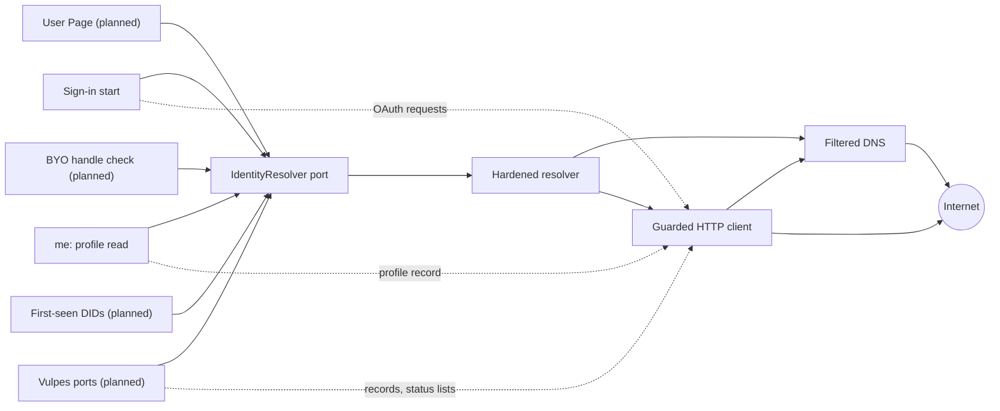
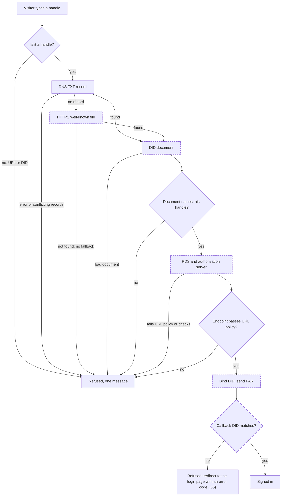

# The hardened identity resolver: design

2026-10-08 · Fox (identity lead) · QA: Magpie · **Design for approval. Nothing is built, and no programmer starts until the Engineer approves.** Revised after QA (resolutions at the end).

**What this builds on.** The Engineer's 2026-10-08 answers to Q4 in `.understand/20261007-unified-identity-investigation.md` §5:
- one resolver for every lookup, built now;
- handles only at sign-in;
- DNS on, and no Bluesky fallback;
- F3 and F5 in the same work.

F2, F6 and Q5–Q7 are out of scope.

**Citations.** Every claim cites a file and line, a design page id or a URL. Line numbers in jacquard, reqwest, hyper-util and hickory are for the versions `Cargo.lock` pins today: jacquard 0.12.0, reqwest 0.12.28, hyper-util 0.1.20, hickory-resolver 0.24.4 and url 2.5.8. Paths starting `$R/` are under `~/.cargo/registry/src/index.crates.io-1949cf8c6b5b557f/`.

---

## 1. Summary

**What gets built.** One resolver does every identity lookup: handle to DID, DID to handle, and the DID document behind them. It lives in `adapter-atproto`, behind one domain port, `IdentityResolver`. It has its own DNS client, and every HTTP request it makes goes through one guarded client.
- Zurfur fetches every DID document itself.
- jacquard still runs the OAuth protocol, but through a Zurfur type that can only use those checked fetches.
- Sign-in and the `me` profile read move onto the resolver now.
- The User Page, BYO-domain checks, first-seen DIDs, the vulpes ports and the CLI's `login --handle` use it when they are built.

**Where it sits.** See diagram (a) below. Callers go through the port to the resolver, which uses the guarded client and its DNS to reach the internet. A guard test fails the build if production code uses one of the known doors around it: reqwest, or jacquard's convenience clients.

**What each check stops.**

| Check | Stops |
|---|---|
| Handles only at sign-in | A typed `https://…` URL choosing the server Zurfur talks to |
| Private addresses refused after DNS; IP-literal hosts refused | A handle or document sending Zurfur to `10.x`, `127.x`, the cloud metadata service, or any other internal address |
| https on port 443 only | Plain-http downgrades, and using Zurfur to probe ports (Q1) |
| Certificates checked against the hostname | An attacker's DNS pointing at a public address it doesn't own, Zurfur's own included: the connection dies at TLS |
| No redirects | A public host answering "302 → internal host" (Q3) |
| A body cap (512 KiB) and a 10 s timeout | A hostile host exhausting memory or holding a server task |
| No third-party fallback | Bluesky learning every handle typed into Zurfur, and Bluesky answering identity questions in place of DNS |
| Handle and DID checked both ways | A domain claiming to be someone else's account |
| Authorization endpoint must be https, port 443, a named host (F5) | Zurfur redirecting a visitor's browser to a plain-http or internal URL |
| DID bound at start, checked at callback (F3) | Sign-in completing as a different account from the handle typed |

**What changes for users.**
- **Ordinary handles:** nothing changes through the web form, which already accepts only handle shapes (`frontend/web/src/lib/types/handle-format.ts`).
- **Handles only DNS verifies:** they keep working, through DNS directly instead of through Bluesky's AppView.
- **No longer works:**
  - a handle whose HTTPS file **redirects**, unless it also has a DNS record. The handle spec allows such redirects; Bluesky's own resolver refuses them. That is Q3;
  - a PDS or handle host on plain http, on a port other than 443 (Q1), or at a private address;
  - signing in as a **different account** at the PDS from the handle typed.
- **The API:** a direct `POST /signin` with a URL or a DID gets `422`.

**You approve, with the design:**
- the names `IdentityResolver` (which replaces the `HandleResolver` port in the parked CLI-login plan of 2026-09-10), `AtHandle` and `ResolveError` (§3.7).

**Questions for you (§7):**
- **Q1.** Port 443 only?
- **Q2.** Rate limits now, or with the User Page?
- **Q3.** Refuse redirects on the handle file?
- **Q4.** Which hickory version?
- **Q5.** A distinct error code for the wrong-account case?

---

## 2. Diagrams

### (a) Where it sits



Solid lines are identity lookups. Dotted lines are the other requests those callers make, which go straight to the guarded client.

| Box | What it is | Lives in |
|---|---|---|
| Sign-in start | `POST /signin`, then `AtprotoAuthenticator`. It resolves the handle through the resolver. Its OAuth requests (metadata, PAR, token, the callback's issuer check) go through the jacquard bridge (§3.2), which sends every request through the guarded client and every document fetch through the resolver | `api/src/routes/session.rs`, `adapter-atproto/src/authenticator*` |
| me: profile read | `AtprotoProfileSource::fetch`, behind `GET /me`. The handle and PDS come from the resolver; `getRecord` goes over the guarded client | `adapter-atproto/src/profile.rs` |
| User Page, BYO check, first-seen DIDs | Callers in `application` and `api` once built. They see only the port | §3.5 |
| Vulpes ports | `DidResolver` (through the resolver), and `RepoReader` and `StatusSource` (straight to the guarded client), all inside `adapter-atproto`, once built | §3.5; vulpes `src/acp/ports.rs:103-194` |
| IdentityResolver port | The domain trait. The only door for code outside `adapter-atproto` | `domain/src/ports/identity_resolver.rs` |
| Hardened resolver | `AtprotoIdentityResolver`: DNS TXT, the HTTPS well-known file, DID documents, the both-ways check | `adapter-atproto/src/resolver*` |
| Filtered DNS | One `hickory-resolver` client on the system's DNS configuration. It answers TXT queries for handles and A/AAAA queries for the client, and refuses any name with a forbidden address | `adapter-atproto/src/guarded_http/dns.rs` |
| Guarded HTTP client | `GuardedHttp`: the URL policy, no redirects, no proxy, certificate checks, the body cap and the timeout. Implements jacquard's `HttpClient` trait | `adapter-atproto/src/guarded_http/client.rs` |
| Internet | `plc.directory`, did:web hosts, handle hosts, PDSes, authorization servers | Never `public.api.bsky.app`, Slingshot or a DNS-over-HTTPS service |

### (b) A sign-in lookup



**Guarded steps** are drawn with a thick dashed border. Each makes requests through the guarded client, so each gets rows 2–6 below. At K, the callback makes four guarded requests:
- the authorization server's metadata;
- the token request;
- the issuer check's DID document, fetched through the resolver;
- that check's metadata.

Between J and K the browser goes to the PDS and back; that is not a Zurfur request.

**Two kinds of refusal.** X is the single anonymous `422` that `POST /signin` answers (§3.1). Y is different: K runs inside `complete` in the callback, which never answers `422`: a `complete` failure redirects to `/login?error=<code>`. A wrong account ends there, and which code it carries is Q5.

| # | Check | Where in (b) | What it stops | Source |
|---|---|---|---|---|
| 1 | Handles only | B | A URL naming the server to fetch: jacquard treats any input starting `https://` as a server (`$R/jacquard-oauth-0.12.0/src/resolver.rs:415`). DIDs are refused too | Ruling Q4, sub-question 1 |
| 2 | Private addresses refused after DNS; IP-literal hosts refused | D, E, G, J, K | DNS answers or document URLs pointing inward | atproto OAuth spec ("hostnames which resolve to private or internal IP addresses"); OWASP SSRF cheat sheet; Bluesky `unicast.ts` refuses non-unicast addresses. Refusing *every* IP literal is Fox's stricter call (I3) |
| 3 | https, port 443 only | D, E, G, J, K | http downgrades, port probing | atproto handle spec ("Secure HTTPS on the default port (443) is required for all real-world handle resolutions"); Bluesky `safe.ts` (`allowHttp` and `allowCustomPort` off when SSRF protection is on). Q1 |
| 4 | Certificate checked against the hostname | D, E, G, J, K | DNS pointing a name at a public address the attacker doesn't own | reqwest's rustls default; the guard forbids turning it off (§6) |
| 5 | No redirects | D, E, G, J, K | "302 → 169.254.169.254" | For OAuth metadata the spec requires it ("must be an HTTP 200 (not 2xx or redirect)"). For the handle file the spec **allows** redirects; refusing them follows Bluesky's `WellKnownHandleResolver` (`redirect: 'error'`) and OWASP ("Disable the support for the following of the redirection"). Q3 |
| 6 | Body cap, timeout | D, E, G, J, K | Huge bodies, slow-loris hosts | Bluesky `safe.ts` defaults (`responseMaxSize = 512 * 1024`, `timeout = 10e3`) |
| 7 | No third-party fallback | the "not found" edge out of D | Bluesky's AppView seeing and answering lookups | Ruling Q4, sub-question 2 |
| 8 | Both ways | F | `_atproto.attacker.com` pointing at a victim's DID | atproto handle spec ("must be confirmed bidirectionally"); DID spec ("The first syntaxtually [sic] valid handle found in the ordered list is treated as the claimed handle") |
| 9 | Authorization endpoint passes the URL policy | H | A 303 to `http://…`, an IP literal, another port, or userinfo | 589826 security-first list ("the https-only PDS redirect") |
| 10 | DID bound at start (J), checked at callback (K) | J, K | Completing as a different account | atproto OAuth spec ("it is critical for the client to verify that this DID matches the expected DID bound to the session earlier"); 19431425 |

The DNS TXT query (C) is not a guarded fetch: it returns text, never an address Zurfur connects to.

---

## 3. The design

### 3.1 The port

**Name and place.** The port is `IdentityResolver`, in `domain/src/ports/identity_resolver.rs`, re-exported from `domain::ports`. It is named by its role: it resolves the identities of actors Zurfur does not own.

It absorbs the `HandleResolver` port named in the parked CLI-login plan (`~/.claude/plans/plan-the-implementation-lovely-donut.md`, approved 2026-09-10), because Q4 (a) asks for one port for every lookup.

**The input type.** `AtHandle` is a new element in `domain/src/elements/handle/at_handle.rs`, re-exported as `domain::elements::handle::AtHandle`. It is any valid atproto handle, unverified:
- trimmed and lowercased;
- at most 253 chars;
- at least two labels, each label 1–63 chars of `a-z0-9-`, with no hyphen at either end;
- a last label that does not start with a digit;
- none of the spec's eight disallowed TLDs (`alt arpa example internal invalid local localhost onion`);
- no trailing dot. The spec lists `name.org.` under "Invalid syntax".

It differs from the two handle types that already exist:
- `Handle` is a handle Zurfur has claimed. It also refuses `xn--` labels, Zurfur's reserved labels and `.test`, and strips one trailing dot as part of normalizing.
- `DisplayHandle` is whatever the network reports, carried for display only and never validated.

`AtHandle` accepts `xn--` labels: an IDN handle is an existing atproto identity signing in, not a claim. The web form already says so (`frontend/web/src/lib/server/forms/login.ts`), and so does the parked CLI plan.

Its traits:
- `FromStr`, hand-written, because it is the rule, with `Err = HandleError`;
- `Display` and `AsRef<str>`, derived.

The syntax rules it shares with `Handle` move into one rule file, `handle/syntax.rs`. Each type passes its own list of reserved TLDs. `Handle`'s existing doc tests, unit tests and proptests must pass unchanged; that proves the refactor kept its behaviour.

**Methods.**

```rust
#[async_trait]
pub trait IdentityResolver: Send + Sync {
    /// The DID `handle` names, returned only when that DID's document claims the handle back.
    async fn resolve_handle(&self, handle: &AtHandle) -> Result<Did, ResolveError>;

    /// The handle `did` claims, when it checks out both ways; `None` when it does not.
    /// Errors when the DID itself does not resolve, or the check could not finish.
    async fn resolve_did(&self, did: &Did) -> Result<Option<AtHandle>, ResolveError>;
}
```

BYO needs one more check: does this handle point at this DID, before Zurfur publishes the DID-side half? That method is added with R4, its only caller (§3.5).

**The error enum.** `ResolveError` lives in `domain/src/ports/errors.rs` and derives `thiserror`. Its `Display` is terse and never echoes the input. The cause rides `#[source]` (55836674 D8).

| Variant | Means | Retry? |
|---|---|---|
| `NotFound` | Nothing names a DID, for any of these reasons: no TXT record and no well-known file; the DID is unknown or tombstoned; its document's `id` is a different DID; the body is not a full DID document; or the identifier is one Zurfur does not resolve (a method other than plc/web, or a did:web with a port or path) | No |
| `NotConfirmed` | The handle names a DID whose document does not claim the handle back (`resolve_handle` only) | No |
| `Refused(#[source] anyhow::Error)` | A host broke a fetch rule: forbidden address, IP literal, http, another port, a redirect, a bad certificate, or an oversized body | No |
| `Unavailable(#[source] anyhow::Error)` | DNS or a host did not answer in time, answered 5xx, or a deadline ran out | Yes |

Zurfur fetches every DID document itself (§3.3), so all four variants can be produced. If jacquard fetched them, it would drop the transport error and return one generic "exhausted" error (QA2).

**`resolve_did`.** It returns `Ok(None)` when the claimed handle fails the back-check with `NotFound`, `NotConfirmed` or `Refused`. It returns `Err(Unavailable)` when the back-check could not finish. That keeps two promises:
- R5 retries only on `Unavailable`;
- `me` never caches a stripped profile because of an outage (`profile.rs:57-60`). Today it does exactly that for an hour (`profile.rs:80-83`, `.ok()`).

**A uniform answer for anonymous callers.** The port keeps four honest variants because internal callers need them. Anonymous routes collapse all four into one answer:
- **Sign-in** keeps today's single `422` "That handle could not be used to sign in" (`session.rs:60-64`). A test pins one byte-identical body for every failure.
- **The User Page,** once built, maps every `ResolveError` to one `404` through one function in `api`. Its test pins the same body for all four variants.

**Logging.** The failure class is logged at `info`. The host is logged only at `debug`. The handle is never logged at `info`.

**The fake.** `MemIdentityResolver` lives in `adapter-mem/src/identity_resolver.rs`. A test can seed a handle↔DID pair (both ways), seed a one-way claim (`NotConfirmed`), or make it unreachable (`Unavailable`). It keeps the port's semantics. A shared conformance suite runs against both it and the real adapter.

### 3.2 The adapter: the guarded client and the jacquard bridge

**The seam, from source.** jacquard never needs reqwest. Its resolver and its OAuth client work over traits:
- jacquard-common's `HttpClient` (`$R/jacquard-common-0.12.0/src/http_client.rs:11-20`);
- jacquard-identity's `IdentityResolver`, whose required methods are `options`, `resolve_handle` and `resolve_did_doc` (`$R/jacquard-identity-0.12.0/src/resolver.rs:312-345`);
- jacquard-oauth's `OAuthResolver: IdentityResolver + HttpClient`, all default methods (`$R/jacquard-oauth-0.12.0/src/resolver.rs:655-666`). Its docs say "Custom implementations are possible for testing or for environments that require non-standard identity resolution";
- `DpopExt: HttpClient`, also default methods (`dpop.rs:361-375`).

`OAuthClient::new_from_resolver(store, resolver, client_data)` takes any such type (`client.rs:146-163`).

**What we build on it.** Two adapter-internal types:
- **`GuardedHttp`** implements `HttpClient` (below).
- **`JacquardBridge`** implements `HttpClient` (it delegates to `GuardedHttp`), `IdentityResolver`, `OAuthResolver` and `DpopExt`:
  - `resolve_did_doc` is Zurfur's checked document fetch (§3.3), returned as a `DidDocResponse` whose fields are public (`resolver.rs:79-86`). jacquard's `into_owned` (`resolver.rs:161-197`) then parses a buffer Zurfur has already validated;
  - `resolve_handle` always fails. jacquard is never handed a handle, so a call is a bug, and this is the tripwire;
  - `options()` returns options with `public_fallback_for_handle(false)`, no `pds_fallback` and an empty `handle_order`, for any default method that reads them.

The OAuth client is `OAuthClient::new_from_resolver(store, JacquardBridge, client_data)`. Every OAuth request then reaches `GuardedHttp`:
- the authorization-server and protected-resource metadata;
- the PAR **POST**;
- the token exchange;
- the callback's `verify_issuer` (`request.rs:724-735` → `resolver.rs:372-387`), whose DID document now comes from Zurfur's checked fetch. QA1 found this path open in the first draft.

The OAuth session the client keeps (for later PDS writes, 54427650) uses the same bridge. jacquard's `JacquardResolver` is not used at all once slices 4 and 5 land.

**Traps avoided.**
- `OAuthClient::new` builds a `JacquardResolver` with `ResolverOptions::default()` (`client.rs:84-89`), which turns the Bluesky fallback on (`resolver.rs:296`).
- `PublicResolver`, `BasicClient` and `with_default_config` are hard-wired to plain `reqwest::Client` (`lib.rs:1213-1227`; `client.rs:92-116`).
- jacquard's DNS switches (`new_dns`, `with_system_dns`) use hickory's default configuration, which is Google Public DNS (`$R/hickory-resolver-0.24.4/src/config.rs:309-316`).

The guard test forbids all of them (§5).

**`GuardedHttp`'s reqwest configuration** (`$R/reqwest-0.12.28/src/async_impl/client.rs`):

| Setting | Call | Why |
|---|---|---|
| Filtered DNS | `.dns_resolver(Arc<FilteringDns>)` (`:2290`) | The address checked is the address dialled. There is no second lookup, so no rebinding window (OWASP: "connects to the validated IP while preserving the original hostname"). TLS checks stay on the hostname |
| No redirects | `.redirect(Policy::none())` (`:1383`) | reqwest's default follows 10 redirects, https→http included (`redirect.rs:160-164`) |
| https only | `.https_only(true)` (`:2209`, enforced `:2586`) | A second lock behind the URL policy |
| No proxy | `.no_proxy()` (`:1427-1431`, which "also disables the automatic usage of the 'system' proxy") | reqwest's `system-proxy` feature is on in our build (`cargo tree -e features -i reqwest@0.12.28`). An `HTTPS_PROXY` variable would send requests to a proxy that resolves names itself, past the filter |
| No decompression | `.no_gzip().no_brotli().no_deflate()` (`:1315`, `:1332`, `:1366`) | gzip, brotli and deflate are on through feature unification (same `cargo tree`). With them off, the cap counts the bytes we parse |
| Certificates | reqwest's rustls defaults, untouched | The guard forbids `danger_accept_invalid_certs`, `danger_accept_invalid_hostnames`, `add_root_certificate` and `tls_built_in_root_certs` |
| Total timeout | `.timeout(10 s)` (`:1441`, "from when the request starts connecting until the response body has finished") | Slow hosts |
| User-Agent | `.user_agent("zurfur-identity/<version>")` | A host's operator can tell who we are |

**One parsed URL, checked once: `PublicHttpsUrl`.** This is an adapter-internal newtype with `TryFrom<&str>` and `TryFrom<url::Url>` (std-trait-first, 37519361 ruling 6). Its only constructor runs the URL policy. It is carried in every signature that takes a URL Zurfur will fetch or hand to a browser: the PDS endpoint, the authorization endpoint and the internal send.

`GuardedHttp::send_http` works in this order:
1. Turn the jacquard request's URI into a `PublicHttpsUrl`. That parses it once.
2. Build the reqwest request from **that same** `url::Url` with `reqwest::Request::new`, so the URL that was checked is the URL dialled. reqwest would otherwise re-parse the string (`request.rs:607-623`).
3. Send.
4. On a **3xx**, return `Refused` before reading the body.
5. **Body cap.** Refuse if `Content-Length` is over the cap. Otherwise read with `Response::chunk()` (`response.rs:315`), keeping a running total, and refuse when it passes the cap. jacquard's own impl reads the whole body (`http_client.rs:87`).
6. Return `http::Response<Vec<u8>>`. Any other non-2xx is passed back, and the caller classifies it.

The cap defaults to 512 KiB. A crate-private `send_capped(url, cap)` lets one caller raise it. Vulpes status lists may reach 1 MiB (`src/acp/status.rs:231`), and the R7 `StatusSource` will use that.

**The URL policy** (`guarded_http/policy.rs`, enforced by `PublicHttpsUrl`):
- the scheme is `https`;
- the port is absent or 443;
- there is no userinfo;
- the host is a domain name. An IP literal is refused in every spelling. The `url` crate parses hex, octal, short and trailing-dot IPv4 forms into an IP host (WHATWG URL Standard; `$R/url-2.5.8/src/host.rs:297-333`). So `https://2130706433/`, `https://0x7f.1/`, `https://127.0.0.1./` and `https://[::1]/` are all refused as literals;
- after stripping one trailing dot, the host has at least two labels and does not end in `.alt .arpa .example .internal .invalid .local .localhost .onion .test`. That is the handle spec's disallowed list plus `.test`. Bluesky's `isLocalHostname` refuses single labels and `test local localhost invalid example`. This is defence in depth: DNS answers for these names would hit the address filter anyway.

IP-literal hosts must be caught here, because they never reach a DNS hook. hyper-util skips resolution when the host parses as an IP (`$R/hyper-util-0.1.20/src/client/legacy/connect/http.rs:540-545`, `dns.rs:189-202`).

**The DNS filter** (`guarded_http/dns.rs`). `FilteringDns` implements `reqwest::dns::Resolve` (`$R/reqwest-0.12.28/src/dns/resolve.rs:21-30`):
- It appends a trailing dot to the name before the A/AAAA lookup, so `resolv.conf` search domains never apply (`$R/hickory-resolver-0.24.4/src/async_resolver.rs:287-327`).
- It runs under an outer 5 s `tokio::time::timeout`.
- If **any** answer is forbidden, the whole name is refused. That is Bluesky's rule, `ips.some(isNotUnicast)` in `unicast.ts`.
- An empty answer → `NotFound`. A DNS failure or the timeout → `Unavailable`.
- The lookup is injected, so tests can script answers.

**The DNS client.** One hickory resolver is built from the system configuration ("use `/etc/resolv.conf` on Unix", `async_resolver.rs:134` in 0.24). It serves both the TXT step and `FilteringDns`, and is built once at boot. If the configuration can't be read, `Runtime::connect` fails with `ConnectError::Setup`. Which hickory version is Q4.

**New dependency lines** in `adapter-atproto/Cargo.toml`:
- `hickory-resolver`, version per Q4;
- `tokio`, promoted from a dev-dependency to a normal one (for the timeouts). It is already a workspace dependency (root `Cargo.toml:19`);
- `url`, if not already reachable directly.

**Why our own filter, not a guard crate.** §3b said the guard crates need reqwest 0.13 while jacquard is on 0.12. That constraint is softer than it looked: jacquard's traits don't care which reqwest we use. A reqwest-0.13 `GuardedHttp` could wrap `http-acl-reqwest` 0.13.0 or `reqwest-ssrf-guard` 0.2.0. We still build our own:
- either crate puts a second reqwest into the production binary (reqwest 0.13.4 is in `Cargo.lock` today only as a dev-dependency of `test-support`), and `http-acl-reqwest` also needs `reqwest-middleware` 0.5;
- we need our own `HttpClient` impl anyway, for the cap and the error classes;
- the range table is the part that needs review, and reviewing a crate's table costs as much as reviewing ours.

The guard sits behind one type, so changing course later is cheap.

<details>
<summary><b>The address table: exactly what the filter refuses</b> (with sources)</summary>

Rust's `is_global` would do this, but it is unstable (`core/src/net/ip_addr.rs:299`, `:836`, `:1601`, `#[unstable(feature = "ip", issue = "27709")]`; rustc 1.94.1 locally, and CI's floating `stable` is no different). So the table is written out and tested row by row. The sources:
- the IANA IPv4 and IPv6 Special-Purpose Address Registries (both last updated 2025-10-09);
- the IANA IPv6 Address Space registry (2025-10-23);
- the cloud vendors' metadata documentation.

**IPv4: refused**

| Block | What | Source |
|---|---|---|
| `0.0.0.0/8` | "This network" | IANA (RFC 791) |
| `10.0.0.0/8` | Private-Use | IANA (RFC 1918) |
| `100.64.0.0/10` | Shared Address Space (CGNAT). Includes Alibaba Cloud's metadata `100.100.100.200` | IANA (RFC 6598); Alibaba Cloud ECS docs |
| `127.0.0.0/8` | Loopback | IANA (RFC 1122) |
| `169.254.0.0/16` | Link Local. Includes the metadata service `169.254.169.254` (AWS, GCP, Azure) and AWS's `169.254.170.2` and `169.254.169.253` | IANA (RFC 3927); AWS EC2 docs; GCP docs; OWASP |
| `172.16.0.0/12` | Private-Use | IANA (RFC 1918) |
| `192.0.0.0/24` | IETF Protocol Assignments, the whole block. Its two global anycast addresses are never atproto hosts | IANA (RFC 6890) |
| `192.0.2.0/24`, `198.51.100.0/24`, `203.0.113.0/24` | Documentation | IANA (RFC 5737) |
| `192.88.99.0/24` | Deprecated 6to4 relay anycast | IANA (RFC 7526) |
| `192.168.0.0/16` | Private-Use | IANA (RFC 1918) |
| `198.18.0.0/15` | Benchmarking | IANA (RFC 2544) |
| `224.0.0.0/4` | Multicast | OWASP minimum list |
| `240.0.0.0/4` | Reserved, including `255.255.255.255` broadcast | IANA (RFC 1112, RFC 919) |
| `168.63.129.16/32` | Azure's platform "virtual public IP" (WireServer, platform DNS). It looks public, so no range catches it | Microsoft Learn, "Azure IP address 168.63.129.16" |

IANA's other globally reachable IPv4 special blocks (AS112 `192.31.196.0/24` and `192.175.48.0/24`, AMT `192.52.193.0/24`) need no rule: nothing internal lives there.

**IPv6: the rule, in order**
1. **Embedded IPv4.** For an IPv4-mapped address (`::ffff:0:0/96`, RFC 4291) or the NAT64 well-known prefix (`64:ff9b::/96`, RFC 6052), take the IPv4 address in the last 32 bits and apply the IPv4 table.
   - Bluesky unwraps mapped addresses the same way (`parseLookupAddress`).
   - Refusing NAT64 outright would break every IPv4-only host if Zurfur ever ran IPv6-only behind DNS64.
   - The deprecated IPv4-compatible form (`::a.b.c.d`) is **not** unwrapped, and rule 2 refuses it. So the code must not use `Ipv6Addr::to_ipv4`, which unwraps both forms; it uses `to_ipv4_mapped` plus an explicit NAT64 match. A test pins `::8.8.8.8` as refused.
2. **Otherwise allow only `2000::/3`,** IANA's "Global Unicast", except these blocks:

| Block | What | Source |
|---|---|---|
| `2001::/23` | IETF Protocol Assignments, refused as a whole. It contains Teredo (`2001::/32`, which embeds an IPv4 address), benchmarking, and a few global anycast, AMT, AS112-v6 and ORCHID blocks that are never atproto hosts | IANA (RFC 2928) |
| `2001:db8::/32` | Documentation | IANA (RFC 3849) |
| `2002::/16` | 6to4, which embeds an IPv4 address. Rust's own `is_global` excludes it too | IANA (RFC 3056); `ip_addr.rs:1628-1630` |
| `3fff::/20` | Documentation | IANA (RFC 9637) |

Everything outside `2000::/3` is refused by rule 2. That covers:
- `::/128` (unspecified) and `::1/128` (loopback);
- `::/96` (IPv4-compatible) and `64:ff9b:1::/48` (local-use NAT64);
- `100::/64` (discard) and `5f00::/16` (SRv6);
- `fc00::/7` (Unique-Local), which includes AWS's metadata `fd00:ec2::254` and GCP's `fd20:ce::254`;
- `fe80::/10` (link-local), `fec0::/10` (deprecated site-local) and `ff00::/8` (multicast).

</details>

### 3.3 The resolver's rules

<details>
<summary><b>Handle → DID, DID → document, DID → handle</b></summary>

**Handle → DID** (`resolver/handle.rs`). The steps run in sequence: DNS TXT first, HTTPS only when DNS has no record. The spec allows that ("It is ok to attempt both resolution methods in parallel"; parallel is optional). Sequential sends fewer requests to hosts an attacker picks.
1. **DNS TXT** for `_atproto.<handle>.`, fully qualified, under an outer 5 s timeout.
   - Concatenate each record's character-strings.
   - Ignore values that don't start `did=` ("Any TXT records with values not starting with `did=` should be ignored").
   - Two `did=` records with different DIDs → `NotFound` ("If multiple valid records with different DIDs are present, resolution should fail").
   - NXDOMAIN, no TXT data, or a name too long for DNS → go to step 2. The handle spec says very long handles "can not be resolved using this method … The HTTPS method will work for such handles."
   - Any other DNS failure, or the timeout → `Unavailable`, with no fall-through. Bluesky's `AtprotoHandleResolver` fails the lookup on a DNS rejection the same way.
2. **HTTPS** `GET https://<handle>/.well-known/atproto-did` through `GuardedHttp`.
   - 200 → take the first line, trim it ("clients should strip small amounts of prefix or suffix whitespace"; Bluesky also takes the first line), and parse it as a DID.
   - 404 or another 4xx → `NotFound`. 5xx → `Unavailable`. 3xx → `Refused`, pending Q3.
3. When DNS answers, it wins ("the DNS TXT result should be preferred"). Running the steps in sequence makes that automatic.
4. **Back-check.** Fetch the DID's document (below). Its first syntactically valid `at://` entry in `alsoKnownAs` must equal the handle; otherwise → `NotConfirmed`. The DID spec says the first such entry "is treated as the claimed handle … Any other handle URIs should be ignored." If that first entry is syntactically valid but uses a disallowed TLD, it is still the claim, and it fails.

**DID → document** (`resolver/document.rs`). Zurfur builds the URL, fetches it and validates the result. jacquard does none of this. There are only two URL shapes.
- **Methods.** Only `did:plc` and `did:web` (DID spec: atproto "only supports a small number of 'blessed' DID methods"). Any other method → `NotFound`, with no request.
- **`did:plc`**:
  - it must match `did:plc:[a-z2-7]{24}`, 32 characters in all. The did:plc spec: "24 characters long, including only characters from the base32 encoding set … the overall identifier length is 32 characters";
  - it is checked before it goes into the URL;
  - it is fetched from `https://plc.directory/<did>`.
- **`did:web`**:
  - it must be hostname-level: no `%3A` port and no path. The DID spec: "only hostname-level `did:web` DIDs are supported … Port numbers … only allowed for `localhost`, and only in testing";
  - the host must pass the URL policy, which refuses `localhost` and IP literals;
  - it is fetched from `https://<host>/.well-known/did.json`. jacquard's `did_web_url` turns extra `:` segments into a path (`lib.rs:425-454`); that code is never used.
- **Length.** A DID over 2048 characters → `NotFound` (DID spec hard limit).
- **Status.** 200 → parse. 404 or 410 → `NotFound`. 5xx → `Unavailable`. A transport failure keeps its class, `Refused` or `Unavailable`. This is what jacquard's document steps lose: they drop the error (`lib.rs:859-892`) and return "exhausted" (`:933`).
- **Parse.**
  - The body must parse as a full `DidDocument`. jacquard's `DidDocResponse::parse` falls back to a Slingshot "mini-doc" shape (`resolver.rs:94-114`); Zurfur does not. Any other shape → `NotFound`.
  - Then its `id` must equal the requested DID. The DID spec: "should always be verified against what was expected". Otherwise → `NotFound`.
- **The PDS endpoint.** The first service whose `id` ends `#atproto_pds` and whose type is `AtprotoPersonalDataServer` (DID spec), as a `PublicHttpsUrl`.

The same fetch serves the port, sign-in `start`, the bridge's `resolve_did_doc` (the callback's issuer check) and the profile read.

**DID → handle.**
1. Fetch the document and take its claimed handle.
2. Resolve that handle forward (steps 1–2 of Handle → DID).
3. Return `Some(handle)` if it names the same DID.
   - `NotFound`, `NotConfirmed` or `Refused` on the forward lookup → `Ok(None)`. An unconfirmed handle is never shown (2026100701 D6).
   - `Unavailable` → `Err(Unavailable)` (§3.1).

A DID whose own document fails to resolve is an error, not `None`.

**Deadline.** Each port call runs under a 20 s deadline; when it runs out → `Unavailable` (§3.6).

**No cache in this work.** Nothing caches identity lookups today (`caches: None`; audit finding 10), and `me` already has its own one-hour profile cache. A resolution cache raises staleness questions; the OAuth spec recommends "less than 10 minutes" for auth flows. It belongs with the User Page, the first high-volume anonymous caller.

</details>

### 3.4 Sign-in: F3 and F5

`AtprotoAuthenticator` moves out of `lib.rs` into `src/authenticator.rs`, so `lib.rs` becomes the façade that ruling 10 asks for. `JacquardBridge` moves with it, into `src/authenticator/jacquard_bridge.rs`.

`start` no longer calls jacquard's `start_auth`. It is built from jacquard's public pieces instead, so that F5 runs **before** the PAR POST and the DID is bound **before** the auth request is saved. The pieces:
- `OAuthResolver::get_resource_server_metadata`;
- `atproto_client_metadata` (`atproto.rs:339`);
- `request::par` (`request.rs:558-630`);
- the registry's `pub` fields `store` and `client_data` (`session.rs:438-452`);
- the store we already own.

**`start(&AtHandle)`.** The port's signature changes from `&str`. `POST /signin` parses the form into an `AtHandle` and refuses anything else with the existing `422`.
1. Resolve the handle through the resolver (both ways), keeping the validated document.
2. Take the PDS endpoint from that document as a `PublicHttpsUrl`. jacquard's `resolve_oauth` is not called: it would fetch the document again.
3. Call `get_resource_server_metadata(pds)` through the bridge (`resolver.rs:530-590`). jacquard checks that the PDS names exactly one authorization server, that the server protects this resource, and that the issuer equals the fetched URL (`:538-576`, `:895`).
4. **F5.** The `authorization_endpoint` must become a `PublicHttpsUrl`: https, port 443, a named host, no userinfo. That is stricter than "https only", because the same policy guards every other URL on this path. It need not be same-origin with the issuer: the attacker controls the issuer too, so that rule would add nothing.
5. Call `par(…, login_hint = the handle, …)`. The OAuth spec recommends "the exact account identifier supplied by the user".
6. Set `account_did = Some(did)` on the returned `AuthRequestData`; jacquard leaves it `None` (`request.rs:611`). Save it through `AtprotoAuthStore`, which seals the whole record (`auth_store.rs:133-144`).
7. Return `authorization_endpoint?client_id=…&request_uri=…`.

**`complete`.**
1. Read the auth request for `state` from our own store **first**, because jacquard deletes it inside `callback` (`client.rs:309-312`). If `account_did` is missing, refuse (fail closed); that only hits a sign-in started before the deploy.
2. Call `oauth.callback(params)`. jacquard's `state`, `iss` and code-exchange logic is kept rather than reimplemented. Its `verify_issuer` now fetches the DID document through the bridge, so Zurfur's checks run, and every request goes through `GuardedHttp`.
3. **F3.** If `sub` ≠ the bound DID, call the returned session's `logout()`, which revokes the token at the revocation endpoint (best effort) and deletes the stored session (`client.rs:819-835`). Then refuse. The route maps the refusal to a callback error code (Q5).

**Residuals of keeping jacquard's `callback`:**
- jacquard stores the session before F3 can run (`client.rs:380-381`), so a mismatched account's tokens sit sealed at rest from the save until `logout` finishes. The alternative is rebuilding the code exchange and RFC 9207 `iss` handling from `exchange_code`, about 80 lines of security-critical protocol code copied from `client.rs:295-378`. Fox chose the short residual over the copy.
- jacquard's `pds_endpoint()` picks a PDS by type only (`$R/jacquard-common-0.12.0/src/types/did_doc.rs:136-150`); Zurfur's rule also requires the `#atproto_pds` id. When a document has several such services and the two picks differ, the callback's issuer check fails, so the mismatch fails closed.

**Sign-in's deadline** is 30 s for `start` as a whole: resolution, two metadata fetches and the PAR.

### 3.5 What each caller changes

| Caller | Today | After |
|---|---|---|
| **R1 sign-in** (`POST /signin`, `AtprotoAuthenticator`) | Takes any string, URLs included. Uses a bare `reqwest::Client::new()` (`lib.rs:113`). The Bluesky fallback is on. No DID binding. No https check | Works as in §3.4. The route takes an `AtHandle` or answers `422`. The port becomes `start(&AtHandle)`; `MemAuthenticator` follows the signature and stays thin, because the fidelity of the fake is an open row on 19431425 (`:149`) and the real adapter's tests cover the binding |
| **R2 `me`** (`AtprotoProfileSource::fetch`) | Uses `BasicClient::unauthenticated()` (`profile.rs:36`): bare reqwest, Bluesky fallback, the document `id` not validated, its own both-ways helper (`:140-145`). An outage during the back-check caches a DID-only profile for an hour | Takes the handle from `resolve_did` and the PDS from the validated document. `getRecord` goes over `GuardedHttp` with jacquard's `XrpcExt` (`$R/jacquard-common-0.12.0/src/xrpc.rs:338`). The avatar URL is built from the validated PDS. An outage now errors, so nothing gets cached. `presented_handle` is deleted; the resolver now owns that rule |
| **R3 User Page** (planned) | Not built | Its application query calls `resolve_handle` (for `/profile/{domain}`) or `resolve_did`, then `ProfileSource`. Every `ResolveError` → one `404` |
| **R4 BYO handle check** (planned; BYO targets are refused today, `api/tests/handle_change.rs:303`) | Not built | Adds the forward-only port method along with its first caller. The flow follows 27852802 D6 and D7: forward check → PLC update → `resolve_handle` both ways → private commit. In dev, the second check needs the local PLC (http, loopback), which the policy refuses. R4 decides its dev story then (I23) |
| **R5 first-seen DIDs** (planned) | Not built | `resolve_did` → `cache_handle`. Retries only on `Unavailable` |
| **R7 vulpes ports** (planned; vulpes is not a dependency) | Not built | All inside `adapter-atproto`, over `GuardedHttp`. `DidResolver` uses the checked document, plus `https://plc.directory/<did>/data` for rotation keys (did:plc spec). `RepoReader` uses guarded XRPC. `StatusSource` uses `send_capped` at 1 MiB. vulpes F42's two MUSTs, no redirects and non-global addresses refused at connect (`ports.rs:177-190`), hold by construction |
| **CLI `login --handle`** (parked plan) | Planned on a `HandleResolver` port | Calls `IdentityResolver::resolve_handle`. The plan's two exit codes map as: `NotFound`, `NotConfirmed` or `Refused` → `handle_unresolved` (permanent); `Unavailable` → `service_unavailable` |
| **Composition** | Each adapter builds its own jacquard client | Builds one `Arc<AtprotoIdentityResolver>`. This can fail, on the system DNS configuration. It passes the resolver to `AtprotoAuthenticator::new` and `AtprotoProfileSource::new`, and stores it as `Runtime.identity_resolver` and `application::Ports.identity_resolver` |

**Not callers.** `plc_directory.rs` and `public_records.rs` talk to hosts the operator configures, not hosts a user picks, so they stay outside the guard. The guard test allowlists them by name, and the allowlist comment says why. `AtprotoPublicRecords::new(endpoint)` has no production caller yet (QA10). If it is ever pointed at a user-chosen PDS, it must move onto `GuardedHttp`. The Character `owner` half (54427650) writes through the user's OAuth session, which runs over the bridge, so it is guarded already.

### 3.6 Configuration values

These are constants in `adapter-atproto`, not figment config: an operator has no business loosening them. Tests override them under `#[cfg(test)]`.

| Value | Setting | Source |
|---|---|---|
| Per-fetch total timeout | 10 s | Bluesky `safeFetchWrap` default `timeout = 10e3` (`packages/internal/fetch-node/src/safe.ts`, bluesky-social/atproto `main` @ 2ee3a27, 2026-10-08) |
| Body cap | 512 KiB by default; 1 MiB for R7 status lists | Same file, `responseMaxSize = 512 * 1024`; vulpes `MAX_STATUS_LIST_BYTES` (`status.rs:231`) |
| Redirects | 0 | OAuth spec, for metadata; for the handle file see Q3 |
| Scheme, port | https, 443 | handle spec; Bluesky `safe.ts`. Q1 |
| DNS limit | 5 s total per lookup (outer timeout) | **Fox's value.** hickory's default is 5 s *per attempt*, with 2 attempts (`config.rs:983-984`), and the system configuration can change both |
| Port-call deadline | 20 s; sign-in `start` 30 s | **Fox's value, no external source.** It bounds a chain of requests rather than letting per-fetch limits stack: sign-in's worst case is 55 s without it |
| Max handle | 253 chars | handle spec |
| Max DID | 2048 chars | DID spec |
| PLC directory | `https://plc.directory` | did:plc spec. Kept separate from the minter's submit endpoint, whose default is deliberately local (`composition/src/config.rs:128-132`) |
| Proxy, decompression, cache | off, off, none | §3.2, §3.3 |

### 3.7 Approvals, and the implementation calls Fox made

**Approvals you give with the design:**
1. **`IdentityResolver`** as the name of the port. It replaces the `HandleResolver` that the parked CLI-login plan named (approved 2026-09-10).
2. **`AtHandle`** as the name of the new element: the third handle type, beside `Handle` and `DisplayHandle`.
3. **`ResolveError`** with the four variants in §3.1.

The hickory dependency is Q4.

<details>
<summary><b>Implementation calls (stated as decisions; overturn any in review)</b></summary>

| # | Decision | Why |
|---|---|---|
| I1 | Build the filter on reqwest 0.12, not buy one on 0.13 | §3.2 |
| I2 | Refuse the whole name if any of its addresses is forbidden | Bluesky `unicast.ts` |
| I3 | Refuse every IP-literal host. Stricter than Bluesky, which allows public literals (`allowIpHost = true`) | No handle, did:web, PDS or issuer needs one, and literals skip the DNS hook |
| I4 | IPv6 allow-list (`2000::/3`); mapped and NAT64 addresses unwrapped and checked; IPv4-compatible refused | OWASP: "Deny-lists are bypass-prone. Prefer allow-lists." |
| I5 | Proxy and decompression off; certificate checks untouched and guarded | §3.2 |
| I6 | Zurfur resolves handles **and fetches documents** itself. jacquard only runs the OAuth protocol, through `JacquardBridge` | jacquard's DNS is Google's; its errors merge "not found" and "down" (`lib.rs:834-835`, `:933`); its document parse accepts mini-docs; its alias check is only a warning (`lib.rs:1043-1048`) |
| I7 | A DNS error other than "no record" → `Unavailable`, with no HTTPS fall-through; a name too long for DNS counts as "no record" | Bluesky `AtprotoHandleResolver`; handle spec |
| I8 | Sign-in `start` is built from jacquard's public pieces; F5 runs before the PAR | §3.4 |
| I9 | Keep jacquard's `callback`. On a mismatch, `logout()` (revoke, then delete) and refuse; a missing binding fails closed | §3.4, residuals stated |
| I10 | Four error variants; anonymous routes collapse them to one answer | §3.1 |
| I11 | No resolution cache in this work | §3.3 |
| I12 | The relaxed test policy exists only under `#[cfg(test)]`. It allows loopback, http and any port, and adds a plaintext test upstream and scripted DNS. Dev and production use the same strict policy | A release build cannot contain it |
| I13 | A guard test keeps the known doors shut (§5) | memory `feedback_make_unsoundness_unreachable` |
| I14 | Limits are constants, with one crate-private per-request cap | §3.6 |
| I15 | The sign-in form does not strip a leading `@` | The web form's regex already refuses it (`handle-format.ts`); one shape everywhere |
| I16 | `Authenticator::start` takes `&AtHandle` | Parse at the door; the adapter can't receive a URL |
| I17 | The forward-only BYO check lands with R4 | Its only caller |
| I18 | Logs: the class at `info`, the host at `debug`, the handle never at `info`; jacquard's `tracing` feature stays off | jacquard instruments `callback` with `state` and `resolve_handle` with the handle (`client.rs:271`, `lib.rs:689`) |
| I19 | `GuardedHttp`, `PublicHttpsUrl` and `JacquardBridge` are crate-private; only `AtprotoIdentityResolver` is exported | Nothing protocol-shaped leaves the crate |
| I20 | `PublicHttpsUrl` is a validated newtype, not a check function | Parse, don't validate (37519361 ruling 6). "Checked before use" holds at compile time |
| I21 | `resolve_did` returns `Err(Unavailable)` when the back-check couldn't finish | §3.1 |
| I22 | `MemAuthenticator` stays thin | 19431425's open row on fake fidelity (`:149`) |
| I23 | The resolver reads the constant `https://plc.directory`. Dev cannot resolve Zurfur-minted DIDs from the local PLC; nothing needs to today | A dev-only exception would need a boot guard: a new decision, for R4's work |
| I24 | `AtHandle` refuses a trailing dot; `Handle` keeps its own normalization | handle spec, "Invalid syntax" |
| I25 | A–AAAA lookups are fully qualified | No search-domain expansion |

</details>

---

## 4. Slices

Six slices, each gate-green on its own (`just gate`), land as slice PRs into one feature branch.

| # | Owner | Slice | Files | Needs |
|---|---|---|---|---|
| 1 | **Lynx** | **Domain words.** `AtHandle` (with the shared `handle/syntax.rs`), `IdentityResolver`, `ResolveError`, `MemIdentityResolver`, and the port conformance suite | `domain/src/elements/handle*`, `domain/src/ports*`, `adapter-mem/src/identity_resolver*`, one `pub use` in `adapter-mem/src/lib.rs`, the suite in `test-support/src/` (new file) | — |
| 2 | **Otter** | **The guarded client.** The URL and address policy (`PublicHttpsUrl`), `FilteringDns` and `GuardedHttp`, plus the network-door guard test. It also swaps both existing clients onto `GuardedHttp`, keeping their current options: the OAuth client becomes `new_from_resolver(JacquardResolver<GuardedHttp>)`, and the profile source an `Agent` over `JacquardResolver<GuardedHttp>`. That drops `BasicClient`, `PublicResolver` and the public `with_resolver_options` (it becomes a `#[cfg(test)]` constructor that names no forbidden token) | `adapter-atproto/src/guarded_http*`, `src/lib.rs` (`build_oauth`), `src/profile.rs` (constructor and test seam), `adapter-atproto/Cargo.toml`, root `Cargo.toml`, `Cargo.lock`, `adapter-atproto/tests/network_door.rs`, `composition/src/runtime.rs` (fallible constructors), `adapter-atproto/NODE.json` | — |
| 3 | **Stoat** | **The resolver.** `AtprotoIdentityResolver` implementing the port (§3.3): its own document fetch and the both-ways rule. The authenticator and profile constructors take it and use its `GuardedHttp` for their interim jacquard clients. Wires `Runtime`, `Ports` and test-support's `MemRuntime` | `adapter-atproto/src/resolver*`, `src/lib.rs` (`mod` line, constructor), `src/profile.rs` (constructor), `composition/src/{runtime,ports}.rs`, `application/src/app.rs`, `test-support/src/runtime.rs` | 1, 2 |
| 4 | **Lynx** | **Sign-in.** `start(&AtHandle)`, the route parse, `JacquardBridge`, the built-up `start` (F5, DID binding), the F3 check with `logout()`, and `MemAuthenticator` | `domain/src/ports/authenticator.rs`, `adapter-mem/src/lib.rs`, `adapter-atproto/src/lib.rs` → `src/authenticator.rs`, `src/authenticator/{jacquard_bridge,tests}.rs`, `api/src/routes/session.rs`, `api/tests/session*.rs`, plus the frontend's `callback-errors.ts` if Q5 is (a) | 3 |
| 5 | **Otter** | **`me`.** `ProfileSource` over the resolver; deletes the interim agent and `presented_handle` | `adapter-atproto/src/profile.rs`, `src/profile/tests.rs` | 3 |
| 6 | **Stoat** | **Close-out.** The guard also forbids `JacquardResolver` and `ResolverOptions` construction now that no interim client remains. Final `NODE.json` notes | `adapter-atproto/tests/network_door.rs`, `adapter-atproto/NODE.json` | 4, 5 |

**What runs in parallel without touching the same files:**
- **Wave 1: slices 1 ∥ 2.** No shared file.
- **Slice 3** merges after both. While wave 1 is in review, Stoat writes its pure rules, stacked on 1 and 2 and in new files only: TXT parsing, well-known body parsing, DID-method rules, strict document parsing, claimed-handle extraction, and the both-ways decision.
- **Wave 3: slices 4 ∥ 5.** No shared file. Slice 3 already moved both constructors, so neither touches `composition`.
- **Slice 6** comes last.

**Why each slice is green on its own:**
- Slice 2 changes only the transport, so sign-in and `me` behave exactly as before.
- Slice 3 adds the resolver without switching sign-in to it. Sign-in still hands the handle to jacquard until slice 4, so DNS-only handles never stop resolving.

**Two notes for the tech lead:**
- Slice 2 edits the root `Cargo.toml` and `Cargo.lock`. The den team's uncommitted working copy changes both today (the `cid` workspace dependency), so coordinate the merge order.
- `docs/design-index.md` lacks 2026100701, which this doc cites. `just design-index` fixes it; that is outside this work.

---

## 5. Tests

**Conventions.**
- Unit tests sit beside their leaf (`x.rs` + `x/tests.rs`).
- Each expected value is named into a `let` (37519361 ruling 3).
- Network tests use `wiremock` (approved in 64290818 D3) through the `#[cfg(test)]` seam: scripted DNS, plus a plaintext test upstream that sends `https://H/path` to the mock with `Host: H`.

<details>
<summary><b>The full list</b> (SSRF cases in bold)</summary>

**Policy** (slice 2; pure, table-driven)
- **Every refused IPv4 block**: its first and last address and one inside, including `169.254.169.254`, `100.100.100.200`, `168.63.129.16`, `0.0.0.0` and `255.255.255.255`.
- The allowed neighbour on each side of each block (`9.255.255.255`, `11.0.0.0`, `100.63.255.255`, `100.128.0.0`, `172.15.255.255`, `172.32.0.0`, `198.17.255.255`, `198.20.0.0`).
- **IPv6 refused**: `::`, `::1`, `::127.0.0.1`, `::8.8.8.8`, `::ffff:127.0.0.1`, `::ffff:10.0.0.1`, `64:ff9b::a00:1`, `64:ff9b:1::1`, `100::1`, `2001::1`, `2001:db8::1`, `2002:a00:1::1`, `3fff::1`, `5f00::1`, `fd00:ec2::254`, `fd20:ce::254`, `fe80::1`, `fec0::1`, `ff02::1`.
- IPv6 allowed: `2606:4700:4700::1111`, `::ffff:8.8.8.8`, `64:ff9b::808:808`.
- **`PublicHttpsUrl` refuses**:
  - `http://`, `:8443` and userinfo;
  - IP literals: `https://127.0.0.1/`, `https://127.0.0.1./`, `https://2130706433/`, `https://0x7f.1/`, `https://0177.0.0.1/`, `https://127.1/`, `https://[::1]/`, `https://[::ffff:7f00:1]/`;
  - local names: `localhost`, `localhost.`, `x.localhost`, `printer.local`, `x.local.`, `a.internal`, `x.onion`, and single-label hosts;
  - `file:` and `data:` schemes.
- `PublicHttpsUrl` allows `https://bsky.social/`.

**DNS filter** (slice 2; scripted answers)
- **A name that resolves to `10.0.0.1` → refused**, and no connection is attempted.
- **A name that resolves to `[93.184.216.34, 127.0.0.1]` → refused** (one bad answer is enough).
- Public addresses only → resolves. An empty answer → `NotFound`. A lookup error → `Unavailable`. **A lookup slower than 5 s → `Unavailable`.**
- The scripted lookup receives the fully qualified name (with the trailing dot).

**`GuardedHttp`** (slice 2; wiremock)
- 200 with a small body passes.
- **301, 302, 307 and 308 whose `Location` is `http://…`, `https://169.254.169.254/…` or the same host: never followed** (the target mock receives 0 requests) → `Refused`.
- **A body over the cap with `Content-Length` → refused before reading.** **A chunked body over the cap with no length → refused at the cap.** `send_capped` at 1 MiB accepts a 700 KiB body.
- **A response delayed past the timeout → `Unavailable`.**
- **The production policy, pointed at the mock's own `http://127.0.0.1:<port>` → `Refused`, and the mock receives 0 requests.**
- A gzip-encoded response is not decoded.

**Resolver** (slice 3)
- A handle with only a TXT record resolves; a handle with only the well-known file resolves. **When TXT and HTTPS disagree, TXT wins.**
- **Two different `did=` records → `NotFound`.** Non-`did=` values are ignored.
- **DNS SERVFAIL → `Unavailable`**, and the well-known mock receives 0 requests. A name too long for DNS → the HTTPS file is used.
- Well-known file:
  - whitespace or a trailing newline → trimmed;
  - a body that is not a DID → `NotFound`; 404 → `NotFound`; 500 → `Unavailable`;
  - **302 → `Refused`, not followed.**
- **A document that does not claim the handle → `NotConfirmed`. One that claims it only in its second `at://` entry → `NotConfirmed`.**
- **A document whose `id` is a different DID → `NotFound`. A Slingshot mini-doc body → `NotFound`.** did:plc 404 or 410 → `NotFound`.
- **No request is made, and the answer is `NotFound`, for**:
  - **`did:web` with a port, a path, `localhost` or an IP**;
  - **`did:key:…`**;
  - **a malformed `did:plc`** (wrong length or charset).
- **Error classes survive**: a did:web host that resolves to a private address → `Refused`; a plc.directory timeout → `Unavailable`.
- `resolve_did`:
  - the claim resolves back → `Some`;
  - it resolves to another DID → `None`;
  - the back-check is `Refused` → `None`;
  - **the back-check is `Unavailable` → `Err(Unavailable)`**;
  - no `alsoKnownAs` → `None`.
- **No request in the whole suite carries `Host: public.api.bsky.app`**: the test upstream fails the test on sight.
- Running past the 20 s deadline → `Unavailable` (the test shortens the deadline).
- `ResolveError`'s `Display` never contains the input.
- **The port conformance suite** (from slice 1) passes against both `MemIdentityResolver` and `AtprotoIdentityResolver`.

**Sign-in** (slice 4)
- **`POST /signin` with `https://evil.example`, with `did:plc:…`, or with `@alice.bsky.social` → `422`.** A valid handle → `303` (in-memory runtime).
- **Every failure class yields a byte-identical `422` body**: not a handle, `NotFound`, `NotConfirmed`, `Refused`, `Unavailable`, and F5.
- **An `authorization_endpoint` of `http://…`, `https://…:8443/…` or `https://127.0.0.1/…` → refused, and the PAR mock receives 0 requests.**
- **A handle whose document doesn't claim it → refused, and no PAR is sent.**
- After `start`, the stored auth request's `account_did` is the resolved DID, and the `login_hint` sent with the PAR equals the typed handle.
- **The token's `sub` is a different DID →**
  - **refused;**
  - **the revocation mock is called, and the stored session row is gone;**
  - **the route redirects with the Q5 error code.**
- **No `account_did` on the stored auth request → refused.**
- **Callback, issuer check:**
  - **a did:web `sub` with a path, or one whose document is a mini-doc → refused at `verify_issuer`;**
  - **the bridge's `resolve_handle` is never called; if it is, it fails.**

**`me`** (slice 5)
- Today's four profile tests, rewritten over the resolver's test seam.
- **A document whose PDS is `http://…`, has a port, or is an IP literal → `Err`, with no request.**
- The avatar URL is built from the validated PDS.
- **The back-check is `Unavailable` → the fetch errors, so nothing is cached.**

**The guard** (slices 2 and 6)
- `network_door.rs` scans the non-test sources of the runtime crates: `api`, `application`, `cli`, `composition`, `domain`, `adapter-*`, `atta` and `shared`. `test-support` and the codegen crates are excluded by name.
- It fails on:
  - `reqwest` outside `guarded_http/client.rs`, `plc_directory.rs` and `public_records.rs`;
  - anywhere: `BasicClient`, `PublicResolver`, `OAuthClient::new(`, `with_default_config`, `with_memory_store`, `new_dns`, `with_system_dns`, `slingshot_resolver_default`, `MemoryCredentialSession`, `UnauthenticatedSession`, `public.api.bsky.app`, `danger_accept_invalid`, `add_root_certificate`, `tls_built_in_root_certs`.
- Slice 6 adds `JacquardResolver` and `ResolverOptions::`.
- It has the shape of `domain/tests/elements_do_not_import_ports.rs`.
- It covers the known doors only. hyper, raw sockets, or a jacquard path nobody has named would pass it; the review checks those by reading (§6, check 1).

</details>

---

## 6. Security review plan

The end-of-work `/security-review` (Designer, xhigh) runs on the feature branch before its PR to `main`. It must check:

| # | Check | How |
|---|---|---|
| 1 | Every request on the identity path goes through `GuardedHttp`, and every DID document through the resolver, the callback included | Read every jacquard construction and the bridge; run the guard test; look for doors the guard can't see (hyper, sockets, other jacquard paths) |
| 2 | The address table matches the IANA registries **as of the review date**, plus the metadata addresses | Re-fetch both IANA special-purpose registries and the vendor pages; diff against `address.rs` (slice 2 put the address table there, as `PublicAddress`) |
| 3 | IP literals are refused in every spelling, trailing dot included | Policy tests, plus a manual pass |
| 4 | The checked URL is the dialled URL (one parse) | Read `send_http` |
| 5 | No redirect is ever followed, 307 and 308 included | Tests; read `Policy::none()` and the 3xx branch |
| 6 | Proxy environment variables are ignored | Manually: one guarded fetch with `HTTPS_PROXY` set; the proxy sees nothing. Not automated, because changing the environment inside parallel unit tests is unsafe |
| 7 | Certificate checks are on, and no `danger_*` call exists | Read; the guard test |
| 8 | The body cap holds with and without `Content-Length`; decompression is off; `send_capped` has one caller | Tests; read |
| 9 | Timeouts per fetch, per DNS lookup, per port call | Tests; read |
| 10 | DNS uses the system resolver, with fully qualified names; the TXT rules hold; no fall-through on DNS errors | Read `handle.rs` and `dns.rs`; tests |
| 11 | Both-ways in both directions; the first valid `at://` entry; strict document parse, `id` validated, mini-docs refused | Read `document.rs`; tests |
| 12 | F3: DID bound before save; compared at callback; a mismatch revokes and deletes; a missing binding fails closed. **Judge the stated residuals** (§3.4) | Read `authenticator.rs`; tests |
| 13 | F5: the endpoint policy runs before the PAR POST | Read; test (the PAR mock receives 0 requests) |
| 14 | No third-party fallback: the bridge's `resolve_handle` fails; no `PdsResolve*`, Slingshot or DoH path is reachable | Read; the `Host: public.api.bsky.app` test |
| 15 | Anonymous callers get one answer. **Judge the timing difference**: a refused address answers in milliseconds, a missing handle only after DNS and HTTPS. It reveals only facts about DNS the attacker can look up themselves | Tests; the reviewer's judgement |
| 16 | The relaxed policy exists only under `#[cfg(test)]`, never behind a feature | grep `cfg(` around the test constructors |
| 17 | jacquard's `tracing` feature is off; logs carry no tokens and no handles at `info` | `cargo tree -e features`; read the `tracing` calls |
| 18 | Signing in as an Account's or Character's DID fails closed at provision | `adapter-pg/src/user.rs:90-93` (`DidBelongsToAnotherActor`) still holds once Accounts get hosted repos (54427650) |
| 19 | Every jacquard citation re-checked against the version locked at review time | Header versions |

**Residuals, stated so nobody assumes otherwise:**
- **Zurfur's own public addresses pass the filter on port 443.** An attacker's DNS can point a handle at them; TLS then fails unless the name is Zurfur's own. Zurfur must never treat its own public IP as a trusted source.
- **NAT64 prefixes.** Only the well-known prefix `64:ff9b::/96` is unwrapped. A network-specific prefix inside `2000::/3` passes as-is, and matters only if Zurfur is ever deployed behind one.
- **No network-layer egress guard.** OWASP lists network-layer controls next to application-layer ones, and vulpes asks for "an egress guard the deployment injects" (`ports.rs:183-185`).

**Deployment follow-up for the tech lead:** an egress firewall that denies the private ranges, and IMDSv2-only on AWS.

**Out of scope, noted:**
- **Profile avatars leak viewer IPs.** The avatar URL makes viewers' browsers load from the subject's PDS host (`profile.rs:116`, existing behaviour).
- **Bare clients toward operator hosts.** `plc_directory.rs` and `public_records.rs` use plain clients with no timeouts.
- **F2 and F6.**

**Follow-ups for the tech lead to offer the Engineer** (this work doesn't do them):
- a DD recording Q4's ruling and this design (`/design-decision`);
- 64290818 D3, whose note on `with_resolver_options` goes stale when it becomes test-only;
- the memory `project_jacquard_resolver_no_ssrf_controls`, which becomes history once this lands.

---

## 7. Questions for the Engineer

**Q1. Should identity fetches be https on port 443 only?**
- **What it means:** a PDS, handle host or authorization server on another port (`https://pds.example:8443`) can't be used to sign in or show a profile.
- **For:**
  - Bluesky's own guarded fetch refuses other ports whenever SSRF protection is on (`safe.ts`: `allowCustomPort = !ssrfProtection`).
  - The handle spec requires port 443 for real-world handle resolution.
  - It stops Zurfur being used to probe other ports on public hosts.
- **Against:** the OAuth spec allows a port on an issuer ("A port number is allowed"), and the DID spec allows an optional port on a PDS endpoint. A self-hoster on another port is locked out.
- **Recommendation: 443 only.** The lockout is narrow and matches the reference implementation, and it can be relaxed later without touching anything else.

**Q2. Should anonymous lookups be rate-limited now, or with the User Page?**
- **What it means:** after this work, any visitor can make Zurfur send up to six requests per `POST /signin`, each to a public https host they choose and each capped at 10 s and 512 KiB. The corpus precedent is per-key limits on by-DID lookups (24543244 F1). A per-IP limit needs a new dependency (a `tower` rate limiter, which would go through 64290818) or hand-written middleware.
- **(a)** Now, on `POST /signin`.
- **(b)** With the User Page, the first high-volume anonymous lookup, together with its cache.
- **Recommendation: (b).** The User Page is where volume and caching decide the right limit.

**Q3. Should Zurfur refuse redirects on the handle file?**
- **What it means:** the handle spec **allows** redirects on `/.well-known/atproto-did` ("HTTP redirects (eg, 301, 302) are allowed, up to a reasonable number of redirect hops"). The Q4 recommendation you accepted said "no redirects". For OAuth metadata the spec itself forbids redirects, so that part is settled. For the handle file, refusing redirects locks out handles whose file redirects and that have no DNS record.
- **(a)** Refuse every redirect, as now. This matches Bluesky's own `WellKnownHandleResolver` (`redirect: 'error'`) and keeps one rule.
- **(b)** For the handle file only, follow up to 3 redirects, re-running the URL policy on each `Location` and the DNS filter on each connection (reqwest's `redirect::Policy::custom` sees every hop).
- **Recommendation: (a).** The reference resolver does the same, and DNS TXT remains for those handles.

**Q4. Which hickory version should the DNS client use?**
- **What it means:** `hickory-resolver` 0.24.4 is already compiled in, through jacquard-identity, and carries **RUSTSEC-2026-0119**: "CPU exhaustion during message encoding due to O(n²) name compression", fixed in hickory-proto 0.26.1 (OSV, fetched 2026-10-08). `deny.toml:30-36` ignores it today *because* it is transitive, "flagged for the Engineer". Making it Zurfur's own DNS client on lookups an attacker influences ends that reason.
  - **Exploitability against a stub client: unverified.** The advisory is about encoding, and a stub client mostly encodes one-question queries.
  - **A second advisory, GHSA-5j98-2g5x-46v6** (hickory-resolver < 0.26.2, DNSSEC validation failures hidden), doesn't apply: DNSSEC validation stays off, the default (`config.rs:988`).
- **(a)** 0.24.4 as a direct dependency: no new code ships, the advisory stays, and the `deny.toml` reason is rewritten.
- **(b)** `hickory-resolver` 0.26.3 (2026-09-10) as a direct dependency, for Zurfur's own lookups. It fixes both advisories and adds hickory-net and hickory-proto 0.26, `moka` and `rand` 0.10 to the binary. jacquard's 0.24 copy stays compiled but never runs (jacquard's DNS is never enabled). Either way it passes 64290818 D1: it supplies a DNS client and dictates nothing.
- **Recommendation: (b).** Security over size: the duplicate costs build time, not correctness, and it disappears when jacquard moves to 0.26.

**Q5. Should the wrong-account case get its own error code?**
- **What it means:** a visitor who picks a different account at their PDS than the handle they typed is refused (F3). Today every `complete` failure, this one included, redirects to `/login?error=exchange_failed` (the callback's other codes are `denied` and `invalid_callback`).
- **(a)** A new code, `account_mismatch`, with its own message on the login page: "You signed in to a different account than the handle you typed." It tells the visitor nothing they don't already know. It changes the callback's error vocabulary, which the frontend maps in `callback-errors.ts`.
- **(b)** Keep `exchange_failed`.
- **Recommendation: (a).**

**Defaults Fox takes unless you say otherwise:**
- **Foreign `xn--` handles are shown as received, never IDNA-decoded.** That is today's behaviour, and it keeps 26050561's look-alike protection for a User's displayed name (2026100701 D6).
- **The dev stack cannot resolve DIDs minted on the local PLC.** No caller needs it before R4 (I23).

---

**Engineer (2026-10-08, in chat):** "I do agree with the five choice's recommendations." *Read as:*
- Q1: port 443 only, yes.
- Q2: rate limits come with the User Page.
- Q3: keep refusing redirects on the handle file.
- Q4: hickory 0.26.3 as a direct dependency, accepting the second copy.
- Q5: yes, a distinct wrong-account error code.
**Both diagrams were approved by the Engineer (2026-10-08).** **The three names (`IdentityResolver`, `AtHandle`, `ResolveError`) were approved by the Engineer (2026-10-08): "Yes. Approved".**

## Appendix: sources

**Specs** (all re-fetched 2026-10-08):
- https://atproto.com/specs/handle
- https://atproto.com/specs/did
- https://atproto.com/specs/oauth
- https://web.plc.directory/spec/v0.1/did-plc

**SSRF guidance and IANA registries:**
- OWASP SSRF Prevention Cheat Sheet: https://cheatsheetseries.owasp.org/cheatsheets/Server_Side_Request_Forgery_Prevention_Cheat_Sheet.html
- https://www.iana.org/assignments/iana-ipv4-special-registry/
- https://www.iana.org/assignments/iana-ipv6-special-registry/
- https://www.iana.org/assignments/ipv6-address-space/

**Cloud metadata documentation:**
- AWS: https://docs.aws.amazon.com/AWSEC2/latest/UserGuide/instancedata-data-retrieval.html
- GCP: https://docs.cloud.google.com/compute/docs/metadata/querying-metadata
- Alibaba Cloud: https://www.alibabacloud.com/help/en/ecs/user-guide/view-instance-metadata
- Azure: https://learn.microsoft.com/en-us/azure/virtual-network/what-is-ip-address-168-63-129-16

**Bluesky reference code** (bluesky-social/atproto `main` @ 2ee3a27, 2026-10-08):
- `packages/internal/fetch-node/src/{safe,unicast,util}.ts`
- `packages/internal/handle-resolver/src/{atproto-handle-resolver,internal-resolvers/dns-handle-resolver,internal-resolvers/well-known-handler-resolver}.ts`

**Advisories:**
- OSV RUSTSEC-2026-0119
- GHSA-5j98-2g5x-46v6
- `deny.toml:30-36`

**Guard crates** (crates.io API, 2026-10-08):
- `http-acl-reqwest` 0.13.0 needs `reqwest ^0.13.4` and `reqwest-middleware ^0.5`
- `reqwest-ssrf-guard` 0.2.0 needs `reqwest ^0.13`; its `reqwest-middleware` is optional

**Vendored source:**
- jacquard 0.12.0, reqwest 0.12.28, hyper-util 0.1.20, hickory-resolver 0.24.4 and url 2.5.8, all under `$R`
- Rust core `ip_addr.rs`
- vulpes `src/acp/{ports,status}.rs`

**Corpus:**
- 19431425 Authenticators
- 589826 Project MVP
- 29687820 Publish Consent & OAuth Scopes
- 27852802 Account Handle Change Flow
- 24870914 The Account Handle
- 26050561 Confusable Handles
- 34013187 Identities
- 2026100701 My Den rulings, D6
- 21594113 User Profiles
- 24543244 Auth Surfaces
- 55836674 The Application Layer
- 64290818 Libraries as Composition
- 37519361 Code Style

---

## QA challenges

2026-10-08 · Magpie (identity QA). The question put to every claim: how did you reach it, and shouldn't the Engineer (PM) or the tech lead decide it?

**Checked against:** the working copy of `~/code/zurfur` (jj `@` on `78e91e56`); the vendored sources under `$R/` at the versions `Cargo.lock` pins (all §3 line citations re-read); the corpus at `177a370`; vulpes `src/acp/ports.rs` (identical on `origin/main`); the parked CLI plan; Bluesky `atproto` at `2ee3a27` (the six cited files, fetched raw); the atproto handle, DID and OAuth specs, the did:plc spec, the OWASP SSRF cheat sheet, the three IANA registries and the four vendor metadata pages (all fetched 2026-10-08); crates.io and OSV for the guard crates and advisories.

**Verdicts:** **holds** · **wrong** · **overstated** · **missing** · **ask** (the Engineer or the tech lead decides, not this doc). **BLOCKING** = fix before the Engineer approves.

**In short**

| # | | Finding |
|---|---|---|
| QA1 | **BLOCKING** · wrong | The callback still fetches a DID document through jacquard's unvalidated path, for a `sub` the authorization server chose, *before* F3 runs. §3.3's "closes the audit's attacker-chosen GET path" and §6 check 9 ("never `into_owned`") are false for that path. |
| QA2 | **BLOCKING** · wrong | Documents fetched by jacquard lose the error class: jacquard swallows transport errors, so `Refused` and `Unavailable` collapse into one "exhausted" error. The four-variant `ResolveError` (approval 3) can't be delivered as designed. |
| QA3 | **BLOCKING** · wrong + ask | The handle spec **allows** redirects for the well-known file. "No redirects" is a deliberate deviation (following Bluesky's reference code), not "the rules". It changes who can sign in, so it's the Engineer's call: add it as Q3. |
| QA4 | **BLOCKING** · missing + ask | `hickory-resolver` 0.24.4 carries RUSTSEC-2026-0119, which `deny.toml` ignores only *because it is transitive*. Approval 4 makes it direct and puts it on every attacker-influenced lookup without naming the advisory. |
| QA5 | ask | `resolve_did` turns a back-check outage into `None`. That contradicts R5's "retries only `Unavailable`", and lets `me` cache a DID-only name for an hour. |
| QA6 | missing | One constant 512 KiB cap refuses vulpes status lists between 512 KiB and 1 MiB (R7). |
| QA7 | missing | DNS: the A/AAAA lookups pick up `resolv.conf` search domains; "5 s" is hickory's per-attempt default, not a total; over-long handles can never resolve. |
| QA8 | missing | URL policy: parse once, trailing-dot hosts, and TLS verification is an unnamed control. |
| QA9 | missing + ask | Residuals not stated: Zurfur's own public addresses, NAT64 network-specific prefixes, no network-layer egress guard. |
| QA10 | ask | `public_records.rs` is exempt by file name, but it has no production caller yet and its first likely caller (54427650's owner half) writes to a user-chosen PDS. |
| QA11 | wrong | Slice 2 can't be green as described: `BasicClient` is hard-wired to reqwest, and the guard's scope trips on `test-support`. |
| QA12 | wrong | Diagrams (a) and (b) don't match the text in six places. |
| QA13 | overstated | Citation nits: 9 items, none load-bearing. |
| QA14 | ask | Smaller calls to put to the Engineer or the tech lead: 9 items. |

<details>
<summary><b>QA1–QA4: the blocking findings</b></summary>

**QA1. The callback re-resolves an unbound `sub` through jacquard's own DID path, before F3. — BLOCKING · wrong**
- **Claim (§3.3, §3.4 `complete` step 2, §6 check 9):** did:web rules close "extra `:` segments become an attacker-chosen GET path"; documents are parsed with `parse_validated`, "never `into_owned`"; `oauth.callback(params)` runs "unchanged".
- **Challenge:** Which code path fetches the document at the callback?
- **Evidence:**
  - `OAuthClient::callback_core` calls `exchange_code` (`$R/jacquard-oauth-0.12.0/src/client.rs:340-346`). That calls `verify_issuer(&server_metadata, &sub)` on the token response's `sub` (`request.rs:724-735`), which the authorization server chose.
  - `verify_issuer_impl` calls `resolve_from_identity(sub)` (`resolver.rs:372-387`), then `resolve_ident_owned` (`resolver.rs:478-491`), then `resolve_did_doc_owned`. That is `resolve_did_doc(did).await?.into_owned()`, with no `id` check (`$R/jacquard-identity-0.12.0/src/resolver.rs:424-432`).
  - For `did:web`, jacquard builds the URL with its own `did_web_url`, path segments included (`jacquard-identity lib.rs:425-454`, `:859-868`). Zurfur's did:web rules never run on this path.
  - The PDS is then chosen by jacquard's `pds_endpoint()`, which matches on `type` only (`$R/jacquard-common-0.12.0/src/types/did_doc.rs:136-150`). The spec rule that §3.3 uses is `id` ending `#atproto_pds` *and* the type. So `start` and the callback can pick different services from one document. That fails closed, but it is a divergence.
  - F3 runs only after `callback` returns, and by then jacquard has already stored the session (`client.rs:380-381`, `registry.set`).
- **Verdict:** Bounded. Every fetch still goes through `GuardedHttp` (public https on 443, 512 KiB, 10 s), and F3 refuses afterwards. So this is not an SSRF. But two stated invariants are false, and a host the attacker chose is fetched after the binding exists and before it is checked.
- **Fix (Fox's call, implementation):**
  - (a) Implement jacquard's `IdentityResolver` and `OAuthResolver` on a Zurfur type whose `resolve_did_doc` is Zurfur's checked fetch. jacquard documents this seam: "Custom implementations are possible" (`resolver.rs:662-666`, where `OAuthResolver: IdentityResolver + HttpClient` with default methods). That covers `start` and the callback with one document path.
  - (b) Also compose `complete` from the public `exchange_code` (`request.rs:700`), the way §3.4 composes `start`, so a mismatched `sub` is refused before any session is saved. Revoke its tokens rather than only deleting the row.
  - Or (c): keep `callback`, and amend §3.3 and §6 check 9 to state the residual.

**QA2. Error classes are lost when jacquard fetches the document. — BLOCKING · wrong**
- **Claim (§3.1 error table, §3.2 hardened options, I6, §3.5 R5 and CLI rows):** `Refused` vs `Unavailable` are honest classes. "jacquard only fetches DID documents."
- **Challenge:** Can the resolver tell a refused did:web host from a plc.directory outage, if jacquard does the fetch?
- **Evidence:**
  - Both document steps call `if let Ok((buf, status)) = self.get_json_bytes(…)` and drop the error (`jacquard-identity lib.rs:859-869`, `:870-892`).
  - When no step succeeds, the result is `handle_resolution_exhausted()` (`lib.rs:933`). That is the same mixing of "not found" and "down" that I6 cites against jacquard's *handle* path (`lib.rs:834-835`).
  - A 5xx answer survives (the status rides `DidDocResponse`), but a timeout, a DNS failure, a refused address or a redirect does not.
  - §3.3 is ambiguous on top of that. "The check runs before the DID is formatted into the directory URL" reads as if Zurfur builds and fetches the URL itself. §3.2's diagram, the options and I6 say jacquard does.
- **Verdict:** As written, approval 3's variants can't all be produced. R5's retry rule and the CLI mapping depend on them.
- **Fix:** Zurfur fetches documents itself over `GuardedHttp`. There are only two URL shapes: `https://plc.directory/<did>` and `https://<host>/.well-known/did.json`. Then it builds `DidDocResponse { buffer, status, requested: Some(did) }` and calls `parse_validated`. One more gap: `parse()` falls back to a Slingshot *mini-doc* shape (`jacquard-identity resolver.rs:94-114`), so a did:web host can answer with something that isn't a DID document and be accepted. Refuse that shape, or say why it's acceptable. QA1 (a) and this fix can be the same code.

**QA3. The handle spec allows redirects; the doc says the rules forbid them. — BLOCKING · wrong + ask**
- **Claim (§1 "These no longer work, because the rules say so: a handle whose HTTPS file redirects"; §2 row 4; §3.3 step 2 "3xx → `Refused`").**
- **Challenge:** Which rule? And shouldn't the Engineer decide who loses sign-in?
- **Evidence:**
  - atproto.com/specs/handle, fetched 2026-10-08: "HTTP redirects (eg, 301, 302) are allowed, up to a reasonable number of redirect hops."
  - Row 4's OAuth quote ("must be an HTTP 200 (not 2xx or redirect)") governs the *authorization-server metadata*, not the handle file.
  - Bluesky's `WellKnownHandleResolver` does pass `redirect: 'error'` (verified at `2ee3a27`). But Bluesky's generic `safeFetchWrap` is built to follow redirects safely: "The dispatcher guard applies the same policy to every request that is actually issued, which is the only way to cover redirect hops" (`safe.ts`).
- **Verdict:** Refusing redirects is defensible: it matches the reference resolver and keeps one rule. But it is a choice that locks out spec-conforming handles that have no TXT record. It is not spec-mandated.
- **Fix:** Reword §1. Add **Q3** for the Engineer:
  - (a) refuse every redirect (as now);
  - (b) for the handle well-known file only, follow up to *N* hops, re-running the URL policy on each `Location` and the DNS filter on each connect (`reqwest::redirect::Policy::custom` can check every hop).
  - Fox recommends; the Engineer rules.

**QA4. The advisory behind approval 4. — BLOCKING · missing + ask**
- **Claim (§3.7 approval 4):** `hickory-resolver` 0.24.4 as a direct dependency; "no new code ships"; it "passes 64290818 D1".
- **Challenge:** Did anything check advisories before asking the Engineer to approve it?
- **Evidence:**
  - `deny.toml:30-36` ignores **RUSTSEC-2026-0119** (hickory-proto, CPU exhaustion from O(n²) name compression; fixed only in ≥0.26.1 per OSV GHSA-q2qq-hmj6-3wpp). The stated reason is: "transitive via jacquard -> hickory-resolver; fix exists upstream (>=0.26.1) but needs a jacquard version bump we don't control. Flagged for the Engineer -- DNS/DID-resolution-adjacent."
  - Approval 4 makes that crate a direct dependency, and the DNS client for every lookup an attacker can influence (TXT and `FilteringDns`). The ignore's reason stops being true.
  - **GHSA-5j98-2g5x-46v6** (2026-10-05; hickory-resolver <0.26.2; DNSSEC validation failures hidden by `lookup`/`lookup_ip`) doesn't apply while `validate` is `false`, the default (`config.rs:988`). The doc should say so.
  - Whether 0119 can be exploited against a stub resolver: **unverified**. The advisory text is about message *encoding*.
  - jacquard-identity 0.12.1 still requires hickory `0.24`.
- **Verdict:** Approval 4 is missing the fact that matters most to it.
- **Fix:** Name both advisories in approval 4, and ask the Engineer:
  - (a) 0.24.4 direct, as proposed, with the `deny.toml` reason rewritten;
  - (b) `hickory-resolver` ≥0.26.2 direct for Zurfur's own lookups, leaving jacquard's 0.24 transitive and unused (jacquard's DNS is never enabled). That ships a second hickory in the binary, the same cost the doc used against the reqwest-0.13 guard crates.
  - Either way, `tokio` has to become a normal dependency of `adapter-atproto` for the timeouts; today it is dev-only (`adapter-atproto/Cargo.toml`). List it with the dependency changes.

</details>

<details>
<summary><b>QA5–QA11: the non-blocking findings</b></summary>

**QA5. A back-check outage becomes `None`. — ask**
- **Claim (§3.3 "DID → handle"):** "Every other outcome of the forward lookup, including `Unavailable`, returns `None`." R5 "retries only `Unavailable`".
- **Evidence:**
  - `profile.rs:57-60` promises that "a transient fault is never cached as a stripped profile", and `me` caches for an hour.
  - Under §3.3, a DNS outage during the back-check makes `me` cache a DID-only name, and makes R5 record "no handle" with nothing to retry.
  - Today's code does the same for the handle (`profile.rs:80-83`, `.ok()`), so `me` keeps its behaviour. R5's stated rule is what can't hold.
- **Fix:** Either `resolve_did` returns `Err(Unavailable)` when the back-check is `Unavailable`, and display callers fall back to the DID themselves; or R5 and `me` accept a stale "no handle". Tech lead's call.

**QA6. The cap vs vulpes. — missing**
- vulpes `src/acp/status.rs:231` sets `MAX_STATUS_LIST_BYTES = 1 << 20` (1 MiB), and `ports.rs:186-189` says implementations SHOULD cap at it.
- With a constant 512 KiB cap (§3.6, I14), R7's `StatusSource` "over a guarded GET" refuses valid lists between 512 KiB and 1 MiB.
- **Fix:** a per-request cap on the crate-private send (512 KiB by default), or a note that R7 needs one.

**QA7. DNS details. — missing**
- **Search domains.** hickory appends every `resolv.conf` `search` domain to a name that isn't fully qualified, and tries the raw name first only when it has more labels than `ndots` (`$R/hickory-resolver-0.24.4/src/async_resolver.rs:287-327`). Under Kubernetes (`ndots:5`) or a cloud search domain, `pds.example.com` is first asked as `pds.example.com.<search>`.
  - The TXT name in §3.3 has the trailing dot, so TXT is safe.
  - `FilteringDns` gets reqwest's bare host, so the A/AAAA lookups are not. Private answers are still refused, so this isn't an SSRF, but it means extra internal queries and wrong answers.
  - **Fix:** `FilteringDns` makes the name fully qualified before it looks it up.
- **"5 s."** `ResolverOpts` sets `timeout: 5s` *per attempt*, with `attempts: 2` (`config.rs:983-984`), and the system configuration can override both. So a lookup can run past 5 s. The 5 s in §3.6 has to be an outer `tokio::time::timeout`; say so, and cite it as Fox's value, not hickory's.
- **Over-long handles.** The spec: "very long handles can not be resolved using this method … The HTTPS method will work for such handles." §3.3 maps "any other DNS failure" to `Unavailable` with no HTTPS fall-through, so a handle whose `_atproto.` name exceeds 253 characters can never resolve. Treat "name too long" as "no record".

**QA8. URL-policy details. — missing**
- **Parse once.** reqwest re-parses an `http::Request` with `Url::parse(&uri.to_string())` (`$R/reqwest-0.12.28/src/async_impl/request.rs:607-623`), and hyper-util skips DNS for IP literals (`http.rs:538-545`, verified). The policy has to judge the *same* `url::Url` that reqwest dials: parse once, check, and send that `Url`. Otherwise a disagreement between parsers (fluent-uri or `http::Uri` vs WHATWG) can turn `0x7f.1` into `127.0.0.1` after the check. The doc implies this; it should say it.
- **Trailing dots.** `localhost.`, `x.local.` and `127.0.0.1.` are missing from the tests. A suffix check written as "ends with `.local`" misses `x.local.`. That is defence in depth only, but it is the case the list exists for.
- **TLS verification is a control.** Attacker DNS can point at any public address, including Zurfur's own. What keeps that to a blind TCP connect plus a ClientHello is certificate verification against the attacker's hostname. It isn't named in §1 or §2. Add it, and have the guard forbid `danger_accept_invalid_certs` and custom root stores.

**QA9. Residuals not stated. — missing + ask**
- OWASP's Case 2 ("send requests to ANY external IP address or domain name") lists **application-layer** and **network-layer** protections, plus IMDSv2.
- Vulpes says an implementation SHOULD "run behind an egress guard the deployment injects … so the network says no even if the code is wrong" (`ports.rs:183-185`).
- Not stated:
  - (i) global IPv4 and IPv6 addresses of Zurfur's own infrastructure on 443 pass the filter;
  - (ii) NAT64 is unwrapped only for `64:ff9b::/96`. A network-specific prefix inside `2000::/3` is allowed as-is.
- **Fix:** add both to "Out of scope; noted for the record", and give the tech lead a Deployment follow-up: an egress firewall and IMDSv2-only.

**QA10. The `public_records.rs` exemption. — ask**
- `AtprotoPublicRecords::new(endpoint: &str, …)` (`public_records.rs:46`) has no production caller; only `tests/public_records.rs:29` and `tests/wipe_replay.rs:206` use it.
- 54427650 writes the Character `owner` half through the user's OAuth session, which means writing to a PDS the user picked. A guard that allowlists the file by name would wave that first caller through on a bare client.
- **Fix:** tie the exemption to an operator-config type, or record that the owner-half work moves it onto `GuardedHttp`. Tech lead.

**QA11. Slicing. — wrong**
- **`BasicClient`.** `BasicClient` is `Agent<CredentialSession<…, PublicResolver>>`, and `PublicResolver` is `JacquardResolver<reqwest::Client>` (`$R/jacquard-0.12.0/src/client.rs:118-123`; `jacquard-identity lib.rs:1213`). Slice 2 can't swap `me`'s transport while keeping `BasicClient`, and slice 2's own guard bans `BasicClient` and `PublicResolver` everywhere. So slice 2 must drop both, `with_resolver_options` included, and slice 5's "drop `BasicClient`" is stale.
- **Guard scope.** The guard is a text scan, the same shape as `domain/tests/elements_do_not_import_ports.rs`. So:
  - a `#[cfg(test)]` function inside `profile.rs` still trips it;
  - `test-support/src/{http,pds}.rs` use reqwest 0.13 as a normal dependency. "Non-test sources of every backend crate" must exclude `test-support` by name.
- **Slice 5's files.** The list omits `src/resolver*`, although `presented_handle` "moves into the resolver".
- **Cargo files.** Slice 2 edits the root `Cargo.toml` and `Cargo.lock`. The den team's uncommitted working copy changes both today (the `cid` workspace dependency). Coordinate the merge.

</details>

<details>
<summary><b>QA12. Diagrams vs text — wrong</b></summary>

1. **(a), "Vulpes ports → IdentityResolver port":** the table says the vulpes ports are implemented inside `adapter-atproto` over the guarded client. `RepoReader` and `StatusSource` aren't identity lookups at all. Draw V → G (and V → R for `DidResolver`).
2. **(a) is missing two edges.** Sign-in's OAuth fetches (metadata, PAR, token, `verify_issuer`) and `me`'s `getRecord` go to `GuardedHttp` directly, not through P → R. As drawn, every request flows through the port.
3. **(b) is missing failure edges:** C → X for DNS errors and for two different `did=` records (I7); E → X for `id` mismatch, method or did:web rules and 404/410; G → X for the PDS URL policy and the metadata checks. It also has no success terminal after K "yes".
4. **(b), K is not marked guarded,** but the callback makes four guarded fetches: AS metadata, token POST, and `verify_issuer`'s document and metadata (QA1). Row 2's "D, E, G, J" omits them.
5. **(b), H "Authorization endpoint https?"** understates F5, which §3.4 step 4 defines as https, port 443, a domain host and no userinfo.
6. **(b), J** merges a guarded fetch (the PAR) with something that isn't a fetch (the browser redirect). Row 9's binding at `start` (§3.4 step 6) has no box.

</details>

<details>
<summary><b>QA13. Citation nits — overstated (none load-bearing)</b></summary>

1. "The same names Bluesky's `isLocalHostname` refuses": Bluesky's list is `test local localhost invalid example` plus single-label names (`unicast.ts`). The doc's list has nine names.
2. Row 2 cites `unicast.ts` for "IP-literal hosts refused". Bluesky *allows* IP hosts by default (`allowIpHost = true`, `safe.ts`) and refuses only non-unicast ones. I3 is stricter, which is fine, but it's Fox's call, not Bluesky's.
3. "Both crates also pull in `reqwest-middleware` 0.5": in `reqwest-ssrf-guard` 0.2.0 it is **optional** (crates.io dependencies API). "Ten days old at 0.2.0" is true of the version, but 0.1.0 dates from 2026-06-08.
4. reqwest 0.13.4 is already in `Cargo.lock`, dev-only (test-support, api dev-deps). The production-binary point still holds.
5. jacquard's `request_timeout: Some(10 s)` never applies to identity fetches. `get_json_bytes` and `get_text` call `self.http` directly (`jacquard-identity lib.rs:462-479`), not the timeout wrapper (`:938-957`). That's harmless because `GuardedHttp` has its own timeout, but say so.
6. `AtHandle` strips one trailing dot, but the handle spec lists `name.org.` under "Invalid syntax". This is inherited from `Handle` (`value.rs:51-53`), so it's fine, but then "any syntactically valid handle" overstates.
7. The IPv6 table refuses all of `2001::/23`, including the globally reachable AS112-v6 `2001:4:112::/48` and AMT `2001:3::/32`. The IPv4 table allows AS112 and AMT "because they are public". Harmless, but the rationale is inconsistent. Also pin `::8.8.8.8` → refused, so nobody "simplifies" rule 1 to `Ipv6Addr::to_ipv4`, which unwraps the deprecated compatible form too.
8. CI runs the floating `dtolnay/rust-toolchain@stable` (`ci.yml:24`); rustc 1.94.1 is the local toolchain. `is_global` is unstable on both.
9. The DID spec's sentence reads "syntaxtually" (sic). The quote is faithful.

</details>

<details>
<summary><b>QA14. Smaller calls to put to the Engineer or the tech lead — ask</b></summary>

1. **F3 failure copy (Engineer, UX).** A visitor who picks another account at their PDS gets the generic `exchange_failed`. A distinct code such as `account_mismatch` would tell them what happened, and reveals nothing they don't already know.
2. **`MemAuthenticator` (tech lead).** 19431425 (`:62`, `:132`) says a fake "must replicate the *semantics*" of the binding, and slice 4 only changes its signature. Either model the bound-DID check in the fake, or cite the DD's own open row (`:149`) as the reason not to.
3. **The PLC read source (tech lead).** The resolver reads a constant `https://plc.directory`, while the minter writes to `ZURFUR_PLC_DIRECTORY_ENDPOINT`, which is local in dev (`.env.example:84`). So R3, R4 and R5 can never resolve a Zurfur-minted DID in dev. Keep the constant, or read from the configured endpoint, with https enforced outside `#[cfg(test)]`?
4. **IDN display (Engineer).** 26050561 bans `xn--` for *Account* handles only. `AtHandle` accepts `xn--` at sign-in, which is backed by the approved CLI plan of 2026-09-10 and the web form. State that external handles are shown raw (`xn--…`), never IDNA-decoded, so a User's name (2026100701 D6) keeps 26050561's protection against look-alike names.
5. **`Refused` → CLI `service_unavailable` (tech lead).** A refused handle host isn't an outage, and §3.1 marks `Refused` "not retryable". Map it to `handle_unresolved`?
6. **Parse, don't validate (Fox, code).** The URL policy is a function called from three places: the fetch, the PDS endpoint and the authorization endpoint. A validated newtype carried in signatures (e.g. `PublicHttpsUrl: TryFrom<&str>`) would make "checked before use" a compile-time fact (std-trait-first ruling, 37519361; memory `feedback_make_unsoundness_unreachable`). State why a function is enough, or adopt the type.
7. **§1 overstates the guard.** "Fails the build if any other code … constructs an HTTP client that could reach a host someone else chose" claims more than it does. It is a name scan for reqwest plus the named jacquard constructors; hyper, raw sockets or another jacquard path would pass it. Say "the known doors".
8. **jacquard's `tracing` feature is off today** (`cargo tree`). If it were turned on, `callback` is instrumented at `info` with `state` (`client.rs:271`) and `resolve_handle` with the handle (`lib.rs:689`), against I18. §6 check 16 should pin the feature off.
9. **The index (tech lead).** `docs/design-index.md` lacks 2026100701, which the doc cites (the page is in the corpus at `177a370`), so `just design-index-check` will flag it. This doc didn't cause it.

</details>

<details>
<summary><b>Verified and holds</b></summary>

- **jacquard:** every §3.2 seam citation:
  - `http_client.rs:11-20`, `:87`;
  - `lib.rs:339-356`, `:352`, `:425-454`, `:462-488`, `:703`, `:718`, `:736-760`, `:818-836`, `:938-957`, `:1043-1048`, `:1213-1235`;
  - identity `resolver.rs:137-159`, `:161-197`, `:249-266`, `:296`;
  - oauth `resolver.rs:415`, `:478-491`, `:530-590`, `:895`, `:943`; `dpop.rs:829`;
  - `client.rs:84-89`, `:92-116`, `:146-163`, `:309-312`; `request.rs:558-630`, `:611`; `session.rs:438-452`; `atproto.rs:339`.
  - `new_dns` and `with_system_dns` do use Google's resolvers (`hickory config.rs:309-316`).
- **reqwest:** `client.rs:1315/1332/1366/1383/1427-1431/1441/2209/2290/2586`, `redirect.rs:160-164`, `response.rs:315`, `dns/resolve.rs:21-30`. The features `system-proxy`, `gzip`, `brotli` and `deflate` are on (`cargo tree`).
- **hyper-util:** `http.rs:540-545`, `dns.rs:190-202`. **url:** `host.rs:297-333`. **hickory:** `async_resolver.rs:134`, `config.rs:983`, already in the build through jacquard-identity.
- **Rust `is_global`:** unstable at `ip_addr.rs:299/836/1601`, and excludes `2002::/16` (`:1628-1630`).
- **IANA:** both special-purpose registries updated 2025-10-09, the address-space registry 2025-10-23. Every IPv4 block that isn't globally reachable is covered; every IPv6 block that isn't globally reachable is covered by rule 2 or the four exceptions.
- **Metadata addresses:** `169.254.169.254`, `fd00:ec2::254` (AWS), `fd20:ce::254` (GCP), `100.100.100.200` (Alibaba) and `168.63.129.16` (Azure) all appear on the cited vendor pages.
- **Spec quotes:**
  - handle spec: 443, bidirectional, parallel allowed, the `did=` rules, whitespace, TXT preferred, the TLD list;
  - DID spec: claimed handle, hostname-level did:web, 2048, `id` check;
  - OAuth spec: SSRF hostnames, "HTTP 200 (not 2xx or redirect)", "critical … bound to the session", `login_hint`, "A port number is allowed", "less than 10 minutes";
  - did:plc: length, charset, endpoint;
  - OWASP: rebinding, redirects, "Deny-lists are bypass-prone. Prefer allow-lists.", `224.0.0.0/4`.
  - All verbatim.
- **Bluesky at `2ee3a27`:** `safe.ts` defaults (512 KiB, 10 s, `allowHttp` and `allowCustomPort` off under SSRF protection); `unicast.ts` `ips.some(isNotUnicast)` and mapped-address unwrapping; `redirect: 'error'` and the first line of the well-known file; a DNS rejection fails `AtprotoHandleResolver`.
- **Corpus:**
  - 19431425 `:62` and `:132` (the binding is critical);
  - 589826 (the "https-only PDS redirect" item in the security-first list);
  - 55836674 D8;
  - 64290818 D1, D3 and D7;
  - 24543244 threat-pass F1 (per-`app_key` limits);
  - 27852802 D6 and D7;
  - 2026100701 D6.
- **Repo:**
  - `session.rs:60-65` and `:88-90`; `lib.rs:113`;
  - `profile.rs:36`, `:116`, `:140-145`; `auth_store.rs:133-144`;
  - `composition config.rs:128-132`; `adapter-pg user.rs:90-93`; `api/tests/handle_change.rs:303`;
  - the web form's regex and its IDN note;
  - the parked plan's `HandleResolver` and the `handle_unresolved`/`service_unavailable` mapping.
- **Vulpes:** `ports.rs:103-194` and `:177-190`, identical on `origin/main`.
- **Guard crates:** both need reqwest `^0.13`; the dates are right.
- **HTTP stack:** OSV lists no advisories for reqwest 0.12.28, hyper 1.8.1, hyper-util 0.1.20, h2 0.4.18, rustls 0.23.45, url 2.5.8, or jacquard-identity and jacquard-oauth 0.12.0.
- **Rulings:** nothing in the design contradicts Q4's rulings (one resolver now; handles only; DNS on; Bluesky fallback off; F3 and F5 in scope; F2, F6 and Q5–Q7 out). QA3 and QA4 are new forks, not contradictions.

</details>

---

## QA resolutions

Fox, 2026-10-08. Before acting, Fox re-checked the load-bearing evidence against the vendored source:
- `verify_issuer_impl` → `resolve_from_identity` (`jacquard-oauth resolver.rs:372-387`);
- `create_session` saves before returning (`client.rs:380-381`);
- `OAuthSession::logout` revokes, then deletes (`client.rs:819-835`);
- `DidDocResponse` has public fields (`jacquard-identity resolver.rs:79-86`);
- the required methods of `IdentityResolver` (`:312-345`);
- `pds_endpoint` matches on type only (`jacquard-common did_doc.rs:136-150`);
- `deny.toml:30-36` and OSV RUSTSEC-2026-0119 ("during message encoding");
- hickory-resolver's crates.io versions (0.26.3, 2026-09-10).

Every resolution is made in place above. Magpie's section is kept verbatim.

| QA | Accepted? | Resolution |
|---|---|---|
| QA1 (blocking) | Yes, fix (a) | The new `JacquardBridge` (§3.2) implements jacquard's `IdentityResolver`, `OAuthResolver` and `DpopExt` over Zurfur's checked document fetch. The callback's `verify_issuer` now gets its document from Zurfur, and the bridge's `resolve_handle` always fails. **Fix (b) is not taken.** jacquard's `callback` is kept rather than its exchange and RFC 9207 `iss` logic rebuilt. A mismatch now calls `logout()` (revoke, then delete) instead of only deleting. Both remaining residuals are stated in §3.4: the session is saved before F3 runs, and a PDS picked by type alone fails closed. Review check 12 asks the reviewer to judge them |
| QA2 (blocking) | Yes | Zurfur fetches every DID document itself, from two URL shapes, and keeps the error class (§3.3). It parses only a full `DidDocument`, so Slingshot mini-docs are refused, then validates `id`. QA1's bridge serves this same fetch to jacquard |
| QA3 (blocking) | Yes | §1, §2 row 5 and §3.3 now say the handle spec **allows** redirects, and that refusing them follows Bluesky's resolver, not the spec. Added as **Q3**, recommending (a): keep refusing |
| QA4 (blocking) | Yes | Moved out of the approvals into **Q4**, naming both advisories. Exploitability is marked unverified, and GHSA-5j98's non-applicability is explained. The recommendation is (b), 0.26.3. The doc now says it is inconsistent with I1's "no second reqwest" reasoning, and why security outweighs size here. `tokio` is promoted to a normal dependency (§3.2, "New dependency lines") |
| QA5 | Yes, decided (I21) | `resolve_did` returns `Err(Unavailable)` when the back-check can't finish. R5's retry rule holds, and `me` no longer caches a stripped profile during an outage. That is a behaviour improvement over `profile.rs:80-83`. Fox decided it as an implementation call: it is the port's error contract, and the only reading under which R5's ruled retry rule holds |
| QA6 | Yes | Added a crate-private `send_capped(url, cap)`. R7's `StatusSource` uses 1 MiB (§3.2, §3.5, §3.6); test added |
| QA7 | Yes, all three | A–AAAA lookups are fully qualified (I25). The 5 s is now an outer `tokio::time::timeout`, cited as Fox's value next to hickory's per-attempt default. A name too long for DNS counts as "no record", so HTTPS is used (I7); test added |
| QA8 | Yes, all three | Parse once: `PublicHttpsUrl` (I20, which also answers QA14.6), with the reqwest request built from the same `url::Url`. Trailing-dot hosts are in the tests. Certificate checks are a named control in §1 and §2 row 4, and the guard forbids `danger_*`, custom roots and turning off the built-in roots |
| QA9 | Yes | All three residuals are stated in §6. The egress firewall and IMDSv2 are a deployment follow-up for the tech lead |
| QA10 | Yes | §3.5 "Not callers": the exemption stays by file name, with the reason in the allowlist comment. If the file is ever pointed at a user-chosen PDS it must move onto `GuardedHttp`. The Character `owner` half writes through the OAuth session, which runs over the bridge, so it is already guarded |
| QA11 | Yes | Slice 2 now drops `BasicClient`, `PublicResolver` and the public `with_resolver_options`, using an `Agent` over `JacquardResolver<GuardedHttp>`; the `#[cfg(test)]` constructor names no forbidden token. The guard scans the runtime crates only and excludes `test-support` by name. Slice 5 no longer claims resolver files: slice 3 implements the both-ways rule, and slice 5 deletes `presented_handle`. The Cargo collision with the den team is a tech-lead note in §4 |
| QA12 | Yes, all six | (a) adds dotted edges from sign-in, `me` and the vulpes ports straight to the guarded client. (b) adds failure edges out of C, E and G and a "Signed in" end state. It marks K as guarded and lists K's four requests. H now reads "Endpoint passes URL policy?". J is "Bind DID, send PAR", and the browser hop is described under the diagram. Still 11 and 12 boxes |
| QA13 | Yes, items 1–7, 9 | 1: the `isLocalHostname` list is corrected. 2: I3 is marked as Fox's stricter call. 3: `reqwest-middleware` is optional in `reqwest-ssrf-guard`; the "ten days old" point is dropped. 4: reqwest 0.13.4 is dev-only in the lock. 5: moot, since jacquard no longer fetches identity documents. 6: `AtHandle` refuses a trailing dot (I24). 7: the `2001::/23` rationale is made consistent, and a `::8.8.8.8` test is pinned. 9: "[sic]" added. **Item 8:** the toolchain note is added (CI's floating `stable`); nothing else changes |
| QA14 | Per item | 1: added as **Q5**. 2: decided, I22 (the fake stays thin; 19431425's open row). 3: decided, I23 (constant `plc.directory`; R4 settles its dev story). 4: listed under "Defaults Fox takes unless you say otherwise" (show `xn--` as received). 5: accepted; `Refused` maps to `handle_unresolved` (§3.5). 6: accepted, `PublicHttpsUrl` (I20). 7: accepted; §1 and §5 now say "the known doors". 8: accepted; I18 and review check 17 pin jacquard's `tracing` off. 9: a tech-lead note in §4 |

**Tech lead, 2026-10-08 (after QA of slices 1 and 2):** the guard also forbids `MemoryCredentialSession` and `UnauthenticatedSession`. Both are jacquard convenience clients that build a bare reqwest, and `UnauthenticatedSession` also turns on Google DNS and the Bluesky fallback. They fall under the design's own rule that the guard closes jacquard's convenience clients (I13). Security check 2 now points at `address.rs`.

**Carried to later slices (tech lead, 2026-10-08, from the QA and security reviews of slices 1 and 2):**
- **Slice 3 (Stoat):**
  - Consolidate the three hand-kept copies of the top-level-domain list into one. `adapter-atproto` can import it from `domain`.
  - Answer `NotFound` for a disallowed top-level domain (such as `.test`) before any DNS query. If that reads as a domain call, route it to the Engineer.
- **Slices 3 and 4:** log only the failure class at `info`. rustls's certificate-name error text contains the hostname.
- **Slice 4 (Lynx), from the slice 3 security review:** sign-in's 30-second `start` deadline must wrap `confirm_handle` and `document`, and the callback's issuer check needs its own deadline. Both are called directly, outside the port's 20-second deadline, so today only the per-fetch limit (10 s) and the per-DNS limit (5 s) bound them.
- **Rate limits:** an anonymous sign-in flood could exhaust plc.directory's per-IP limit for everyone. This predates the resolver and arrives with the rate-limit work (the Engineer's ruling: limits come with the User Page).
- **Slice 6 (close-out):** hickory logs the queried name at `error` when a DNS answer is malformed, so set a tracing directive for hickory in `api`.
- **Slice 6 (close-out), from Copilot on #239:** add a policy test that `https://@bsky.social/` (empty userinfo) parses to the same URL as `https://bsky.social/`. Under WHATWG, empty credentials are never serialized, so nothing with userinfo is ever dialled.
- **Slice 6 (close-out), from the security verification:** `let r: JacquardResolver<_> = Default::default();` and its two other spellings still pass the guard, because Rust resolves them to jacquard's only `Default` impl, the bare-reqwest one. Slice 6's ban on all `JacquardResolver` construction closes this.
- **Deployment checklist (Heron's final verdict, 2026-10-08):**
  - identity fetches need an egress IP that no internal service trusts;
  - cloud metadata set to IMDSv2 only;
  - production Caddy logs redact cookies (`zurfur.sid`, `__Host-zurfur.signin`);
  - no user-controlled content on any `zurfur.app` subdomain, which would defeat the `__Host-` cookie guarantees.
  - production ingress sends `/signin-callback` straight to the API with the browser's cookies, as the design rule in Domains and Applications (11763713) says. Check it against staging with `scripts/web-smoke.sh` (Copilot on #242).

**Engineer ruling (2026-10-08, in chat: "Yes to both"): handles follow the atproto handle spec exactly.**
1. `AtHandle` **refuses** leading and trailing whitespace instead of trimming it. Trimming happens only where people type: the sign-in route (slice 4) and, later, the CLI. This replaces the design's "the type trims".
2. The older `Handle` type lowercases **ASCII only**, as the spec says ("ASCII A-Z to a-z"). So it no longer accepts the Kelvin sign (U+212A) as `k`.

**Tech lead, 2026-10-08 (slice 3 QA): two of Stoat's calls written into the design.**
- **Any 2xx** from the handle's well-known file counts as a body, not only 200. The handle spec's own wording is "2xx".
- **408, 429 and 5xx count as Unavailable,** so they're retryable. Every other status counts as NotFound.
- Refusing a reserved top-level domain (such as `.test`) before any DNS query is the spec's own rule, so the Engineer's ruling that handles follow the spec exactly already covers it.

**Parked for the Engineer (2026-10-08, from Copilot on #239): which transport should `AtprotoPublicRecords` use?** It writes records over bare reqwest and sits on the network-door guard's allowlist. Today it has no production caller.
- Under the alpha rulings, its first caller writes to Zurfur's own PDS (hosted repos for Accounts and public Characters).
- A User's own repo is written through their OAuth session, which uses DPoP, not this adapter.
- Interim: a guard tripwire keeps anything outside `adapter-atproto` from naming it (Otter, slice 2).
- **Asked when:** the Hosted Repos design decision, or the adapter's first production caller, whichever comes first.
- **Recommendation (triage):** a hardened client of its own whose endpoint can come only from operator config. `GuardedHttp` would refuse the dev and test PDSes, and it still wouldn't stop a session token going to a re-pointed public host.
- Detail: `.understand/20261008-resolver-copilot-triage-238-239.md`.

**Engineer ruling (2026-10-08): sign-in is bound to the browser that started it.** Heron's review of slice 4 found login CSRF. An attacker can start a sign-in as their own handle, approve it at their own PDS, and get a victim to open the callback link. The victim then ends up signed in to the attacker's account. PKCE's verifier is stored server-side, keyed by `state`, so it isn't bound to the browser. RFC 9700 §2.1.1 requires the PKCE challenge to be "transaction-specific and securely bound to the client and the user agent"; checked 2026-10-08.
- **The fix:** a short-lived cookie set at `/signin` and checked at the callback.
- **When:** its own slice, built before `feature/identity-resolver` merges to `main`.
- **The accepted cost:** a sign-in started in one browser and finished in another (some phone in-app browsers) fails and needs a retry.
- **The corpus:** this tightens the Authenticators decision (19431425), which accepted `state` or PKCE alone. Offer a design-sync.

**For the Engineer (2026-10-08, from Copilot on #240–#243; neither blocks the merge):**
1. **Should a PDS address that isn't a bare origin be refused?** The DID spec "should" points that way. Recommendation: yes.
2. **Should the sign-in cookie be cleared only when it matched this sign-in?** Today any cross-site navigation to the callback cancels a sign-in in progress. Recommendation: yes, after the merge.

**Claude's answer (2026-10-08; the Engineer adjusts if wrong):**
- **A distinct "different browser" message:** yes. Add the code `browser_mismatch`, with the message "This sign-in was started in a different browser. Please sign in again here."
- **Refuse a PDS address that isn't a bare origin:** yes. It follows the DID spec's "should", in line with the Engineer's spec-exact ruling for handles.
- **Clear the sign-in cookie only when it matched this sign-in:** yes, as a follow-up after the identity branch merges.
- **Corpus updates:** go. Design-sync the Authenticators decision (19431425) for the browser-bound cookie, and write the hardened resolver up as a decision page.
