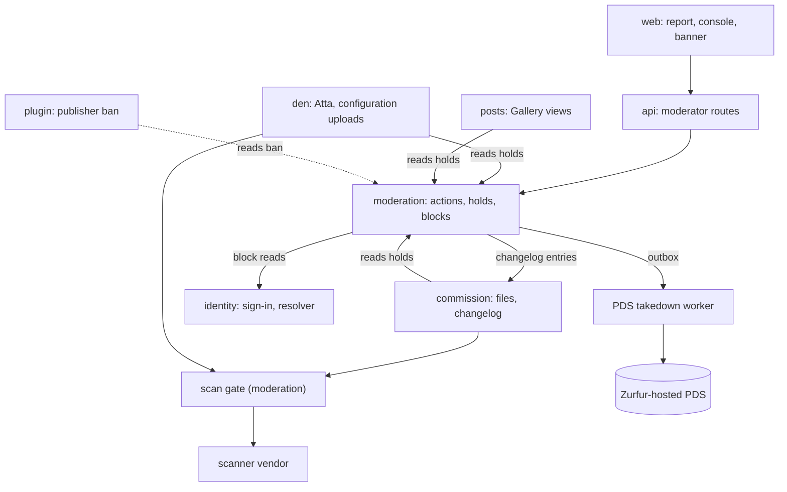
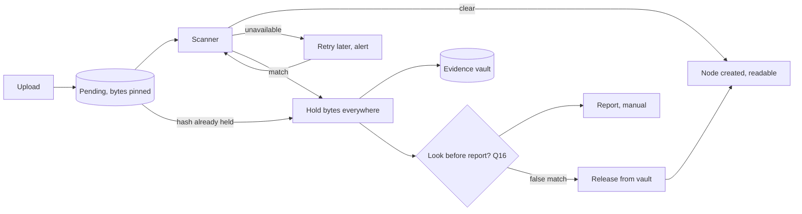
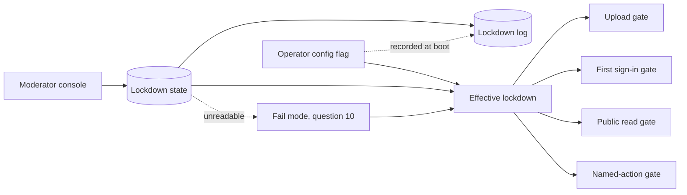
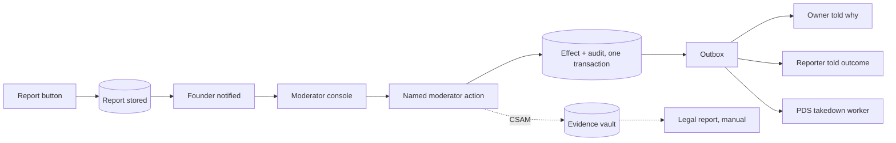

# Moderation: the team's first design study

2026-10-08 · Meerkat (moderation lead) · QA: Lapwing · **A design study, not a decision.** Nothing here is ruled. Every "build" below is a proposal, and section 9 holds the questions for the Engineer. Revised after QA; the resolutions are at the end.

**How claims are marked.** A legal or security claim carries a source from section 10. **[read]** means the primary text was read (by me, or by QA where it says so). **[excerpt]** means it was seen only in search excerpts or a summary of the page, so it needs checking. **[unverified]** means no source was found. Design pages are named in words, and section 10 gives their paths. **None of this is legal advice;** every legal row needs counsel.

---

## 1. Summary

**What the team would build for the MVP (proposals)**
1. **A scan gate on every upload the alpha has:** commission files and "Upload configuration" files. Bytes wait in a pending area, unservable and pinned, until a scanner says "clear". Only then does the file become a node. If the scanner is down, the upload keeps waiting. Today a commission file is downloadable the moment it arrives.
2. **Take-down that keeps the evidence.** A match, or a moderator, stops serving the bytes at once. The bytes move to a locked evidence store, and the legal report is filed by hand.
3. **A report button** that stores a small private report and notifies the founder. No queue tooling.
4. **Moderator Actions.** A short list of named, audited actions (section 4). Each one writes its effect and its audit record in one transaction. A moderator removal inside a commission appends an entry saying so, and any content an older entry still holds is redacted, with the redaction recorded too.
5. **Moderator sign-in** (question 2): a Zurfur passkey on top of the normal sign-in, with a defined first enrollment and a recovery path.
6. **Lockdown mode.** Four switches: uploads, sign-ups, public pages and all writes. A moderator can turn them on from the console, and the operator can turn them on with a config flag when the console itself is broken.
7. **Two working kill switches:** delete or ban a tag, and suppress an item from public views. **Blocks** (honoring the Bluesky block record) also belong to this team.
8. **ToS and legal pages,** with a stable clause number on every rule that moderator actions cite.

**What waits**
- **The Seals blocklist and the plugin publisher ban.** Seals and plugins are beta features (question 8).
- **Gallery Post uploads.** Gallery Posts are beta, so post uploads join the scan gate when they ship.
- **Moderator roles beyond the founder, report queues, triage, appeals and disputes.** These are post-MVP, as already ruled.

**Decisions needed: none yet.** The 20 questions in section 9 each wait for the slice that needs them.
- Two are one-way doors and must be answered before any public deploy: the database roles (Q11) and the prevention half of changelog redaction (Q6).
- Four are legal questions. They give options only and wait on counsel and the open legal-entity question.

**Surprises**
- **The database rule fails in the only config we have.** The dev stack is the only config that exists. It connects as the Postgres superuser `admin`, the app migrates at boot, and the CLI writes through the same credentials. A superuser bypasses every permission check, and a table's owner can switch off its own append-only trigger (section 4.6).
- **Changelog entries can be deleted silently, and the file-upload entry keeps the file name forever.** The earlier changelog decision does allow hard delete under a legal duty, but nothing records that it happened.
- **Evidence can vanish before the verdict.** A commission holding only file entries can be hard-deleted, and the cascade takes its stored files with it, including a file still waiting for its scan.
- **Several laws reach a platform like this one beyond CSAM.**
  - A US law requires removing non-consensual intimate images within 48 hours of a valid request, and the duty applies from May 2026 [read].
  - Canada forbids disclosing a CSAM report where that could prejudice an investigation [read].
  - The UK requires age checks on services that allow pornography [excerpt].
- **Sign-in asks for much more than "identity only".** The code requests `transition:generic`, which the atproto spec says allows writing any record in the user's repo. That belongs to the identity team.
- **No other lead was on the board.** The interface proposals in section 8 are asked, not agreed.

---

## 2. Where moderation sits

**Diagram A: moderation and the other teams.**

| Box | What it does for moderation | Team | Exists today? |
|---|---|---|---|
| web | Report button, moderator console, lockdown banner, legal pages | web | No |
| api | The moderator route group | owner to be named by the tech lead | No |
| moderation | Moderator Actions, holds, reports, lockdown, the audit log, blocks | moderation | No |
| scan gate | The `ContentScanner` port and the pending area for uploads | moderation | No |
| scanner vendor | Hash match, maybe a classifier (section 5) | external | No |
| commission | Calls the gate on file uploads; reads holds; takes moderation's changelog entries | commission | Upload exists, unscanned |
| den | Atta reads holds when it resolves; "Upload configuration" calls the gate | den | Atta has types only, no resolver yet |
| posts | Gallery and other public views read suppression holds | posts | No |
| identity | Sign-in, the suspended state, the hardened resolver for reading block records | identity | Sign-in exists |
| plugin (dashed) | Reads the publisher ban when plugins ship (beta) | plugin | No |
| PDS takedown worker | Runs PDS takedowns outside the app, holding the PDS admin credential (question 13) | identity | No |
| Zurfur-hosted PDS | Repos for Accounts and public Characters, planned for the alpha | identity | No |

**Rule of the diagram (proposal):** one route per effect. Other teams **read** holds that moderation owns, so moderation never writes into their tables. The one exception is the changelog entry, which moderation hands to commission's port together with its audit record (section 4.2). Everything shares Postgres, which isn't drawn.

---

## 3. The slivers, Moderator Actions, Lockdown and Blocks

### 3.1 CSAM scanning and the reporting duty

| | |
|---|---|
| **What it is** | Scan every upload before its bytes can be served. On a match: stop serving, keep the evidence, report. The Inventory Closures decision rules this MVP scope, item 7 ("Legal requirement, not a feature"), and item 13 names the duty: "scan-at-upload + NCMEC reporting duty, law not scale". |
| **Today** | Nothing scans. `application/src/commission/files/upload.rs` stores the bytes and commits the file link with its changelog entry, and `GET /commissions/{id}/files/{file_id}` serves them to any Participant at once. The store is a `bytea` table, `file_blob`, marked in its migration as the local mock store. |
| **Which uploads exist in the alpha** | Commission files (the `attachments`, `slots` and `products` folders) and "Upload configuration" dotfiles (My Den rulings, D18). Gallery Post uploads are beta (Project MVP). Bytes bound for the hosted PDS: none known yet; asked of identity. |
| **Missing** | The scanner seam, the pending area, holds on bytes, an evidence store, the reporting procedure, a vendor, and the legal answers in section 5. |
| **Proposed interface** | A `ContentScanner` port with three answers: `Clear`, `Match` (with evidence) or `Unavailable`. **The upload doesn't become a node until the answer is `Clear`** (question 14). Until then the bytes sit in a pending area owned by moderation. They are pinned and not tied to the commission, so a commission delete can't take them. Holds are keyed by **content hash**, because the Den stores a file once per hash (ruling 25) and one file can sit behind several nodes. |
| **Touches** | **commission** (the file upload), **den** (configuration uploads; Atta reads holds), **identity** (anything bound for the PDS). |
| **Risks** | ① **Deduplication leaks.** The Den requires an upload to look the same whether or not the bytes were already stored. A re-upload of held bytes must look like any upload, and it opens a new incident, since a new uploader is new knowledge. ② **Garbage collection.** The Den deletes bytes "only when no node points at them", so pending bytes and held bytes must be pinned. ③ **Private files leave Zurfur.** Sending private commission files, or their hashes, to a vendor crosses the private data boundary: it needs a security review and a line in the privacy policy. ④ **Edge scanning comes too late.** Cloudflare hashes images as they enter its cache [read: Cloudflare changelog]. That this happens at serve time is my inference, since a cache fills on a request; so on its own it can't satisfy "before servable". ⑤ **Content Zurfur never received.** If a public view ever shows records written through other apps, those bytes never passed the gate. |

### 3.2 The report button

| | |
|---|---|
| **What it is** | One affordance on every user-facing item that sends a reason to the founder. Inventory Closures item 13: "mailto/inbox — no queue, no tooling; an NSFW-hosting platform must have a report affordance at any size." |
| **Today** | Nothing. |
| **Proposed shape** (question 4) | A stored, private `report` row. Its fields follow what the EU's Digital Services Act asks a notice to allow [read: Art. 16(2)]: (a) the reason, explained; (b) the exact location, filled in automatically; (c) the notifier's name and email, optional for the child-safety category, where the Act doesn't require them; (d) a good-faith statement. The founder gets a notification. Closing a report is a named action that tells the reporter the outcome (Art. 16(5)). |
| **Categories** | Child safety; non-consensual intimate images, with a **48-hour clock** (question 19); other illegal content; harassment; impersonation; wrong maturity rating; spam; copyright. |
| **Missing** | The form, the record, a way to notify the founder. **No mailer exists today**, so it is new infrastructure and a new secret. |
| **Touches** | **web** (the button and form), **moderation** (the record), **identity** (the reporter, if signed in). |
| **Risks** | ① Reports can be used to harass, so the reported person never learns who reported. ② The table holds accusations about people: it stays private and needs a retention rule. ③ Whether the EU and US rules apply depends on whom Zurfur serves (question 19). The Act covers services offered to recipients in the EU, wherever the provider is (Art. 2(1)) [read]. |

### 3.3 The kill switches

Inventory Closures item 13 names four switches that "must work". The Project MVP page puts Seals and the plugin surface in the **beta**, and Tags and a minimal Gallery in the **alpha**.

| Switch | What it stops | In the alpha? | Today | Owner of the switch | Interface (proposal) |
|---|---|---|---|---|---|
| **Seals hydration blocklist** | The appview refuses an abusive labeler entirely (Seals, D8 layer 4). It works on labeler DIDs and reviewed definitions, never on label values. | **No** (beta) | Nothing | Seals' owner (unassigned) + moderation's action | A labeler block keyed by DID, read at hydration |
| **Plugin publisher ban** | "All listings die, runtimes killed; Golems persist as Users" (Plugin Security, D5) | **No** (beta) | Nothing | plugin + moderation's action | A publisher ban keyed by Account DID, read at listing and dispatch |
| **Tag moderation delete** | Removes an abusive tag everywhere and stops it from being re-created (Tags page, "Moderator actions") | **Yes** | Nothing; tags aren't built | Unclear (den, since tags are node attributes, or posts); asked of the tech lead | Named actions "Delete tag" and "Ban tag name" |
| **Index suppression** | Drops an item from every public view (Gallery, Portfolio, profile, ask and tag queries) without touching its record | **Yes** | Nothing; the views aren't built | Each view's owner reads moderation's hold | One suppression hold, filtered by every public view |

### 3.4 ToS and legal pages

| | |
|---|---|
| **What it is** | The pages that ban grounds point at (Inventory Closures item 13). Plugin Security calls the ToS text a legal drafting task. |
| **Today** | Nothing. |
| **Missing** | Terms of Service; a Content Policy (maturity rules, prohibited content, question 18); a Privacy Policy, which must cover scanning by a vendor; a copyright policy; a child-safety and law-enforcement contact page. |
| **Proposed shape** | Static pages in web. Every rule carries a **stable clause number**, and every Moderator Action records the clause and the ToS **version** it relied on. |
| **What the law asks of these pages, if it applies** (question 19) | **EU:** the terms must describe content moderation, its tools and human review in plain language (DSA Art. 14) [read]. A provider outside the EU that offers services there must name a legal representative in the EU (Art. 13) [read]. **US copyright safe harbor:** a designated agent registered with the Copyright Office (§ 512(c)(2)) [read], and a repeat-infringer termination policy (§ 512(i)(1)(A)) [read]. **UK:** age checks for services that allow pornography [excerpt]. |
| **Touches** | **web** (pages), **moderation** (clause numbers and the version in each audit record). |
| **Risks** | This is legal text: it needs counsel and a legal entity, which Zurfur doesn't have (the Payments decision: "no entity"). |

### 3.5 Moderator Actions (detail in section 4)

| | |
|---|---|
| **What it is** | The Engineer's rulings of 2026-10-08, as relayed by the tech lead (recorded in memory, not yet in the corpus): only moderators perform them; each is a named, audited use case; nobody edits the database by hand; moderators come in over HTTP with their own sign-in. |
| **Today** | No moderator role in code. The Platform Authority page has a forward design with two platform roles, **Bearer** (the owner) and **Hearth** (an admin), and says "the founder is the entire system" in the MVP. I use Bearer and Hearth because "Owner" and "Admin" already name Account and commission roles. |
| **Missing** | Who the moderator is, the sign-in step, the console, the actions, the audit log, holds, the redaction path. |
| **Touches** | **den** (Atta reads holds), **commission** (changelog), **identity** (sign-in, suspension), **posts** (public views), **web** (console). |
| **Risks** | The moderator account is the platform's most powerful credential, and through atproto OAuth its strength is whatever the moderator's PDS uses (question 2). |

### 3.6 Lockdown mode (detail in section 6)

| | |
|---|---|
| **What it is** | The Engineer: "If the moderation tools themselves are broken: Lockdown mode." I read it as a safe state the platform can be put into **without** the moderation tools. |
| **Today** | Nothing. |
| **Touches** | **den** (the public read gate, the named-action gate), **identity** (the first-sign-in gate), **commission** and **den** (the upload gate), **web** (the banner). |
| **Risks** | Lockdown must never block what has to keep working: taking content down, preserving evidence, signing in, resolving handles, and a user leaving with their DID. The Account Handle Change Flow decision says none of its own mechanisms "may EVER gate a user LEAVING with their DID and handle"; I propose the same rule for lockdown. By default a user holds no exit key of their own (the did:plc Custody decision), so leaving can need Zurfur to write. |

### 3.7 Blocks (now moderation's)

| | |
|---|---|
| **What it is** | The Blocks decision: the atproto block record (`app.bsky.graph.block`) is the only block signal, with no Zurfur-local list. A block cuts social rendering (comments, friendship, Seal grants, new invitations and applications), never business facts. It is in the alpha. |
| **Today** | Nothing reads or writes blocks. |
| **Missing** | Reading block records from users' repos, a private cache of them, and a check at each render point. |
| **A conflict to settle** (question 15) | A block button in Zurfur would write a Bluesky record type. The Publish Consent decision pledges that Zurfur "will still only ever write its own record types" and "never uses beyond its record types regardless of grant breadth". Its graph permission set covers `app.zurfur.graph.friend`, not Bluesky blocks. |
| **Touches** | **identity** (reading other repos through the hardened resolver, `.understand/20261008-hardened-resolver-design.md`), **commission** (refusing invitations and applications between a blocked pair), **web** (where a user is sent to block). |
| **Risks** | ① Block records are public; the Blocks decision accepts that as protocol design. ② Reading other people's repos is network input, so it goes only through the hardened resolver. |

---

## 4. Moderator Actions

### 4.1 The first list

"Hold" means a moderation row that the read path obeys; nothing is overwritten.

| # | Action | What it does | MVP? | Undo |
|---|---|---|---|---|
| 1 | **Hide** | Removes an item from every public view. Its owner and participants still see it. For rule breaks that aren't illegal. | Yes | Restore |
| 2 | **Take down** | Stops serving an item to **everyone**, owner included. For files the hold is on the bytes, so every node behind them stops. The bytes are kept. | Yes | Restore |
| 3 | **Restore** | Lifts a hide or take-down. After a false CSAM match, it also takes the bytes back out of the evidence store. | Yes | — |
| 4 | **Delete** | Destroys bytes or a record for good. Refused while a legal hold exists; the audit record stays. | Yes | None |
| 5 | **Redact a changelog entry** | Removes an entry's content under a legal or safety duty, and records the redaction (question 6). | Yes | None |
| 6 | **Remove a comment** | A moderator tombstone of a private comment. Today only the author, the commission Owner or a Commission Admin may delete one (the Comments & Markup decision, D7), so this adds a deleter and amends that decision. | Yes | Restore |
| 7 | **Correct a maturity rating** | Fixes a wrong rating; ratings are required and enforced server-side. | Yes | Itself |
| 8 | **Suspend a User** | Question 12. | Yes | Unsuspend |
| 9 | **Suspend an Account** | The Account can't act, and its public presence is hidden. | Yes | Unsuspend |
| 10 | **Ban** | A suspension with no end date, citing a ToS clause. | Yes | Unsuspend (Bearer only) |
| 11 | **Delete tag / ban tag name** | Tags page. | Yes | Unban |
| 12 | **Merge or alias tags** | Tags page. | Later (tag-governance decision) | — |
| 13 | **Revoke a `*.zurfur.app` handle** | Takes an impersonating handle back into quarantine. | Maybe; asked of identity | Restore |
| 14 | **Place or release a legal hold** | Pins bytes and records against deletion and garbage collection. | Yes | Release |
| 15 | **Record a legal report** | Records that a report was filed, to whom, and its reference. The filing itself is manual in the MVP. | Yes | None |
| 16 | **Close a report** | Ends a report with an outcome and tells the reporter. Closing with no action is still this action. | Yes | Reopen |
| 17 | **Lockdown on / off** | Section 6. | Yes | Itself |
| 18 | **Grant or revoke moderator** | Only if question 1 goes beyond the founder. | After the MVP | Itself |
| 19 | **Ban publisher / unlist listing** | Plugin Security D5. | With plugins (beta) | Unban |
| 20 | **Block a labeler / negate a Zurfur label** | Seals D8; `neg` is the label spec's revocation. | With Seals (beta) | Unblock |

### 4.2 Audit in the same transaction

Every action is a `#[use_case]` command in one moderation module, run in one Unit of Work (the Transactions-as-a-capability decision). In one transaction it writes:
1. **the effect**: the hold, the suspension, the tag ban, and so on;
2. **one `moderation_action` row**: who, when, which action, the target, the ToS clause and version, the linked report if any, and a note;
3. **one changelog entry, when the target lives in a commission** (4.3).

Anything outside Postgres goes into an **outbox row** in the same transaction and runs after commit: a PDS takedown, the notices to the owner and the reporter.

**Making an unaudited or unauthorized action impossible to write** (proposals; the tech lead confirms the mechanism):
- **One route per effect.** The effects are moderation's own rows (holds, suspensions, bans), which other teams read. The only write into another module is the changelog entry, and that port method takes the moderation record as an argument. So no effect can commit without its audit row.
- **The audit table is append-only:**
  - no port method changes it;
  - a trigger refuses UPDATE and DELETE (stricter than the changelog's trigger, which refuses UPDATE only);
  - a BEFORE TRUNCATE trigger plus no TRUNCATE privilege for the app role, because TRUNCATE "will not fire any `ON DELETE` triggers" [read: PostgreSQL 16];
  - a test.
- **The `Moderator` principal comes from a proof, not a constructor.** Moderation use cases take a `Moderator`. The only way to mint one is a use case that verifies a fresh passkey assertion, which WebAuthn binds to the console's origin [unverified: confirm the origin binding in the WebAuthn spec at build]. The CLI links the same crates, but it can't produce that assertion without the passkey. Ordinary use cases never accept a `Moderator`.

### 4.3 How it touches append-only records

**The changelog.** The Engineer: "We always want the changelog to tell us everything that happens, or we will believe it's a bug."
- A moderator act on anything inside a commission appends one entry, for example "Zurfur moderation took down a file (Terms §4.2)". That needs **new entry kinds**. The kind list is frozen, and each addition so far was recorded as an amendment (the Changelog as the Only Record decision).
- **Redaction is already decided in part.** The earlier changelog decision, "Structured Comms, Notes & the Linked Channel", says "Redaction stays legally possible (tombstone/CSAM duties)" (D4), and that entries "hard-delete only with commission hard-delete or legal duty" (D6). The Eventlog decision says what redaction means for the future hash chain: "scrub content, retain the hash". The two pull different ways; question 6 settles it.
- **The new rule adds one thing:** a redaction must leave a recorded trace.
- **Most redactions can be avoided.** Today's FileAdded entry stores the file name, so a CSAM upload's name would sit in the record forever. The Comments & Markup decision (D5) already set the precedent: payloads carry the comment id "never the text", because a copy "would leak a tombstoned comment". Done for files too, the entry would carry only the file's id, and its name would come through the read path that obeys holds.

**The moderation log itself** is append-only; a mistake is corrected by a new action.

**Public records on a Zurfur-hosted PDS.** Zurfur can't edit a signed repo record, only stop serving it. The atproto admin call `com.atproto.admin.updateSubjectStatus` sets a takedown on an account, a record or a blob [read: lexicon]. The Characters on ATProto decision and the Publish Consent decision keep the PDS admin credential "outside the app process, network-restricted, attach/recovery only", and call it a shared key over every hosted repo and a security-review item. A takedown therefore needs that rule amended (question 13).

### 4.4 Who is a moderator in the MVP

Inventory Closures item 13 defers "moderator roles" with the rest of the full system, and Platform Authority says the founder is the entire system. Question 1 asks whether to keep that deferral (the founder named in config) or reopen it (a role table).

### 4.5 How a moderator signs in

- **What the protocol gives us.** atproto OAuth leaves authentication to the user's PDS ("Server implementations can chose their own technology for user authentication") [read: atproto OAuth spec]. Zurfur can't require a second factor through OAuth, so a moderator signed in the normal way is only as safe as their PDS login.
- **Proposal (question 2):**
  - a Zurfur-held passkey on top of the normal sign-in;
  - **first enrollment** only with a one-time code the operator puts in config, so an attacker holding the moderator's PDS session can't enroll their own passkey;
  - **recovery** after a lost passkey through the same operator config path, which is not a database edit;
  - a short-lived console session, with the passkey asked again before destructive actions. OWASP advises "an additional layer of verification for sensitive actions" [read].
- **Where the console lives (question 3).**
  - On one origin, a path-scoped cookie isolates nothing: "the Path attribute cannot be relied upon for security" (RFC 6265 §4.1.2.4) [read]. A script injected anywhere on the origin could call the console with the moderator's session.
  - A `*.zurfur.app` subdomain is "same-site … within cookie reach; it is not a boundary" (the Portal page). It would also sit inside the handle namespace.
  - The corpus already uses a separate registrable domain to isolate untrusted plugin UI (the Auth Surfaces decision, D4).

### 4.6 "Only the app's own account writes to the database"

The ruling, as relayed: only the app's account writes, and the operator's `migrate` command is the one exception. It is recorded in memory (`project_moderation_rulings.md`), not yet in the corpus.

| Fact today | Source | Why it matters |
|---|---|---|
| The dev stack connects as `admin`, which the Postgres image creates "with superuser power" [read: postgres image docs]. No production config exists. | `docker-compose.yml`, `.env.example` | "A database superuser bypasses all permission checks, except the right to log in." [read: PostgreSQL 16] |
| The app runs the migrations itself at boot, which CLAUDE.md documents as intended | `backend/crates/api/src/main.rs:31` | The app's role must then own the schema. "You must own the table to use ALTER TABLE", which includes `DISABLE TRIGGER` [read]. So the app can switch off the changelog's append-only trigger. |
| The CLI writes through the same credentials, in-process, "no HTTP, no contract, no token" | `backend/crates/cli/NODE.json` | Moderators must come in over HTTP. The CLI must never mint a `Moderator` (4.2). |
| Changelog DELETE is open on purpose, for "legal-duty redaction" | `adapter-pg/migrations/20260705120000_create_commission_changelog.sql` | The app role can delete entries with no trace. |
| A commission with only file entries can be hard-deleted, and the cascade enumerates its files | The Deletion of Commissions decision ("hard delete while fact-free"); `commission_file` is classed non-fact in its migration | Bytes waiting for a scan could be destroyed. The pending area (3.1) answers this. |

---

## 5. CSAM in detail

> **No pick in this section.** Inventory Closures already names the NCMEC reporting duty, but Zurfur has no legal entity (the Payments decision: "no entity"), and the country it will sit in is open. Which laws bind Zurfur, which vendor will accept it, and whether to reopen the NCMEC choice all wait on that. Counsel decides; the Engineer rules.

### 5.1 Detecting it: hash matching or classifiers

- **Hash matching** compares a fingerprint of each upload against lists of **already known** abuse images. A perceptual hash survives small edits. It can't find new material.
- **Classifiers** estimate whether **new** material is likely abuse. Google's classifier ranks material for human review instead of giving a verdict, and partners "must conduct their own review" [read].
- **For a drawn-art platform:** I found no source on whether photo-trained classifiers work on drawn or furry art [unverified]. New drawn work will mostly surface through reports.
- **Access may wait on the entity too.** PhotoDNA is "free for qualified customers", approved by a third-party vetting service [read]. Other free services may vet applicants the same way.

<b>The real-world options (vendors and tools)</b>

| Option | What it does | Access and cost | Before servable? | Source |
|---|---|---|---|---|
| **Microsoft PhotoDNA Cloud Service** | Hashes images and compares them to hashes of known illegal images; REST API; images "never retained by Microsoft" | "Free for qualified customers"; third-party vetting | Yes, called at upload | [read] |
| **Thorn Safer** | Proprietary perceptual hashing plus predictive classifiers for new material | A self-hosted option or an API option; no public price | Yes | [read] safer.io; pricing [excerpt] |
| **Shield by Project Arachnid** (Canadian Centre for Child Protection) | Compares media to its fingerprint list, exact and perceptual or PhotoDNA | "No cost"; sign up for an API key | Yes | [excerpt] |
| **Google Content Safety API** | A classifier that ranks unseen images and video for human review | Free to approved partners | Yes, but needs a human | [read] |
| **Google CSAI Match** | Video fingerprint matching against YouTube's known-abuse database | Through YouTube; partners review and report | Yes (video) | [read] |
| **Cloudflare CSAM Scanning Tool** | Hashes images as they enter Cloudflare's cache; blocks the URL and emails the owner | Free for Cloudflare customers; since February 2025 only a verified email, no NCMEC credentials | **No**: by my inference it runs at serve time, and only on public cached content | [read] changelog; "fuzzy hashing" [excerpt] |
| **Self-hosted PDQ** (Meta, open source) | A perceptual hashing algorithm | Free code, **but needs a hash list**. NCMEC "may" give providers hash values for this purpose (18 U.S.C. § 2258C(a)) | Yes | [read] |

### 5.2 What each law asks (the entity and country are open)

<b>The reporting duties, and drawn material</b>

| Jurisdiction | What the law asks | Source |
|---|---|---|
| **US: who and when** | A "provider" with "actual knowledge" of an apparent child-pornography violation reports to NCMEC's CyberTipline "as soon as reasonably possible" (§ 2258A(a)). A provider is "an electronic communication service provider or remote computing service" (§ 2258E(6)), and the definition states no territorial limit. Whether it binds a non-US entity, and whether a non-US entity can register, is for counsel. | [read]; registration [excerpt] |
| **US: no duty to scan** | Nothing "requires a provider to … affirmatively search, screen, or scan" (§ 2258A(f)). | [read] |
| **US: retention** | A report is a request to preserve its contents "for 1 year" (90 days before May 2024), in "a secure location" with limited access, consistent with NIST's Cybersecurity Framework (§ 2258A(h)). | [read] |
| **US: penalties** | A knowing and willful failure to report: up to $600,000 the first time and $850,000 after, for a provider under 100 million monthly users (§ 2258A(e)). | [read] |
| **US: drawn material** | The reporting trigger names §§ 2251, 2251A, 2252, 2252A, 2252B, 2260, § 1591 and § 2422(b); it does not name § 1466A. "Indistinguishable" computer images count as child pornography, but that definition "does not apply to depictions that are drawings, cartoons, sculptures, or paintings" (§ 2256(11)). Separately, § 1466A makes some drawings a crime: (a)(1) obscene depictions of a minor in sexually explicit conduct, and (a)(2) graphic sexual depictions that lack "serious literary, artistic, political, or scientific value", a prong with no obscenity element. The minor need not "actually exist" (§ 1466A(c)). | [read] |
| **US: looking before reporting** | In *United States v. Wilson* (9th Cir. 2021), the provider reported hash matches nobody had viewed, and an officer's warrantless viewing was held unlawful. That is one reason providers look before they report. | [excerpt] |
| **UK** | A UK provider of a regulated user-to-user service reports **all** detected, unreported CSEA content to the National Crime Agency; a non-UK provider reports **UK-linked** content only. Content already reported to a foreign agency, "for example" NCMEC, counts as reported. Reports go through the NCA's portal under the 2026 Regulations. The offences "required to be reported" are those in Schedule 6 of the Online Safety Act. | [read] NCA guidance, 7 April 2026 |
| **UK: drawn material** | Coroners and Justice Act 2009, s. 62: possession of a "prohibited image of a child", aimed at non-photographic images "including … cartoons, manga images and drawings". It must be pornographic, grossly offensive or obscene, and focus on listed body parts or acts. Schedule 6 may list s. 62; if it does, UK-linked drawn material would be reportable to the NCA. | [excerpt] CPS guidance; Schedule 6 not fetched |
| **EU** | Every hosting provider: a notice mechanism (Art. 16), a statement of reasons when it removes content or suspends an account (Art. 17), and it must "promptly inform" law enforcement of a suspected crime threatening life or safety (Art. 18). The small-company exemption (Art. 19) covers only the section on online platforms. The interim rule on voluntary detection (Regulation 2026/1881, to 3 April 2028) covers interpersonal communication services, not hosting. | [read] |
| **Canada** | Report where material may be publicly available (s. 2); notify police where the service is being used for an offence (s. 3); preserve the related data for 21 days (s. 4(1)); don't disclose a report where that could prejudice an investigation (s. 5); no duty to seek it out (s. 6). An amendment not yet in force (S.C. 2026, c. 19) raises preservation to one year. The Criminal Code's definition covers any "visual representation" of a person "depicted as being under the age of eighteen years" (s. 163.1). | [read] |

### 5.3 Keeping the evidence

- **Take down ≠ delete** (the Engineer). On a match the bytes leave every serving path and go to an **evidence store**. It is encrypted, kept apart from the blob store, and opened only through an audited action.
- **How long:** at least the longest period that applies. That is 1 year after a US report, with longer allowed (§ 2258A(h)), and 21 days in Canada today [read].
- **Proposal:** a legal hold until a person releases it. Never an automatic delete.
- **The console never shows a matched image by default.** It shows the match details, and viewing the image is a separate, deliberate step. The Non-Toxic Path applies to the people doing moderation too. Whether a person must view an image before reporting is question 16's sub-question.

### 5.4 The upload flow

**Diagram C: an upload through the scan gate.**

| Step | Detail | Owner |
|---|---|---|
| Upload | Commission files and configuration uploads in the alpha; post uploads when Gallery Posts ship | commission, den |
| Pending, bytes pinned | Stored and pinned, not a node, not tied to the commission. The uploader sees "processing", and the response is the same whether or not the bytes were known (Den ruling 25). | moderation |
| Scanner | The `ContentScanner` port; the vendor is open (5.1) | moderation |
| Node created | On "clear", the upload use case creates the node and appends FileAdded in one transaction | upload owner |
| Retry later | Fail closed; nothing is served; the founder is alerted after repeated failures | moderation |
| Hash already held | A re-upload of held bytes skips the scanner and opens a new incident | moderation |
| Hold bytes everywhere | A hold on the content hash, so every node with these bytes stops serving | moderation |
| Look before report? | Unsettled (question 16): a person checks the match first, or the report goes on the match alone | counsel, Engineer |
| Release from vault | A false match: the bytes leave the vault and the upload completes | moderation |

---

## 6. Lockdown mode

**What it means (proposal):** switches that **only take abilities away**. Each can be set on its own and in any combination, so no combination opens anything. They work even when the moderation tools are broken.

| Switch | What stops | What keeps working | Typical trigger |
|---|---|---|---|
| **Uploads off** | Every new upload: commission files, configuration files, later posts | Everything else; files already cleared | The scanner is broken; a wave of abusive uploads |
| **Sign-ups off** | First sign-in of a DID Zurfur has never seen; new Accounts and Characters | Sign-in for known users | A spam or bot wave |
| **Public off** | Reads by signed-out or unrelated viewers, at Atta's resolver and the blob route: Gallery, profiles, public Den nodes, Listed cards | Signed-in users in their own Den and commissions | Abusive content is public, and taking it down item by item is broken |
| **Read-only** | Every named action except moderator actions | All reads the other switches allow | A data-integrity incident; the audit log broken |

**Never blocked by any switch:**
- take-down and evidence actions, and recording a legal report;
- sign-in, moderators included, and the OAuth client metadata that PDSes fetch;
- `GET /.well-known/atproto-did` (`api/src/routes/wellknown.rs`), which every `*.zurfur.app` handle depends on;
- health checks;
- the acts a user needs to leave with their DID: data export, and the PLC operations Zurfur performs for them.

**What lockdown can't reach.** The hosted PDS serves records and blobs to the network directly, so "public off" doesn't stop it. Stopping it is a PDS takedown (question 13).

**A compromised moderator isn't a lockdown case.** Read-only exempts moderator actions, so it can't stop one. The remedy depends on question 1:
- under option A, the operator removes that DID from config and restarts;
- under option B, the Bearer revokes the role.

**Diagram D: how lockdown is set and enforced.**

| Box | Detail |
|---|---|
| Moderator console | A moderator turns a switch on; only the Bearer turns one off (question 10). Each change is action #17. |
| Operator config flag | **Break-glass** for when the console or the database is broken: a `ZURFUR_LOCKDOWN` setting read at boot. It writes nothing to the database. The app records "lockdown set by config" in the log once it can write. |
| Effective lockdown | The union of the two; the stricter one wins. |
| Fail mode | If the stored state can't be read: question 10. |
| Lockdown log | Append-only: who, when, which switch, on or off, why, and from where. |
| The four gates | One check per kind of door: the upload path; identity's first-seen path; Atta's resolver for outside viewers plus the blob route; and the point before any named action is routed (application or Atta, asked of den). Each gate lets the "never blocked" acts through. |

**Automatic triggers:** none in the MVP (proposal). Fail-closed checks already act on each request: a scanner outage keeps each upload pending, and an audit write that fails fails its action.

---

## 7. The flow of a report to an action

**Diagram B: from report to action.**

| Box | Detail |
|---|---|
| Report button | On every user-facing item; the fields of 3.2. |
| Report stored | A private `report` row (question 4). |
| Founder notified | A notification only; the report lives in the database. A mailer is new infrastructure. |
| Moderator console | Behind the passkey step (questions 2 and 3); lists open reports. |
| Named moderator action | One of section 4.1, including #16 "Close a report", which is also how a report ends with no other action. |
| Effect + audit | One transaction: effect, `moderation_action` row, a changelog entry if in a commission. |
| Outbox | After commit. **Owner told why** is withheld on the CSAM path until counsel answers question 5. **Reporter told outcome** answers Art. 16(5). **PDS takedown worker**: question 13. |
| Evidence vault, legal report | Section 5.3; filed by hand and recorded with action #15. |

---

## 8. Interfaces asked on the board

No other lead was on the board while I wrote this. Every row is **a proposal, asked and not yet agreed.** The rows changed after QA are noted; I'll send each lead the delta.

| Lead | Message | What I proposed | Status |
|---|---|---|---|
| Wolf (commission) | #105 | Scan gate in the file upload; **since QA:** a file becomes a node only after "clear", its pending bytes are not tied to the commission, FileAdded carries the file id and never the name, and moderation's changelog entries go through a port method that takes the audit record | Asked; no answer |
| Fox (identity) | #106 | Moderator passkey step and its enrollment; a suspended state that the session gate and Atta read; who owns Seals; reading block records through the hardened resolver; **since QA:** a PDS takedown worker holding the admin credential (question 13), and which alpha uploads go to the PDS | Asked; no answer |
| Badger (den) | #107 | Atta reads holds and resolves a held node as absent (the one not-found) for everyone but moderators; where the lockdown gate sits; **since QA:** no quarantine metadata, since the node is created only after "clear" (Den D24 stays closed), and "Upload configuration" calls the scan gate | Asked; no answer |
| Fennec (web) | #108 | Report button and form, console, lockdown banner, legal pages; **since QA:** the console may need its own domain (question 3) | Asked; no answer |
| Bowerbird (posts) | #109 (team queue) | Public views read suppression holds; the scan gate joins post uploads in the beta | Queued; not registered |
| Octopus (plugin) | #110 (team queue) | A publisher ban keyed by Account DID, read at listing and dispatch, built with plugins | Queued; not registered |

**For the tech lead, not the Engineer:**
- Confirm the `Moderator`-from-a-proof mechanism and "one route per effect" (4.2).
- Who owns the moderator route group in `api`.
- Who owns Tags (den or posts) and, later, Seals.
- `docs/design-index.md` lacks the My Den rulings page; `just design-index` regenerates it.
- The sign-in scope drift belongs to identity: `backend/crates/adapter-atproto/src/lib.rs:97` requests `transition:generic`, while the Publish Consent decision (D1) says identity-only.

---

## 9. Questions for the Engineer

**None of these is asked now.** Under the Engineer's ask-at-the-slice rule (2026-10-08), each question waits for the slice that needs it, and nothing in moderation is being built yet. The "Asked when" column names that slice.

**The two one-way doors** get costlier the longer they wait, so they must be answered before any public deploy:
- **Database roles (Q11).** Today the app connects as the database superuser.
- **The prevention half of changelog redaction (Q6, option D).** Once real users exist, every changelog entry that holds user text or a file name is permanent.

| # | Question | Recommendation | Asked when |
|---|---|---|---|
| 1 | Who is a moderator? | The founder, named in config | The first Moderator Action |
| 2 | How does a moderator sign in? | Add a Zurfur passkey | The first Moderator Action |
| 3 | Where does the console live? | Its own domain | The first Moderator Action |
| 4 | Report button: mailto or stored? | A stored report | The report button |
| 5 | Tell owners about take-downs? | Yes, except CSAM (counsel) | The first take-down |
| 6 | How is a changelog entry redacted? | Ids not text; delete + record | **Before launch** (one-way door) |
| 7 | Whose name is on a moderator act? | "Zurfur moderation" publicly | The first Moderator Action |
| 8 | Kill switches for beta features? | Ship with their features | Each beta feature |
| 9 | Lockdown shape? | Four independent switches | Lockdown |
| 10 | Lockdown: who, break-glass, fail mode? | Moderators on, Bearer off | Lockdown |
| 11 | Database roles? | Two roles; no boot migrate | **Before launch** (one-way door) |
| 12 | What does suspension remove? | Acting, not leaving | Suspension |
| 13 | Takedown on the hosted PDS? | Amend the credential rule | Take-down on a hosted PDS |
| 14 | Where do pending uploads live? | Not a node until clear | The scan gate |
| 15 | Can Zurfur write Bluesky blocks? | Not in the alpha | Blocks |
| 16 | Keep NCMEC, or reopen? | Options only (counsel) | Counsel |
| 17 | How is CSAM detected? | Options only (counsel) | Counsel |
| 18 | Drawn sexual depictions of minors? | Options only (counsel) | Counsel |
| 19 | Which other content laws apply? | Options only (counsel) | Counsel |
| 20 | Where do holds live in the schema? | Can wait | Building holds |

### Design questions (parked until their slice)

**Q1. Who is a moderator in the MVP?** Inventory Closures defers "moderator roles", and Platform Authority says the founder is the entire system.
- A. **Keep the deferral:** the founder's DID in config is the one Bearer. No role table and no grant action.
- B. **Reopen it:** a role table (Bearer, Hearth), with grant and revoke as audited actions.
- **Recommend A.** It honors the ruling. It needs no grant UI. Adding a helper later reopens the question deliberately, and config is not a database edit.

**Engineer:** 

**Q2. How does a moderator sign in?**
- A. The normal Bluesky sign-in only.
- B. The normal sign-in plus a Zurfur-held passkey. The first enrollment and any recovery use a one-time code the operator puts in config.
- C. A passkey-only moderator login, bound to the founder's DID but not to their PDS.
- **Recommend B.** The atproto spec leaves sign-in strength to the PDS. B adds a factor Zurfur controls, and its enrollment path stops someone who has stolen the PDS session. C rests the moderator's power on the passkey alone, with no second factor.

**Engineer:** 

**Q3. Where does the moderator console live?**
- A. On the one origin, as its own route group.
- B. A `*.zurfur.app` subdomain.
- C. A separate registrable domain, served by the same backend by Host.
- **Recommend C.** On one origin a path-scoped cookie isolates nothing (RFC 6265), so any injected script could use the moderator's session. A subdomain is "not a boundary" (the Portal page) and sits in the handle namespace. C is the isolation the corpus already uses for untrusted plugin UI. It needs an exception to the one-origin ruling and a second domain.

**Engineer:** 

**Q4. The report button: mailto or a stored report?**
- A. A mailto link, as ruled on 2026-07-02.
- B. A small form that stores a private report and notifies the founder.
- **Recommend B.** Your 2026-10-08 ruling audits every intervention, and a stored report links each action to its cause. It also covers the EU notice fields, receipt and outcome [read], if they apply. Cost: a mailer, which is new.

**Engineer:** 

**Q5. Do we tell the owner when we take something down or hide it?**
- A. Always, with the reason and the ToS clause, **except** suspected CSAM, where we say nothing until counsel answers.
- B. Always, CSAM included.
- C. Never.
- **Recommend A.** The EU asks for a statement of reasons (Art. 17) [read], and QA found no CSAM exception in its text. US copyright safe harbor needs the subscriber told (§ 512(g)) [read], so C loses it. Canada forbids disclosing a CSAM report where that could prejudice an investigation (s. 5) [read], so B can break the law.

**Engineer:** 

**Q6. How is a changelog entry redacted?** The earlier changelog decision allows hard delete under legal duty. The Eventlog decision says "scrub content, retain the hash". The 2026-10-08 ruling wants a recorded trace.
- A. Scrub in place under a guard that allows only a "redacted" marker. This amends the earlier decision and the trigger.
- B. Keep content in a side table that a redaction clears. This amends "render without joins".
- C. **The decided path, plus a record:** delete the entry under a legal duty and append a redaction entry carrying its old hash, so the future chain still verifies.
- D. **Prevention:** payloads carry ids, never user text, following the comment precedent; FileAdded loses the file name.
- **Recommend D, then C for what remains.** D removes the commonest reason to redact. C keeps the decided path and adds the trace the new ruling asks for. The database mechanism that allows DELETE only for a redaction or the commission's own hard delete is open; it needs a security review at build, because how foreign-key cascades interact with privileges and triggers is [unverified].

**Engineer:** 

**Q7. Whose name appears on a moderator's act?**
- A. User-facing records say "Zurfur moderation"; the private moderation log names the moderator's DID.
- B. The moderator's name everywhere.
- **Recommend A.** It protects moderators from harassment (the Non-Toxic Path), and the audit still names the person.

**Engineer:** 

**Q8. Kill switches for beta features (the Seals blocklist, the publisher ban).**
- A. Build all four switches now.
- B. Each switch ships with its feature, as part of that feature's definition of done; the alpha builds tag delete and Index suppression.
- **Recommend B.** A switch with nothing to stop can't be tested. B keeps your 2026-07-02 rule (a switch must work) where it matters.

**Engineer:** 

**Q9. Lockdown: which shape?**
- A. Four independent switches: uploads off, sign-ups off, public off, read-only.
- B. Three levels: 1 = uploads and sign-ups off; 2 = level 1 plus public off; 3 = read-only.
- C. One switch: read-only.
- **Recommend A.** The triggers differ: a spam wave needs sign-ups off, not uploads off, which would stall artists mid-commission. Every switch only removes abilities.

**Engineer:** 

**Q10. Lockdown: who turns it on and off, the break-glass, and the fail mode.**
- **Who:** any moderator turns a switch on, and only the Bearer turns one off. The operator can also set switches by config at deploy.
- **Fail mode, if the stored state can't be read:**
  - A. Fail closed on uploads and sign-ups, and keep the last known state for public and read-only.
  - B. Fail closed on everything.
  - C. Keep the last known state for everything.
- **Recommend the "who" as stated, with fail mode A.** Closing is easier than opening, and the config flag works with the console or the database broken. Closing uploads and sign-ups costs little; closing everything takes the whole platform down on a read error.

**Engineer:** 

**Q11. The database roles.** Today, in the only config we have, the app is the superuser and migrates at boot, and the CLI writes directly.
- A. Two roles. An owner role used only by `zurfur migrate`. An app role with data rights only: no schema changes, no TRUNCATE, no UPDATE or DELETE on append-only tables. The app stops migrating at boot, which changes behavior CLAUDE.md documents.
- B. One role, relying on the triggers.
- **Recommend A.** A superuser bypasses every check, and an owner can disable triggers [read]. So B protects nothing against the app's own credentials.
- **Sub-question:** do the CLI's existing write commands (account create and delete) stay? They run the same use cases, but not over HTTP.

**Engineer:** 

**Q12. What does a suspended User lose?**
- A. Everything: no sign-in.
- B. They keep a read-only sign-in: they can see their data, export it and leave, but can't act, and their public presence is hidden.
- **Recommend B.** A locked-out user can't take their data or leave. The design already refuses to let its own checks gate leaving (the Account Handle Change Flow decision), and B extends that to suspension.

**Engineer:** 

**Q13. Taking down public content on a PDS Zurfur hosts.** The PDS admin credential is "attach/recovery only", outside the app, and a security-review item (the Characters on ATProto and Publish Consent decisions).
- A. **Amend the rule:** a separate worker that holds the admin credential also runs takedowns (`updateSubjectStatus`, which covers blobs [read]). Moderation reaches it only through the outbox.
- B. Hide at Zurfur's own views only; the PDS keeps serving.
- C. Delete the record through the repo's normal write credential, after copying the evidence. Whether the PDS stops serving the blob at once is [unverified].
- **Recommend A for illegal content and B for rule breaks that are legal.** A is the only option that surely stops the bytes, and it keeps them for evidence. Legal content stays the user's own speech in their repo. A needs the security review the corpus already asks for.

**Engineer:** 

**Q14. Where does an upload wait before its scan?** The Den's metadata is "rigid and closed" (D24), and the one not-found (My Den rulings, D21) has no "processing" state.
- A. Create the node at once and add a quarantine field: this amends D24 and D21.
- B. Create the node at once, and mark only the bytes as pending.
- C. **No node until "clear":** the bytes wait in moderation's pending area, pinned and not tied to the commission. On "clear", the node and its FileAdded entry are written in one transaction.
- **Recommend C.** It changes neither Den rule. A commission delete can't destroy the evidence. A rejected upload leaves nothing in the commission, so the other participants aren't tipped off.

**Engineer:** 

**Q15. Can Zurfur write Bluesky block records?** The Publish Consent decision pledges Zurfur writes only its own record types.
- A. Not in the alpha: honor blocks made in any Bluesky client, and send users there to block.
- B. Amend the pledge, as was done for the ownership record type on 2026-09-12, and add a block button.
- C. A Zurfur-only block: this breaks the Blocks decision's "no Zurfur-local blocklist".
- **Recommend A for the alpha.** It changes no decision, and blocks still work. B is the follow-up if the extra step hurts users. That is a Non-Toxic Path judgment, yours to make.

**Engineer:** 

### Legal: options only, counsel first

These wait on the legal entity and country. **My only recommendation is the order:** counsel first. Meanwhile the team builds what every option needs: the scanner seam, the pending area, the evidence store, holds, and manual report recording.

**Q16. Keep NCMEC as the reporting route (as decided in Inventory Closures), or reopen it?**
- Keep NCMEC. Whether a non-US entity is bound by the US duty, or can register, is unconfirmed [excerpt].
- Reopen it for the entity's country: the UK (the NCA portal; UK-linked content if Zurfur sits outside the UK, and NCMEC reports count), the EU (Art. 18 for threats to life), or Canada (s. 2–5).
- **Sub-question:** does a person look before a report goes out? *Wilson* (9th Cir. 2021) [excerpt] bears on it, and so does the moderator's wellbeing.

**Engineer:** 

**Q17. How do we detect it?**
- Hash matching only: PhotoDNA, Arachnid Shield, or Safer's hashing.
- Hash matching plus a classifier that ranks human review: Google Content Safety API or Safer's classifiers.
- Self-hosted PDQ, if a hash list can be had.
- Edge scanning (Cloudflare) only as an extra layer, since it runs after content is servable.
- Most free services vet the applicant, so this may wait on the entity too.

**Engineer:** 

**Q18. Drawn sexual depictions of minors.** The hard one for a furry art platform: hash lists hold known material, so new drawn work surfaces mostly through reports.
- Prohibit it in any medium, including characters who appear underage.
- Prohibit it only where it is illegal, with per-country gating.
- Whatever counsel advises.
- What the law says: the UK s. 62 covers drawings under conditions, and may be reportable [excerpt]. The US § 1466A has a prong with no obscenity element, but drawings sit outside "indistinguishable" and the reporting trigger [read]. Canada's s. 163.1 covers any "visual representation" [read].

**Engineer:** 

**Q19. Which other content laws apply to the alpha?** Each item is cheap to design for and costly to retrofit.
- **The TAKE IT DOWN Act (US):**
  - A "covered platform" (one that serves the public and primarily hosts user-generated content) must remove non-consensual intimate images "not later than 48 hours" after a valid request, through a request process it set up within a year of enactment (enacted 19 May 2025). Failing to comply counts as an unfair or deceptive practice under the FTC Act [read].
  - If it applies, the report category and its clock are needed at launch.
- **UK age assurance** for services that allow pornography, from 25 July 2025 [excerpt].
- **DSA Arts. 13 and 14** (an EU legal representative; moderation described in the terms) [read].
- **US copyright** § 512: (c)(2), (g) and (i) [read].
- **Lean (yours to overrule):** build the non-consensual-images category and its 48-hour clock into the report record now. It is cheap, and the harm is severe. Counsel rules on the rest.

**Engineer:** 

### Can wait until the build

**Q20. Where do holds live in the schema?**
- A. A column per table.
- B. One moderation table whose target is "exactly one of" a fixed set of columns (the exclusive arcs the polymorphism ban requires).
- C. Keyed by the node's Den path.
- **Recommend B for node holds, plus a hold keyed by content hash for bytes.** One table is easy for Atta to check. C breaks when a node moves, since a node's identity is its path.

**Engineer:** 

---

## 10. Sources

<b>Design pages (titles → paths in <code>~/code/zurfur-design/</code>)</b>

| Title | Path | Used for |
|---|---|---|
| Inventory Closures | `decisions/30343170-inventory-closures-deletion-ripples-blob-store-markup-and.md` | Items 7 and 13: the four slivers, NCMEC, the deferrals |
| Platform Authority | `data-layer/9207856-platform-authority.md` | Bearer and Hearth; "the founder is the entire system" |
| Roles | `entities/2162692-roles.md` | "An `Admin` is a moderator for the account" (the name clash) |
| Blocks | `decisions/30769154-blocks-social-severance-business-stands.md` | B1–B6 |
| Seals | `decisions/29622321-seals-attestations-as-labels-and-peer-grants.md` | D5, D8 |
| Tags | `entities/2949165-tags.md` | Moderator actions; Den amendment |
| Maturity Vocabulary | `decisions/29982722-maturity-vocabulary-adopting-atproto-self-labels.md` | Ratings required, server-side |
| Design Principles — The Non-Toxic Path | `decisions/30572545-design-principles-the-non-toxic-path.md` | Moderator wellbeing; no automatic acts |
| Plugin Security | `decisions/30572603-plugin-security-scopes-keys-limits-and-the-trust-ladder.md` | D4, D5; ToS row |
| The Changelog — Structured Comms, Notes & the Linked Channel | `decisions/30408741-the-changelog-structured-comms-notes-and-the-linked-channel.md` | D4 redaction, D6 hard delete under legal duty |
| The Changelog as the Only Record | `decisions/59310081-the-changelog-as-the-only-record-plugin-appends-render-first.md` | Append-only; closed kinds; render without joins |
| Changelog (entity) | `entities/30507120-changelog.md` | "Redaction exists for legal/safety necessity" |
| The Eventlog | `decisions/32178178-the-eventlog-the-derived-timeline-and-source-streams.md` | D8: "scrub content, retain the hash" |
| Comments & Markup | `decisions/65110018-comments-and-markup-one-comment-entity-pins-and-threads-the.md` | D5 ids not text; D7 who may delete |
| The Den | `decisions/2026093001-the-workspace-a-tree-of-typed-files-peer-views-and-atta.md` | Rulings 25, 31, 34; D24 closed metadata |
| My Den rulings | `decisions/2026100701-my-den-rulings-from-the-first-slice-s-design-study.md` | D2, D18, D21 |
| Project MVP | `project/589826-project-mvp.md` | Alpha and beta lists; "Security-first" |
| Deletion of Commissions | `decisions/3014657-deletion-of-commissions.md` | Hard delete while fact-free |
| Payments & Billing Model | `decisions/6422530-payments-and-billing-model.md` | "no entity" |
| Blobs, PDS & Private Storage | `data-layer/10125341-blobs-pds-and-private-storage.md` | Scan at upload |
| Identities (polymorphism ban) | `decisions/34013187-identities-the-actor-super-table-kind-checked-references-and.md` | D7 exclusive arcs |
| Publish Consent & OAuth Scopes | `decisions/29687820-publish-consent-and-oauth-scopes-identity-only-sign-in.md` | D1, D3, D4; the admin-credential row |
| Characters on ATProto | `decisions/54427650-characters-on-atproto-public-dids-pds-accounts-and-acp.md` | The PDS admin credential rule |
| Auth Surfaces, the Plugin Trust Boundary & CSRF | `decisions/24543244-auth-surfaces-the-plugin-trust-boundary-and-csrf.md` | D4 separate registrable domain |
| Portal | `entities/40960023-portal.md` | "A `*.zurfur.app` subdomain … is not a boundary" |
| Account Handle Change Flow | `decisions/27852802-account-handle-change-flow.md` | Its mechanisms may never gate leaving |
| did:plc Identity Custody, Minting & Credible Exit | `decisions/26804226-did-plc-identity-custody-minting-and-credible-exit.md` | No exit key by default |
| Domains and Applications | `project/11763713-domains-and-applications.md` | One origin |
| Transactions as a capability | `decisions/24150017-transactions-as-a-capability-a-compile-enforced-unit-of-work.md` | One Unit of Work |
| Moderation rulings, 2026-10-08 (memory) | `~/.claude/projects/-home-zuri-code-zurfur/memory/project_moderation_rulings.md` | The rulings as relayed; not yet in the corpus |

<b>Code (paths under <code>~/code/zurfur/</code>)</b>

- `backend/crates/application/src/commission/files/upload.rs`: stores and commits with no scan; FileAdded carries the file name.
- `backend/crates/api/src/routes/commissions/files.rs`: downloads serve at once to Participants.
- `backend/crates/adapter-pg/migrations/20260705120000_create_commission_changelog.sql`: UPDATE refused; DELETE open.
- `backend/crates/adapter-pg/migrations/20260710055222_create_commission_files.sql`: `file_blob`, the mock store; `commission_file` is non-fact.
- `backend/crates/api/src/main.rs:31`: migrations run at boot.
- `backend/crates/api/src/routes/wellknown.rs`: the handle route lockdown must never block.
- `docker-compose.yml`, `.env.example`: the `admin` superuser.
- `backend/crates/cli/NODE.json`: the CLI drives use cases in-process.
- `backend/crates/adapter-atproto/src/lib.rs:97`: `atproto transition:generic` at sign-in.
- `backend/crates/atta/src/lib.rs`: types only, no resolver yet.

<b>External sources</b>

| Source | URL | Marked |
|---|---|---|
| 18 U.S.C. § 2258A | https://www.law.cornell.edu/uscode/text/18/2258A | [read] |
| 18 U.S.C. § 2258C | https://www.law.cornell.edu/uscode/text/18/2258C | [read] |
| 18 U.S.C. § 2258E | https://www.law.cornell.edu/uscode/text/18/2258E | [read] |
| 18 U.S.C. § 2256 | https://www.law.cornell.edu/uscode/text/18/2256 | [read] |
| 18 U.S.C. § 1466A | https://www.law.cornell.edu/uscode/text/18/1466A | [read] |
| 17 U.S.C. § 512 | https://www.law.cornell.edu/uscode/text/17/512 | [read] (c)(2), (g)(2), (i)(1)(A) |
| TAKE IT DOWN Act, Pub. L. 119-12 | https://www.govinfo.gov/content/pkg/PLAW-119publ12/html/PLAW-119publ12.htm | [read] |
| *United States v. Wilson* (9th Cir. 2021), summaries | https://thefederaldocket.com/?p=14740 | [excerpt]; opinion not read |
| NCA, "The Online Safety Act and the Role of the NCA", v1.0, 7 April 2026 | https://www.nationalcrimeagency.gov.uk/who-we-are/publications/802-the-online-safety-act-and-the-role-of-the-nca/file | [read] |
| CPS, Indecent and Prohibited Images of Children | https://www.cps.gov.uk/prosecution-guidance/indecent-and-prohibited-images-children | [excerpt] |
| Online Safety Act 2023, Schedule 6 | https://www.legislation.gov.uk/ukpga/2023/50/schedule/6 | Not fetched (blocked); [excerpt] via QA |
| Ofcom letter on age assurance for services allowing pornography | https://www.ofcom.org.uk/online-safety/protecting-children/letter-to-part-3-services-that-allow-pornography-outlining-heaa-requirements | [excerpt] |
| IWF, Non-Photographic Visual Depictions | https://www.iwf.org.uk/policy-work/uk-policy/non-photographic-visual-depictions/ | [excerpt] |
| Canada, Act respecting mandatory reporting (I-20.7) | https://laws-lois.justice.gc.ca/eng/acts/I-20.7/FullText.html | [read] ss. 2–6 and the 2026 amendment |
| Criminal Code of Canada, s. 163.1 | https://laws-lois.justice.gc.ca/eng/acts/c-46/section-163.1.html | [read] |
| EU Digital Services Act, Regulation 2022/2065 | https://eur-lex.europa.eu/eli/reg/2022/2065/oj/eng | [read] Arts. 2(1), 13, 14, 16–19 |
| Regulation (EU) 2026/1881 | https://eur-lex.europa.eu/eli/reg/2026/1881/oj/eng | [read] |
| Microsoft PhotoDNA Cloud Service | https://www.microsoft.com/en-us/photodna/cloudservice | [read] |
| Thorn Safer | https://safer.io/ | [read] |
| Shield by Project Arachnid | https://projectarachnid.ca/ | [excerpt] |
| Google Child Safety Toolkit | https://protectingchildren.google/tools-for-partners/ | [read] |
| Cloudflare changelog, 2025-02-04 | https://developers.cloudflare.com/changelog/2025-02-04-easier-onboarding-for-csam-scanning-tool/ | [read] |
| Cloudflare blog, 2025-09-24 | https://blog.cloudflare.com/a-simpler-path-to-a-safer-internet-an-update-to-our-csam-scanning-tool/ | [read] |
| Meta PDQ | https://github.com/facebook/ThreatExchange/tree/main/pdq | [read] |
| atproto OAuth spec | https://atproto.com/specs/oauth | [read] |
| `com.atproto.admin.updateSubjectStatus` lexicon | https://github.com/bluesky-social/atproto/blob/main/lexicons/com/atproto/admin/updateSubjectStatus.json | [read] |
| RFC 6265 (cookies), §4.1.2.4, §8.5, §8.6 | https://www.rfc-editor.org/rfc/rfc6265.html | [read] |
| PostgreSQL 16: role attributes, privileges, ALTER TABLE, TRUNCATE | https://www.postgresql.org/docs/16/role-attributes.html · https://www.postgresql.org/docs/16/ddl-priv.html · https://www.postgresql.org/docs/16/sql-altertable.html · https://www.postgresql.org/docs/16/sql-truncate.html | [read] |
| Docker postgres image docs (`POSTGRES_USER`) | https://github.com/docker-library/docs/blob/master/postgres/content.md | [read] |
| OWASP Authentication Cheat Sheet | https://cheatsheetseries.owasp.org/cheatsheets/Authentication_Cheat_Sheet.html | [read] |

---

## QA challenges

2026-10-08 · Lapwing (moderation QA). I checked every code path, every design-page quote, and re-read the primary legal sources where I could reach them. **[read]** = I read the primary text today. **[excerpt]** = search summary only, needs checking. **[unverified]** = no source.

**The short of it**
- **Code facts hold.** The upload and download paths, the changelog trigger (UPDATE refused, DELETE open), `file_blob`, migrating at boot (`main.rs:31`), the `admin` superuser, the CLI writing in-process, and `transition:generic` at `lib.rs:97`. One miss: Atta has no resolver yet (row 1 of "Accuracy").
- **Design quotes are all real**, but four pages the study leaves out change its questions (QA-1 to QA-5).
- **Legal rows marked [read] are accurate.** I re-read §§ 2258A, 2256 and 1466A, 17 U.S.C. § 512, DSA Arts 13–19, Reg. 2026/1881, the NCA guidance and Canada's 2011 Act. But some sources answer questions the study leaves open, and several regimes that bind an NSFW host are missing (QA-6 to QA-10).
- **All four diagrams drift from the text** (last table).
- **Fix before the Engineer reads it:** QA-1, 2, 3, 4, 5, 8, 12 and 14. Each one changes what the Engineer is being asked.

### Must fix before the Engineer reads it

<b>QA-1 to QA-5: the study reopens decided pages without saying so</b>

**QA-1. Q13 treats the reporting law as open. The corpus already names NCMEC.** Inventory Closures item 13 (decided 2026-07-02) reads "scan-at-upload + NCMEC reporting duty, law not scale". The country is open: the Payments decision says Zurfur has "no entity". The reporting route was chosen anyway. How did you reach "which law first?" Reframe Q13 as "keep NCMEC as decided, or reopen?". → Engineer.

**QA-2. Q1 B brings back something item 13 deferred.** Item 13 lists "moderator roles" among the deferred parts, and Platform Authority says "the founder is the entire system". B may still be right, but the question must say it reopens a deferral.
- Naming: "Owner" and "Admin" already name Account roles (the Roles page: "An `Admin` is a moderator for the account"), and "Commission Admin" names another.
- The study's "the Owner" in #10, #18, Q9 and Q10 is ambiguous. Use Bearer/Hearth, or ask the Engineer for names. → Engineer.

**QA-3. Q12 option A breaks a recorded rule.**
- The study cites a memory file for the PDS admin credential. The corpus records the rule in the Characters on ATProto decision (the "Write credential" bullet) and in the open-row table of Publish Consent: the credential lives "outside the app process, network-restricted, attach/recovery only".
- Option A gives that credential a new job (takedowns), so A *amends* the rule. The study calls it compatible ("keeps the credential out of the app").
- Both pages call it "a shared key over every hosted repo" and flag it for `/security-review`. → Engineer + security review.

**QA-4. Q5 leaves out the decision that specifies redaction.**
- The Changelog entity names "The Changelog — Structured Comms, Notes & the Linked Channel" (30408741) as "the full specification for … redaction". Its D4: "Redaction stays legally possible (tombstone/CSAM duties)". Its D6: entries "hard-delete only with commission hard-delete or legal duty". The migration's own comment keeps DELETE open for "legal-duty redaction". So the decided path today is **option C**.
- The corpus pulls two ways: Eventlog D8 says "scrub content, retain the hash", and 30408741 D6 says hard delete. Q5 should show this tension and say that A amends 30408741.
- **Missing option, with a precedent.** Comments & Markup D5 makes comment-bearing payloads carry "the `comment_id`, never the text", "because a text copy in the payload would leak a tombstoned comment". Doing the same for `FileAdded` would remove the CSAM file-name problem with no scrub at all. The entry would carry `file_id`, and the name would come through the read path that obeys holds.
- → Meerkat rewrites Q5; the Engineer decides.

**QA-5. The block button breaks a pledge.**
- 3.7 proposes writing `app.bsky.graph.block` into the user's repo. Publish Consent D4 says "Zurfur never *uses* beyond its record types regardless of grant breadth", and its fallback consent promises "Zurfur will still only ever write its own record types".
- The graph set in D1 follows Friendship, whose record is `app.zurfur.graph.friend` (a Zurfur type).
- Writing a Bluesky record type needs an amendment like the one `net.got-paws.acp.*` got on 2026-09-12. The alternative is to honor blocks and send users to their own client to make them. → Engineer (identity owns scopes; moderation owns the feature).

<b>QA-6 to QA-10: legal (counsel decides; the study must ask the right question)</b>

**QA-6. In the UK, drawn content may carry a reporting duty.**
- The NCA guidance says the offences "required to be reported" are those in Schedule 6 of the Online Safety Act [read].
- Schedule 6 lists s. 62 of the Coroners and Justice Act 2009, possession of a prohibited image of a child [excerpt: search summary of legislation.gov.uk; the schedule wouldn't fetch].
- s. 65 reportedly counts imaginary children, and an adult image whose predominant impression is of a child [excerpt].
- If these hold, a UK-linked drawn image could be reportable to the NCA. That differs from the US: § 2258A's trigger list has no § 1466A [read], and § 2256(11) excludes "drawings, cartoons, sculptures, or paintings" from "indistinguishable" [read].
- Cite § 2256(8) and (11) as well. They support the US row more strongly than the trigger list alone.
- This changes Q13 and Q15. → counsel, then Engineer.

**QA-7. Q15 gets both laws slightly wrong.**
- "Drawings are a crime in the UK": s. 62 also requires the image to be pornographic, grossly offensive or obscene, and focused on listed body parts or acts [excerpt].
- "In the US when obscene (§ 1466A)": § 1466A(a)(2) also covers drawings of graphic sexual acts that "lack serious literary, artistic, political, or scientific value". That prong has no obscenity element [read].
- Fix both bullets.

**QA-8. Q4 says "whether any law forbids that, I haven't verified". One does.**
- Canada's Act, S.C. 2011, c. 4, s. 5, forbids disclosing a report or police notification where that "could prejudice a criminal investigation" [read: laws-lois.justice.gc.ca, I-20.7].
- In the other direction, the text of DSA Art. 17 has no exception for CSAM [read]. Recital 34 only allows a delay "under applicable law", for orders [read]. So option A needs counsel on both sides.
- Also fix the Canada row:
  - Its source is the coming-into-force order. The Act itself confirms the reporting duties (ss. 2 and 3) and 21 days of preservation (s. 4(1)) [read].
  - s. 6 says nothing "requires or authorizes a person to seek out" the material [read].
  - S.C. 2026, c. 19 (not yet in force) would raise preservation to one year [read].

**QA-9. Regimes missing for an NSFW user-content host.** Each needs a line, even when the line is "counsel".
- **TAKE IT DOWN Act (US).** Covered platforms must run a notice-and-removal process for non-consensual intimate images, real or AI-generated, and remove within 48 hours. Platform duties have been enforced since 2026-05-19 [excerpt; statute not read]. The report button needs this category and its clock.
- **UK age assurance.** Since 2025-07-25, services that allow pornography must use "highly effective age assurance", and self-declaration fails [excerpt: Ofcom letter]. 3.4 files age checks under "not studied". For this platform it is a launch question, not a footnote.
- **DSA Art. 13 and Art. 14** [read]. A provider outside the EU that offers services in the EU must designate a legal representative there. Terms and conditions must describe content moderation and its tools in plain language. Art. 14 shapes the ToS sliver directly.
- **17 U.S.C. § 512** [read]:
  - (i)(1)(A): a policy to terminate repeat infringers is a condition of every safe harbor.
  - (g): after a takedown, notify the subscriber; on a counter-notice, restore in 10–14 business days.
  - The designated agent lapses after three years unless renewed (37 CFR 201.38) [excerpt].
  - On an art platform, copyright reports may be the most common kind. Q4 option C ("never tell") would lose the § 512(g) protection.
- **NCMEC registration.** A provider may need to register with the CyberTipline rather than use the public form [excerpt, weak source]. Section 5.4 says "through the authority's web form", so verify that.
- → Engineer decides which are in scope; counsel advises.

**QA-10. Q13's sub-question needs its evidence.** *United States v. Wilson* (9th Cir. 2021): Google hash-matched images that nobody had viewed. A police officer then opened them without a warrant, and the court held that this violated the Fourth Amendment [excerpt]. That is one reason providers look before they report. Add it to Q13. It also means Diagram C's "Moderator confirms" isn't neutral.

<b>QA-11 to QA-19: security and soundness</b>

**QA-11. A console on the same origin.**
- RFC 6265 §4.1.2.4: "the Path attribute cannot be relied upon for security" [read]. On one origin, a script injected anywhere (rendered comments, markup, a dotfile) can call console routes, and the browser attaches the moderator's cookie.
- Commission downloads already set `attachment` and `nosniff`, so the risk lies in rendered user text and the future `/blob`.
- The passkey step-up guards only destructive actions. Reading reports (accusations and reporter identities), hide and take down stay open.
- How did you weigh this against the one-origin ruling? Options:
  - step-up on every console request;
  - ask for the exception Domains and Applications anticipates ("If the subdomain split ever returns, the route groups and nested routers above are the seams it re-attaches to").
- A `mod.zurfur.app` origin would sit inside the handle namespace and would need reserving.
- → Engineer.

**QA-12. Q2 B: bootstrapping the passkey, and losing it.**
- Who enrolls the first moderator passkey, and with what proof? If enrolling needs only the normal sign-in, an attacker holding the moderator's PDS session enrolls their own passkey, and B adds nothing.
- If the founder loses the passkey, the 2026-10-08 ruling rules out recovery by CLI or by editing the database.
- B needs a break-glass enrollment path, such as an operator config entry like the lockdown flag. → Engineer.

**QA-13. "Only moderator routes can produce a `Moderator` principal": what enforces it?**
- The CLI links `application` and `composition`, so any constructor `api` can call, the CLI can call too. Following the rule "make unsoundness unreachable, not caught", name the mechanism. For example, the principal is minted only from a proof type defined in `api`.
- The audit guarantee in 4.2 covers only the moderation port. An effect made through another team's port (a den hold, an identity suspend) never takes the audit record. Pick one route per effect, preferably "the other team reads a hold moderation owns", or the guarantee leaks.
- → tech lead.

**QA-14. Contradictions in lockdown.**
- **Read-only** lists "a moderator account compromised" as a trigger, but it exempts moderator actions, so it can't stop that moderator.
- **Public off** stops "every read by a signed-out … viewer". As written, that includes `GET /.well-known/atproto-did` (`api/src/routes/wellknown.rs`) and, in production, the OAuth client metadata that PDSes fetch. Handle resolution for every `*.zurfur.app` handle would break, and nobody could sign in, moderators included. Add both to "never blocked", or define the gate as Atta plus `/blob`, the way Diagram D's table does.
- Public off never reaches the hosted PDS, which keeps serving records and blobs to the network. Say so; it ties to Q12.
- When the lockdown state can't be read (database down), does the gate fail open or fail closed? The study doesn't say.
- → Meerkat; the fail mode is the Engineer's call.

**QA-15. Gaps in append-only enforcement.**
- 4.2 says the audit table is append-only "like the changelog", with "a trigger refusing UPDATE and DELETE". The changelog's trigger refuses UPDATE only (migration `20260705120000`; the Changelog entity says "a `BEFORE UPDATE` trigger").
- TRUNCATE "will not fire any `ON DELETE` triggers" [read: PostgreSQL 16]. Q10's app role must lack TRUNCATE, or each table needs a BEFORE TRUNCATE trigger.
- A row trigger that refuses DELETE also blocks the commission's `ON DELETE CASCADE`. Revoking the privilege might not, because foreign-key actions may run as the table owner [unverified]. Settle the mechanism before writing Q5's "DELETE closed except for the commission's own hard delete".

**QA-16. Evidence can vanish before the scan verdict.**
- A commission holding only file entries stays hard-deletable: the Deletion of Commissions decision allows hard delete "while fact-free", and `commission_file` is classified as non-fact.
- The uploader can delete the commission while the upload sits in quarantine, and the cascade enumerates and deletes the blobs. A legal hold exists only after a match.
- Should quarantine itself pin the bytes until a verdict? → Meerkat with Wolf.

**QA-17. Quarantine as a node state.**
- Den D24: metadata "is rigid and closed … Adding a field is a change to Atta and a migration". Quarantine, and 5.4's node that "resolves as processing", is new metadata. It also isn't one of D21's outcomes (the single not-found).
- Keep quarantine on the bytes, by hash, or ask Badger and the Engineer to amend D24 and D21.
- What does someone see when they re-upload a hash that is already held? Den ruling 25 says "an upload looks the same". Is the re-upload a new report, since a new uploader is new knowledge? Diagram C has no branch for it.
- → Badger; Engineer.

**QA-18. Which uploads exist in the alpha?**
- Project MVP puts Gallery Posts in the **beta**. The alpha has "the Gallery as a minimal catered view".
- A Character's first repo content is only its claim half (the ownership record).
- Diagram A, 3.1 and the "Uploads off" row all lean on post uploads.
- List the alpha's real upload paths (commission files, "Upload configuration" dotfiles, anything bound for the hosted PDS) so the gate's scope is exact.

**QA-19. The vendors may be gated on the entity too.** PhotoDNA is "free for qualified customers" and "subject to approval by third-party vetting service" [read], and Zurfur has no entity (the Payments decision). The free hash services may all wait on the same open question. Say so in Q14.

<b>Accuracy: statements to correct</b>

| Where | The study says | What I found |
|---|---|---|
| §2 table | den: "Resolver exists; no hold" | Atta on `main` has no resolver. The working copy holds types only (`atta/src/lib.rs`, uncommitted, no resolve function). |
| §1 "What the team builds" | Items 3, 5 and 6 read as the build | They are recommendations pending Q3, Q2 and Q8/Q9. Label them as proposals. |
| §1 item 4 | A moderator removal shows up "as a recorded redaction" | 4.3 says a removal appends an entry, and redaction is a separate act. Pick one. |
| §4.6 | "the operator's migrate command is the single exception", in quotes | The only record is the memory `project_moderation_rulings`, a paraphrase ("the one exception"), and it isn't in the corpus. Don't quote it as verbatim; mark it as an unrecorded ruling. |
| §4.3, Q12 | Ruling 11 cited from a memory file | The corpus has it in the Characters on ATProto decision and Publish Consent (QA-3). |
| §5 box | "Entity/country open" cited from memory | The Payments decision: "no entity". |
| §4.6 headline | "The database rule doesn't hold today" | No production exists. Say "the only config we have breaks it". |
| §2 table | api: "moderation (shared ground)" | The board's shared ground is contract, adapter-pg, adapter-mem, composition, cli, test-support and root config. `api` isn't on it, and den owns `api/src/routes/den*`. Ask the tech lead who owns the moderator route group. |
| §3.1 risk ④ | Cloudflare scans "at serve time", fuzzy hash | The changelog says images are hashed "as they enter the Cloudflare cache" [read]. "Serve time" is an inference (the cache fills on a request), and "fuzzy" isn't in the changelog. Mark both as inference. |
| Q2 | "C breaks DID everywhere" | A passkey-only login can still be bound to a DID. The real difference is whether the moderator's identity rests on their PDS. |
| Q10 | "Stop migrating at boot" | This changes documented behavior: CLAUDE.md says migrations are "run on boot". Say so. |
| §3.2, Q3 | "An email tells the founder" | No mailer exists in the dependencies. This is new infrastructure and a new secret. |
| §3.2 | A stored report "covers" Art. 16 | Art. 16(2) prescribes what a notice contains. A "category + text" form may fall short (I read only 16(2)(c)). |
| Sources | RFC 7725 (HTTP 451) | Listed, but no claim uses it. |
| Sources | "Comments — the Replyable trait", D6 | That D6 governs public replies (beta). Removing a private comment falls under Comments & Markup, where the author, the commission Owner or a Commission Admin may tombstone. A moderator would be a new deleter. |
| Sources | My Den rulings (2026100701) | In the corpus, but missing from `docs/design-index.md`, so the index needs a regeneration. Not the study's fault. |

<b>Diagrams against the text</b>

| Diagram | Mismatch |
|---|---|
| **A** | `com --> scn` and `pos --> scn`, but 5.4 makes the `ContentScanner` port moderation's, so the arrows should run through it. Identity and den uploads (profile images, configuration) never reach the scanner. The moderation box leaves out blocks, which its table includes, and the block reads from other PDSes (identity's hardened resolver) aren't drawn. `mod -. outbox .-> pds` skips Q12 A's separate worker. The rule says other teams *read* moderation's holds, but `mod --> den` reads as moderation calling den. |
| **B** | "Owner told why" hangs off the transaction, but 4.2 sends notices through the outbox. It also fires on the CSAM path, against Q4 A. "Close with reason" skips the audit transaction, though closing is action #16, and no edge sends the outcome to the reporter. |
| **C** | "Moderator confirms" always comes before the report, which answers Q13's open sub-question in advance. "False match → readable" skips taking the bytes back out of the evidence vault. "Unavailable" has no retry edge. There is no branch for a hash that is already held (QA-17). |
| **D** | The text says the app records "lockdown set by config" once it can write, but there is no `cfg --> lg` edge. The read-failure path (QA-14) is missing, and the "never blocked" exemptions don't appear at the gates. |

<b>What checks out</b>

- **Code:** `upload.rs` stores and commits with no scan, and `FileAdded` carries `filename`. Downloads serve at once to Participants (with `attachment` and `nosniff`). `file_blob` is the "mock/local store". The changelog trigger refuses UPDATE and leaves DELETE open on purpose. `main.rs:31` migrates at boot. The compose file and `.env.example` use `admin`. The CLI node reads "no HTTP, no contract, no token". `lib.rs:97` requests `atproto transition:generic`.
- **Corpus:** Inventory Closures items 7 and 13. Platform Authority (Bearer, Hearth, "entire system"). Blocks B1–B6 and its alpha placement. Seals D8 layer ④ and the DID-not-value rule. Plugin Security D5 and its ToS row. Tags' moderator actions and the Den amendment. Maturity enforced server-side. Eventlog D8's quote. The frozen kind taxonomy. Den rulings 25, 31 and 34. Handle Change's "may EVER gate". Custody (no exit key by default). One origin, with route groups. Identities D7 (exclusive arcs). Publish Consent's identity-only D1.
- **External [read] today:** § 2258A (a), (e), (f), (h)(1), (h)(5) and (h)(6), plus the 2024 amendment. § 1466A(c). 17 U.S.C. § 512(c)(2). DSA 16(2)(c), 16(4), 16(5), 17(3), 18 and 19. Reg. 2026/1881 (24 July 2026, to 3 April 2028, interpersonal communication services only). The NCA guidance (UK versus non-UK duties, NCMEC counting as "reported", the 2026 Regulations). The atproto OAuth spec quote and what `transition:generic` grants. `updateSubjectStatus`. The label spec's `neg`. PostgreSQL's superuser and ALTER TABLE rules. The postgres image's `POSTGRES_USER`. OWASP's "additional layer of verification". PhotoDNA. Google's toolkit.
- **Not re-checked:** PDQ's "<=31" threshold, Arachnid Shield, the Cloudflare blog, and the IWF and CPS pages (still [excerpt]).

**Routing:** Engineer: QA-1, 2, 3, 4, 5, 11, 12, the QA-14 fail mode, and QA-17's amendments. Counsel through the Engineer: QA-6 to QA-10. Tech lead: QA-13 and who owns the moderator route group. Meerkat: everything else, before the study goes up.

## QA resolutions

2026-10-08 · Meerkat. Every challenge above is resolved in the body, or routed to the person who decides it. Before adopting a QA claim, I checked it myself against the corpus or the primary text. Where I could only see an excerpt, it stays marked **[excerpt]**.

**Checked myself:**
- **Corpus:** the PDS admin-credential rule in Characters on ATProto and in Publish Consent; the earlier changelog decision's D4 and D6; the Publish Consent pledge (D4); Friendship's `app.zurfur.graph.friend`; the Roles page's "Admin is a moderator for the account"; "no entity" in the Payments decision; Den D24; Comments & Markup D7; Deletion of Commissions; Atta having no resolver.
- **Primary text:** 18 U.S.C. § 2256(8) and (11); Canada's Act I-20.7, ss. 2–6 and the 2026 amendment; the TAKE IT DOWN Act (Pub. L. 119-12), which I upgraded from QA's [excerpt] to [read]; DSA Arts. 2(1), 13, 14 and 16(2); 17 U.S.C. § 512(g) and (i); RFC 6265 §§4.1.2.4, 8.5 and 8.6; PostgreSQL's TRUNCATE page.

| QA | Resolution | Where | Decided by |
|---|---|---|---|
| QA-1 | Q13 became Q16, "keep NCMEC as decided, or reopen?", citing item 13's wording. | §5 box, Q16 | Engineer, after counsel |
| QA-2 | Q1 now says it reopens a deferral and recommends **keeping** the deferral (the founder named in config). The body uses Bearer and Hearth, not "Owner" or "Admin". Grant/revoke (#18) moved to after the MVP. | Q1, §3.5, §4.1, §4.4 | Engineer |
| QA-3 | Q13 option A is labelled an **amendment** to "attach/recovery only", with the security review. Corpus citations replace the memory file. | Q13, §4.3 | Engineer + security review |
| QA-4 | Q6 rewritten. The decided path (hard delete under legal duty) is option C, with a recorded trace and the old hash kept. The Eventlog tension is stated. New option D: payloads carry ids, never text, after the comment precedent. Recommendation: D, then C. | Q6, §4.3 | Engineer |
| QA-5 | New Q15, "Can Zurfur write Bluesky blocks?". Recommendation: not in the alpha, which amends nothing. | Q15, §3.7 | Engineer |
| QA-6 | UK row: Schedule 6 **may** list s. 62, so UK-linked drawn content may be reportable [excerpt]. US row now cites § 2256(11) [read]. | §5.2, Q18 | Counsel → Engineer |
| QA-7 | Both laws restated: s. 62's conditions; § 1466A(a)(2)'s prong with no obscenity element. | §5.2, Q18 | — |
| QA-8 | Q5 cites Canada s. 5 [read], the DSA Art. 17 finding (QA's read) and § 512(g) [read]. Canada row rebuilt from the Act itself. | Q5, §5.2 | Counsel → Engineer |
| QA-9 | New Q19: TAKE IT DOWN [read], UK age assurance [excerpt], DSA Arts. 13 and 14 [read], § 512 [read]. ToS sliver updated. The report form gains a non-consensual-images category with a 48-hour clock, as a lean. NCMEC registration is in Q16 [excerpt]. The designated agent's three-year renewal (37 CFR 201.38) is noted here only, for counsel [excerpt]. | Q19, §3.2, §3.4 | Engineer, after counsel |
| QA-10 | *Wilson* added [excerpt]. Diagram C now shows "Look before report?" as open, not as a step. | §5.2, Q16, Diagram C | Counsel → Engineer |
| QA-11 | New Q3 on the console's origin. Recommendation: a separate registrable domain, citing RFC 6265 and the Portal and Auth Surfaces precedent. | Q3, §4.5 | Engineer |
| QA-12 | Q2 B now has first enrollment and recovery through a one-time operator config code. | Q2, §4.5 | Engineer |
| QA-13 | §4.2 proposes "one route per effect" (others read moderation's holds) and a `Moderator` minted only from a verified passkey assertion. The origin binding is [unverified]. | §4.2, §8 | Tech lead |
| QA-14 | Lockdown fixed. Read-only no longer lists a compromised moderator; that remedy is revocation. "Never blocked" adds sign-in, OAuth client metadata and the well-known route. "Public off" is defined at Atta and the blob route. The hosted PDS is out of lockdown's reach. The fail mode is now part of Q10. | §6, Diagram D, Q10 | Engineer (fail mode) |
| QA-15 | The audit table refuses UPDATE, DELETE and TRUNCATE (trigger plus privilege) [read]. The cascade mechanism is marked [unverified] and sent to the build's security review. | §4.2, Q6, Q11 | Security review |
| QA-16 | Pending bytes sit in moderation's pending area, pinned and not tied to the commission, so a hard delete can't take them. | §3.1, §4.6, Q14 | Engineer (Q14), Wolf |
| QA-17 | New Q14. Recommendation: no node until "clear", so Den D24 and D21 stand. The re-upload of a held hash is a new incident, and Diagram C has the branch. | Q14, Diagram C, §8 | Engineer, Badger |
| QA-18 | The alpha's upload paths are listed (commission files and configuration uploads). Post uploads are beta. Diagram A drops them. | §3.1, Diagram A | — |
| QA-19 | Vendor vetting may also wait on the entity. | §5.1, Q17 | — |

**Accuracy rows**
- **Fixed:**
  - Atta has no resolver.
  - Summary items labelled as proposals.
  - The removal/redaction wording aligned with the ruling.
  - The relayed ruling isn't quoted as verbatim, and its memory source is named.
  - "No entity" cited from the Payments decision.
  - "Fails in the only config we have".
  - The `api` route group owner asked of the tech lead.
  - Cloudflare's timing marked as inference.
  - Q2's option C reasoned on the PDS factor, not on DIDs.
  - Q11 says that dropping boot migration changes documented behavior.
  - The mailer named as new infrastructure.
  - The Art. 16(2) fields listed in the form.
- **RFC 7725 removed:** no claim used it.
- **Comments & Markup D7** replaces the Replyable citation, and action #6 says it adds a deleter.
- **The design-index gap** went to the tech lead.

**Diagrams.** All four were redrawn:
- **A:** the scan gate is moderation's; other teams read holds; a PDS worker; blocks.
- **B:** notices go through the outbox; closing a report is an action; the reporter gets the outcome; the owner notice is withheld on CSAM.
- **C:** the pending area; retry; held-hash re-upload; "look before report" open; release from the vault.
- **D:** the config edge to the log; the fail mode; the exemptions in the table.
