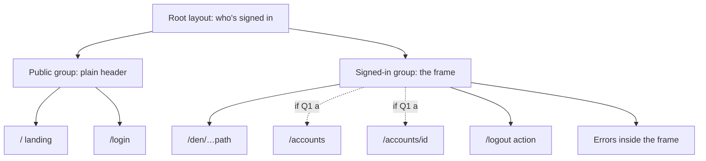
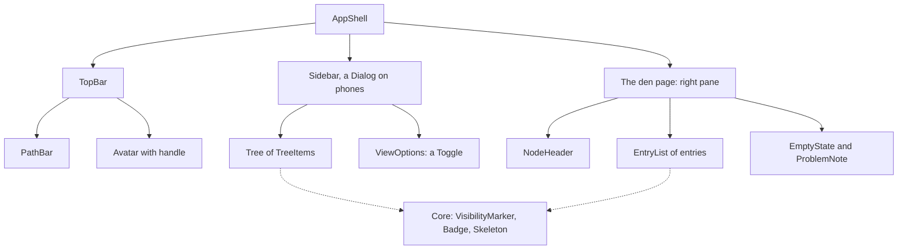
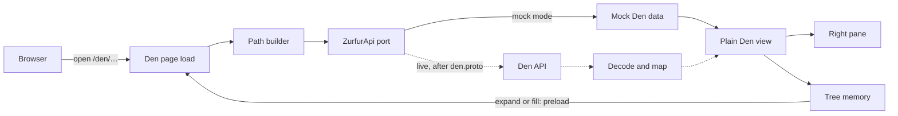

# The web app's Explorer shell: first UI slice (design study)

2026-10-08 · Fennec (web lead) for the tech lead (`claude`) and the Engineer · QA by Crow (web QA) · design only: no code is changed.

> **Revised 2026-10-08 after Crow's QA and the design language.** The components and tokens now use the names in your design language (`.understand/20261008-design-language.md`). The dotfiles question became a difference from your mockup. Q2 now covers the mouse too, and Q3 is new: the words for archived and deactivated items. The QA resolutions are at the end.

## In one screen

- **What this is.** The first screen you can click through. It's a signed-in frame with your Den's folder tree on the left, the open item on the right and its path along the top, as in your mockup. On a phone (320 px and up), the tree slides in from the left and the item fills the screen.
- **What it shows.** Exactly what the My Den read returns:
  - each item's name;
  - whether it's a folder, a file or a link;
  - its visibility: Private, Listed or Public;
  - three marks: mounted, archived (or deactivated), and "content not shown yet".
- **Where it differs from your mockup:**
  1. No "Status: in progress" line. A commission's status is part of its own content, and this slice serves names and visibility only (your "metadata only" ruling).
  2. No `profile` folder. The top of your Den holds `accounts`, `characters`, `commissions` and `posts`; profiles live in their own public directory, outside anyone's Den.
  3. No `participants` file yet. It arrives in its own slice.
  4. No dotfiles toggle yet. No dotfile exists, and the contract has no flag for them until one does, so the Project MVP rule "no screen without a backend capability behind it" holds it back.
  5. The bar along the top shows names ("Untitled"). The browser's address bar shows keys (the commission's id).
- **Style.** Neutral, dark by default, and built on your design language's names: its tokens (§9) and core components (§10). So your Claude Design system maps one to one. Section 3 lists the few places where the shell needs something the list lacks, or where the list disagrees with the corpus.
- **First clickable step.** Step 2: My Den on the web's mock data (`just dev-mock`, sign in, click "My Den"). It needs neither your ruling on den.proto nor the backend. Step 1 comes first and is clickable too: the frame around today's Accounts pages.
- **What waits for den.proto.** Only the wiring to the real API (step 3). Until step 4 runs on the backend, everything stays on the feature branch, so `main` never shows a Den screen with nothing behind it.
- **Questions for you: 3,** just below:
  - Do the Accounts pages sit inside the frame?
  - How does the tree behave, with the keyboard and the mouse?
  - Which words do archived and deactivated items get?
- **One-way doors.** None now. The token names become one when theme files start using them.

## Questions for you

**Q1. Do today's Accounts pages sit inside the Explorer frame?**

Today `/accounts` holds your account list and the "Found Account" form, and `/accounts/<id>` shows one account with its delete form. Both have a plain page with a header.

- (a) **Yes.** Every signed-in page uses the frame. The Accounts pages fill the right pane, and the top bar keeps both "My Den" and "Accounts" links.
  - On an Accounts page, the path bar reads "Accounts" and nothing in the tree is highlighted. The tree shows what you've opened in My Den, or just `~`.
  - Accounts then appear twice in one frame. The tree's `accounts` folder comes through My Den, and the Accounts pages come through the older read that still bypasses My Den. The two can disagree: a deactivated Account can show in one and not the other.
- (b) **No.** Only My Den gets the frame, and the Accounts pages keep today's plain layout.
- **Recommendation: (a).**
  - One frame for the whole signed-in app matches "the Den is the web app", and you test one layout instead of two.
  - The duplicate goes away when Accounts move into the Den; folding them in later only removes a link.

**Claude's answer (2026-10-08; the Engineer adjusts if wrong):** (a) Yes. Every signed-in page uses the frame, and the Accounts pages fill the right pane.

**Engineer:** 

**Q2. How does the tree behave?**

Keyboard:
- (a) **Like a file explorer.** Tab enters the tree once. The arrow keys move between items, Right opens a folder and Left closes it, and typing a letter jumps to a name. This is the W3C tree pattern, and it needs the page's script. Before the script runs, the tree is plain links that Tab reaches one by one.
- (b) **Like a web menu.** Every item is its own Tab stop, and each folder has its own open/close button. The W3C guide recommends this simpler pattern for most site navigation.

Mouse, clicking a folder's name:
- (i) **Opens it in the right pane** and highlights it in the tree. Only the arrow beside it expands or collapses it.
- (ii) **Opens it in the right pane and also expands it** in the tree.

- **Recommendation: (a) with (i).**
  - You asked for VS Code or Obsidian. The W3C guide's caution is about site menus, and its own "navigation tree" example is a tree of links like this one, where activating an item follows the link.
  - Under (ii), the tree would repeat the folder's contents right beside the pane. Your mockup shows the open item collapsed in the tree, with its contents on the right.

**Claude's answer (2026-10-08; the Engineer adjusts if wrong):** (a) with (i). File-explorer keys (the W3C tree pattern). Clicking a folder opens it in the pane; only the arrow expands it.

**Engineer:** 

**Q3. Which words do archived commissions and deactivated Accounts get?**

"Show archived" lists archived commissions, and a deactivated Account to its Owner. The corpus uses two words: you said archiving is a commission's soft delete, and Account Deletion renders a soft-deleted Account as "deactivated".

- (a) **Each its own word, sent by the backend.** The toggle reads "Show archived and deactivated", and items show "Archived" or "Deactivated". den.proto's soft-deleted mark becomes a small word list (`archived`, `deactivated`) in place of a yes/no flag.
- (b) **Each its own word, picked by the web** from the item's type name, with no contract change. But type names are provisional, and they are meant only to pick an icon.
- (c) **One word for both.** You pick it.
- **Recommendation: (a).** The backend already knows which it is, so the web never guesses, and the command-line tool gets the same word. It changes one field in the den.proto draft while it's still unruled, which is the cheapest time (den lead to confirm).

**Claude's answer (2026-10-08; the Engineer adjusts if wrong):** (a) Each its own word, sent by the backend: "Archived" for commissions and "Deactivated" for Accounts. den.proto's soft-deleted mark becomes the word list `archived` / `deactivated`.

**Engineer:** 

**Choices I made inside the design (veto any):**

- **Folders first, then files,** each group in the server's order (by name), as your mockup's right pane shows. The tech lead allowed this kind of grouping.
- **Your root shows as `~`,** as in your mockup. The pane's title there reads "My Den".
- **The tree opens down to the open item** and highlights it, but leaves the item itself closed (your mockup).
- **Dark only in this slice.** Your design language makes dark the default. The light theme is defined, but switching to it needs a remembered choice, which belongs in the viewer's preferences file, and that isn't built yet. The device's light setting can't be the trigger: it also reports "light" when someone has expressed no preference.
- **The landing page.** "Your commissions will appear here." becomes a link, "Open My Den".
- **Nothing about the tree is kept in browser storage.**
- **Page titles carry the open item's name,** so screen readers announce it. That puts names in the browser history; the end-of-slice security review weighs a generic title instead.

## The diagrams, for approval

Solid lines are designed or ruled. Dashed lines wait on a question or on den.proto, as labelled. Every block was parsed with mermaid 11.4.1 under jsdom (parse only, not rendered).

### A. Routes and layouts



- **Groups change no URL.** `/`, `/login`, `/accounts` and `/den` keep their addresses. The groups only decide which layout wraps a page.
- **The frame itself reads nothing from the Den.** Only the den page's load does (diagram C).
- **Under Q1 (b)** the Accounts pages stay behind the sign-in gate but outside the frame.
- **Left out:** the dev-only `/mock/signin` route, which is unchanged.

**Engineer:** 

### B. Components



- Names from your design language's core list: PathBar, Avatar, Dialog, TreeItem, Toggle, EmptyState, VisibilityMarker, Badge and Skeleton. The rest (AppShell, TopBar, Sidebar, Tree, ViewOptions, NodeHeader, EntryList, ProblemNote) are the shell's own layout, built only from core components and tokens.
- Dotted arrows mean "uses". Section 3 has the full list.

**Engineer:** 

### C. From the API to the tree



- **One load and one path builder.** The den page's load is the only code that calls the Den. Every Den link the page shows is built on the server by the path builder that the path-handling security review asked for, and the browser never puts a Den address together itself.
- **The plain Den view** is the web's own shape (`lib/api/den.ts`). Both the mock and, later, the decoded contract produce it. That is why steps 1 and 2 don't wait for den.proto.
- **Tree memory** keeps every folder listing the tree has seen. To expand a folder, or to fill in an ancestor it lacks, it runs the same page load through SvelteKit's `preloadData` on a server-built link, without opening anything.

**Engineer:** 

## The slice plan

| Step | What gets built | Waits for | What you can click |
| --- | --- | --- | --- |
| **1. Frame** | Tokens and base styles (dark), self-hosted fonts; AppShell, TopBar, Sidebar and the phone drawer; the two route groups; an error page inside the frame that never shows an error's message; an error hook that logs only the route; `Referrer-Policy: same-origin` on signed-in pages | Q1 | Today's Accounts pages in the new frame, and the drawer on a phone |
| **2. My Den on the mock** | The plain Den view shape; `denRoot` and `denNode` on the ZurfurApi port; the mock Den world; the path builder with the security review's test cases, also hardening today's account-delete call; the `/den` route; Tree with keyboard and mouse; every pane state; the "Show archived" Toggle; loading and error states | Q2 and Q3 | **The first Den click-through:** `just dev-mock`, sign in, open My Den, browse alice's Den, found an Account on `/accounts` and watch its mount appear in the tree |
| **3. Wire to den.proto** | Generate the TypeScript messages; the live port decodes (an answer without a node is a contract error) and maps to the plain view; tolerant-reader tests (an unknown access shows as a card, an unknown kind gets a generic marker, unknown content shows "content not shown yet", an unknown own level shows no level and never Public, an unknown soft-deleted word shows the generic soft-deleted label and never as live); golden-response tests once den publishes them | Your den.proto ruling | Nothing new on screen. The screens now speak the real contract |
| **4. Against the backend** | Run live against the in-memory dev profile signed in as alice; the end-of-slice security review | Den routes and the dev profile (den team, tech lead) | My Den on the real backend |

- **Before den.proto:** steps 1 and 2. **After:** steps 3 and 4.
- **The branch.** All four steps land as slices on one feature branch, which reaches `main` only after step 4. On the feature branch, until step 3, a live run answers `/den` with a "My Den isn't connected to the backend yet" notice, never an empty Den or the not-found.
- **The mock Den world** follows the approved fixture tree: alice's Den, with Ember, Kael-sona, the commission "Untitled" and her `posts`.
  - Its `accounts` folder reads the mock's own account store, which keeps today's seed name, "Alice's Studio".
  - Hand-made extras, marked as hand-made, cover what the seed can't produce: a card, an archived commission, a paginated folder, a very long name, and a right-to-left name.

<details>
<summary><b>If the den.proto ruling changes it</b></summary>

| If the ruling… | The web changes… |
| --- | --- |
| makes a path to a file answer not-found instead of 200 | File rows stop being links, and the file pane state goes. |
| drops the `mount` mark | The mounted marker goes. |
| drops the soft-deleted mark, or keeps it yes/no (Q3 (b) or (c)) | The words come from the type name or are one word; the Toggle still filters. |
| spells query parameters another way (its spelling question) | One string per parameter in the path builder's allowlist. |
| gives a card fields, such as a commission's maturity | The card view shows them. |
| lets cards carry their path and kind (its card question) | Card rows can link to their own page and get a kind marker; until a slice acts on cards they stay inert. |
| drops `crumbs` | The path bar falls back to keys from the address instead of names. I'd argue to keep crumbs. |
| keeps content required (if the tech lead reverses the 2026-10-08 change) | An open node with an unknown content case shows the error view instead of "Content not shown yet." |
| sends a path as one string instead of a list of segments | The path builder's input changes. |

</details>

## Detail

<details>
<summary><b>1. Wireframes: desktop, phone, and each pane state</b></summary>

**Desktop** (wider than 48rem). alice opens the commission through her own `commissions` folder. `↪` is the mounted marker.

```text
┌───────────────────────────────────────────────────────────────────────────┐
│ zurfur  ~ / commissions / Untitled  My Den  Accounts  (◕) alice  Sign out │
├─────────────────────┬─────────────────────────────────────────────────────┤
│ ▾ ~                 │  ▣ Untitled ↪                                       │
│   ▸ accounts        │    Folder · ◆ Private · Mounted                     │
│   ▸ characters      │  ─────────────────────────────────────────────────  │
│   ▾ commissions     │  ▸ attachments                         ◆ Private    │
│ ┃   ▸ Untitled ↪    │  ▸ products                            ◆ Private    │
│   ▸ posts ↪         │  ▸ slots                               ◆ Private    │
│      not shown yet  │  · changelog                           ◆ Private    │
│                     │                                                     │
│ ── View ─────────── │                                                     │
│ (○ ) Show archived  │                                                     │
│      and deactivated│                                                     │
└─────────────────────┴─────────────────────────────────────────────────────┘
  ┃ marks the open item.  ▸ closed folder  ▾ open folder  · file  ↪ mounted
  ◆ stands for the VisibilityMarker: an icon and a word, never colour alone.
```

- The tree opens down to the item and highlights it, but leaves the item itself closed: its contents are in the right pane.
- The visibility appears only in the right pane; the mounted marker appears in both.
- Folders come first, then files, each group in the server's order.
- `(◕) alice  Sign out` is today's signed-in corner, now Avatar with handle, in the monospace font.
- The Toggle's words follow Q3; shown here under its recommendation.

**Phone** (48rem or narrower, down to 320 px), drawer closed:

```text
┌──────────────────────────────────┐
│ ☰   ‹ commissions                │
├──────────────────────────────────┤
│ ▣ Untitled ↪                     │
│   Folder · ◆ Private · Mounted   │
│ ──────────────────────────────── │
│ ▸ attachments          ◆ Private │
│ ▸ products             ◆ Private │
│ ▸ slots                ◆ Private │
│ · changelog            ◆ Private │
└──────────────────────────────────┘
```

Phone, drawer open (☰):

```text
┌────────────────────────────┬─────┐
│ My Den                  ✕  │░░░░░│
│ ▾ ~                        │░░░░░│
│   ▸ accounts               │░░░░░│
│   ▸ characters             │░░░░░│
│   ▾ commissions            │░░░░░│
│ ┃   ▸ Untitled ↪           │░░░░░│
│   ▸ posts ↪  not shown yet │░░░░░│
│ ── View ────────────────── │░░░░░│
│ (○ ) Show archived and     │░░░░░│
│      deactivated           │░░░░░│
│ ────────────────────────── │░░░░░│
│ Accounts                   │░░░░░│
│ (◕) alice       Sign out   │░░░░░│
└────────────────────────────┴─────┘
```

- On a phone, the path bar shows only the parent, as a back link ("‹ commissions"). The current name is the pane's title.
- Choosing an item in the drawer opens it and closes the drawer.

**The pane's other states** (desktop shown; the phone shows the same pane full width):

```text
"Content not shown yet"           A file                            A card (hand-made fixtures only)
┌──────────────────────────────┐  ┌──────────────────────────────┐  ┌──────────────────────────────┐
│ ▣ posts ↪                    │  │ ▤ changelog                  │  │ ▢ Some commission            │
│   Folder · ◆ Public · Mounted│  │   File · ◆ Private           │  │   Can't open                 │
│ ──────────────────────────── │  │ ──────────────────────────── │  │ ──────────────────────────── │
│ ⓘ Content not shown yet.     │  │ ⓘ Content not shown yet.     │  │ ⓘ You can see that this      │
│                              │  │                              │  │   exists, but you can't      │
│                              │  │                              │  │   open it.                   │
└──────────────────────────────┘  └──────────────────────────────┘  └──────────────────────────────┘

An empty folder                    Not found (every cause, one copy)
┌──────────────────────────────┐  ┌──────────────────────────────┐
│ ▣ products                   │  │ Nothing here                 │
│   Folder · ◆ Private         │  │ This doesn't exist, or you   │
│ ──────────────────────────── │  │ can't open it.               │
│ This folder is empty.        │  │ [ Back to My Den ]           │
└──────────────────────────────┘  └──────────────────────────────┘
```

- **A card shows no visibility,** because a card viewer never learns the level set for others (My Den rulings, decision 5). Under the den.proto draft's recommendation on cards, it shows only a name and a type.
- **The not-found view has no breadcrumbs.** The not-found answer carries none, so the path bar shows only `~`.
- **The messages are EmptyState components:** "Content not shown yet", "This folder is empty", "Nothing here".

</details>

<details>
<summary><b>2. Routes and the layout tree</b></summary>

```text
src/routes/
├── +layout.server.ts             who's signed in, once per render (unchanged)
├── +layout.svelte                tokens.css and base.css, favicon; no header any more
├── (public)/
│   ├── +layout.svelte            today's header, plus a "My Den" link when signed in
│   ├── +page.svelte              /        moved, URL unchanged
│   └── login/…                   /login   moved, URL unchanged
├── (session)/
│   ├── +layout.server.ts         the sign-in gate (unchanged); reads nothing from the Den
│   ├── +layout.svelte            AppShell: TopBar, Sidebar (Tree, ViewOptions), the main pane; holds tree memory
│   ├── +error.svelte             errors render inside the frame, without the error's message
│   ├── den/[...path]/
│   │   ├── +page.server.ts       the node at the path; on a full page load, also its ancestors' listings
│   │   └── +page.svelte          the right pane
│   ├── accounts/…                unchanged pages, in the right pane (Q1 a)
│   └── logout/…                  unchanged action
└── mock/signin/+server.ts        unchanged, dev-only
```

- **One route serves the root and everything under it.** SvelteKit's rest parameter matches zero or more segments: the docs say `a/[...rest]/z` "will match `/a/z` (i.e. there's no parameter at all)". So `/den` and `/den/commissions/…` share one load. The load calls `GET /api/v1/den` when the path is empty and `GET /api/v1/den/{path}` otherwise.
- **The frame reads nothing from the Den.** So the path builder lives only in the den page's load, as the path-handling review requires. A Den failure can only come from the page's load, and it renders inside the frame.
- **Under Q1 (b)** the signed-in group nests a framed group (`den`) and a plain group (`accounts`), both behind the same gate.

</details>

<details>
<summary><b>3. Components, and the fit with your design language</b></summary>

**Core components, by your design language's names** (§10). The design system owns their look.

| Core component | Used in this slice for | Variants and states the shell needs |
| --- | --- | --- |
| Button | "Sign out", "Back to My Den", "More", "Retry" | primary, quiet; busy |
| IconButton | ☰ (open the drawer), ✕ (close it), a folder's expand arrow | default, focus |
| TextInput | Today's Accounts forms (name, handle, the delete confirmation) | default, invalid with its message |
| Toggle | "Show archived and deactivated" (words per Q3) | off, on, focus |
| TreeItem | Every row of the tree | kind: folder, file or link; a **mounted** marker on any kind (fit 1); current, focused, expanded or collapsed, loading; can't open (a Den card, fit 2); "not shown yet"; unknown kind; a "More…" row |
| PathBar | Breadcrumbs by name; on a phone, only the parent | root, deep, not-found |
| Badge | "Archived" or "Deactivated" | neutral |
| VisibilityMarker | An open item's own level: Private, Listed, Public | the three; an unknown level shows nothing |
| Avatar (with handle) | The signed-in corner | with a picture, without |
| Dialog | The phone drawer: a side sheet from the left (fit 3) | open, closed |
| EmptyState | "This folder is empty", "Content not shown yet", "My Den isn't connected yet", "Nothing here" (not found), the card's notice | info |
| Skeleton | Loading rows in the tree and the pane | — |

Not used in this slice: Select, Checkbox, Tabs, Card, StatusPill, Toast, MatureCover, Pin.

**The shell's own layout** (app-owned, built only from core components and tokens, so it restyles with the design system):

| Composition | What it is |
| --- | --- |
| AppShell | The frame: TopBar, Sidebar, main pane, and a "Skip to content" link |
| TopBar | The brand, PathBar, the "My Den" and "Accounts" links, Avatar with handle, and Sign out |
| Sidebar | Holds the Tree and the ViewOptions; on a phone, inside a Dialog |
| Tree | The labelled tree: roles, keyboard, and tree memory |
| ViewOptions | The "View" group under the tree |
| NodeHeader | The pane's title: kind marker, name, VisibilityMarker, mounted marker, Badge |
| EntryList | One page of the open folder's entries, then "More". Each row looks like a TreeItem without the arrow, plus a VisibilityMarker (fit 4) |
| ProblemNote | Exists today; the one way an API problem renders, inline (fit 5) |

**Fit with your design language.** These go to the tech lead to take to you, as the tech lead asked. None blocks step 1.

1. **"Mounted" is a mark, not a fourth kind.** In the Den, a mount is a folder or file shared into your tree, and it shows its target's kind (the den.proto draft: a kind plus a mount mark). So a TreeItem needs a kind (folder, file or link) plus a mounted marker that combines with any of them.
2. **"Card" means two things.** The design system's Card is a container. In the Den, a card is an item you may know exists but can't open (Listed). The shell calls that state "can't open" in code and on screen, to avoid the clash. You may prefer to rename one of the two.
3. **The drawer** is a modal side sheet. It works best as a Dialog variant rather than a new component.
4. **The pane's entry rows** look like TreeItems but sit in a list, not a tree. That means either a list variant of TreeItem or a separate row component.
5. **An inline error** isn't on the list. API problems render inline today (ProblemNote). Either an inline message component (info or error) or an error tone for EmptyState would cover it.
6. **Tokens the shell needs beyond §9:**
   - `--color-on-accent`, for text on a primary Button;
   - `--color-hover`;
   - `--color-selected`, for the open tree item;
   - `--color-backdrop`, behind the drawer.

   The layout tokens stay app-owned: `--topbar-height`, `--sidebar-width`, `--tree-indent`, `--row-height`.
7. **Three lines contradict the corpus,** and Claude Design would build them in:
   - **"Their profile" as a tree item.** Profiles live in the public `/profile` directory, outside anyone's Den (My Den rulings, decision 16).
   - **Mature art "never hidden".** A viewer who picks Safe hides labelled content; Blurred is only the default (User-Profiles and Content Maturity, decision 10).
   - **The mounted kind** (item 1).
8. **Dark by default.** Honouring a light preference needs a remembered switch, because the browser reports "light" both for a light preference and for no preference (MDN, `prefers-color-scheme`). The Den keeps light or dark as a viewer's own setting in their preferences file (The Den, decision 28), which isn't built. So this slice is dark only.
9. **StatusPill and MatureCover** have no screen yet. This slice serves neither a status nor an image.

</details>

<details>
<summary><b>4. Design tokens</b></summary>

Two files, imported once by the root layout:

- `lib/styles/tokens.css`: every custom property.
- `lib/styles/base.css`: element defaults (body, links, buttons, inputs, the focus ring) and the `.visually-hidden` helper.

| Tier | Names | Who reads it |
| --- | --- | --- |
| **Palette** (raw values) | `--palette-…`, which takes your sona's colours once you fill them in | Only the semantic tier. Components never name a palette colour |
| **Semantic** (your §9) | `--color-bg`, `--color-surface`, `--color-surface-raised`, `--color-border`, `--color-text`, `--color-text-muted`, `--color-accent`, `--color-focus`, `--color-danger` (destructive actions and system errors only), `--color-status-*` (unused here), `--color-visibility-private`, `--color-visibility-listed`, `--color-visibility-public`, `--font-ui`, `--font-mono` (handles, DIDs, paths), `--text-*`, `--space-*` (on a 4 px base), `--radius-*`, `--elevation-*`, `--duration-*`; plus fit 6's four extras | Every component |
| **Layout** (app-owned) | `--topbar-height`, `--sidebar-width`, `--tree-indent`, `--row-height` | The shell's compositions |

- **Dark is the default.** The dark values sit on `:root`. The light values are defined under `:root[data-theme="light"]` and stay unused until a remembered switch exists (fit 8).
- **Motion and contrast.** Under `prefers-reduced-motion: reduce`, every `--duration-*` is 0. `prefers-contrast: more` swaps in stronger borders and text, and under `forced-colors` the borders and the focus ring stay visible.
- **Sizes are in rem,** so the browser's text-size setting scales the whole frame.
- **The phone breakpoint** (48rem) is one literal. A CSS variable can't be used inside a media query, so the value is written once, in `base.css`.
- **Fonts and icons are self-hosted.** Loading a font from Google's servers would show every visitor's IP address to a third party, the same reason the theme rules forbid external URLs (The Den, decision 28). The icon set ships as inline SVG, hidden from screen readers.
- **The later theme files.** A space's `.theme.yaml` takes values from a validated vocabulary ("colors, fonts from a list, spacing tokens", The Den, decision 28). The semantic names are the natural candidates for it. Once theme files use them, renaming a token breaks those files: that is the one-way door, and it isn't open yet.

**Claude Design hand-off.** Claude's help article "Get started with Claude Design" (read 2026-10-08) says a design system comes in "from a GitHub repo, design files, raw uploads, or your local codebase", through a `/design-sync` command in Claude Code, and that `/design` brings a design back into the code.

- **Point any import from the codebase at `frontend/web/src/lib/styles/` and `frontend/web/src/lib/components/` only.** An import sends code to a hosted service, and the repo root holds `.env` (after `just setup`) and `.understand/` holds the security reviews. What the import actually reads is [unverified].
- **A name clash.** This repo already has a project skill called `/design-sync`, which syncs the design corpus. If Claude Design's command arrives under the same name, rename one of the two first.

</details>

<details>
<summary><b>5. How each node renders, for what My Den read-only returns</b></summary>

| What the read returns | Right pane | Tree |
| --- | --- | --- |
| An open folder with entries | NodeHeader (kind marker, name, "Folder", VisibilityMarker, mounted marker, Badge), then the entries: folders first, then files, each group in the server's order. "More" appears when the server sends a next page | A folder with an arrow. Expanding it shows the first page, then "More…" |
| An open folder, empty | NodeHeader, then "This folder is empty." | Expanding it shows a muted "Empty" row |
| An open folder flagged "content not shown yet" (a Workflow, your `posts`, an Account's `commissions`) | NodeHeader, then "Content not shown yet." | No arrow, since the contract answers it with an empty page; a muted "not shown yet" hint |
| An open file (an attachment, the changelog) | NodeHeader ("File"), then "Content not shown yet." | A leaf, linked |
| An open link (none exist in this slice) | NodeHeader ("Link"), then "Opening links isn't available yet." | A leaf with the link marker |
| A card (only hand-made fixtures produce one) | Its name, "Can't open" and no visibility, then "You can see that this exists, but you can't open it." | A leaf that isn't a link and can't be opened |
| An access the web doesn't recognize | Shown as a card: it fails closed | As a card |
| A kind the web doesn't recognize | A generic marker; the pane follows the content that came back | A leaf |
| An open node whose content case the web doesn't recognize | NodeHeader, then "Content not shown yet." (the den.proto draft as revised 2026-10-08) | As its kind |
| Not found, for every cause (absent, nonexistent, inside something you can't open, a malformed path) | One view, one copy: "Nothing here. This doesn't exist, or you can't open it." and a link back to My Den | Unchanged; nothing is highlighted |
| An answer without a node (a contract error) | The frame's error view, without the error's message | Unchanged |
| The root (`/den`) | Title "My Den", then its entries | `~` at the top, open |

- **Marks only openers see.** The own level, the soft-deleted word and "content not shown yet" come only inside an open entry (den.proto draft, `DenOpen`), so a card can never show them.
- **The flag is not about the data.** "Content not shown yet" is fixed per type by the backend and never computed from the node's data (My Den rulings, decision 15). The web shows it as given.
- **Mounts** show their target's name, kind and level (My Den rulings, decisions 5 and 6), plus the mounted marker.
- **No thumbnails in this slice.** Files are listed, never opened, so no image appears and MatureCover isn't used. When images arrive, mature art is blurred by default (User-Profiles and Content Maturity, decision 10), and the gate on your own Den is left to each type's handler (My Den rulings, decision 17).

</details>

<details>
<summary><b>6. The "Show archived and deactivated" Toggle</b></summary>

- **What it sends.** The contract's deleted-items flag, spelled `includeDeleted` under the den.proto draft's recommendation. My Den rulings decision 13 says the flag belongs to the request, is "dynamic and never persisted", and the UI "may offer it as a toggle".
- **How it travels.** The flag rides only in the address (`?includeDeleted=true`). While it is on, the server's path builder adds it to every Den link it builds. The server also sends the current page's link with the flag both on and off, so the Toggle never builds an address. Nothing is stored in a cookie or in browser storage.
- **What it shows.** Archived commissions, and a deactivated Account to its Owner, appear in listings with their Badge. A typed path ignores the flag (the den.proto draft).
- **Tree memory is cleared when the flag flips,** so the tree and the pane never disagree.
- **Without the page's script,** the Toggle is a small form with a submit button. With it, flipping the Toggle loads the page's other link in place, and focus stays on the Toggle.
- **The seed has nothing archived,** so on the dev profile the Toggle changes nothing you can see. The mock's hand-made archived commission demonstrates it.

</details>

<details>
<summary><b>7. Keyboard and screen reader</b></summary>

**Landmarks.** A "Skip to content" link comes first. Then the header, a navigation region labelled "My Den" (the tree and the View group), and the main region (the pane).

**Under Q2 (a): the tree pattern** (WAI-ARIA Authoring Practices, the Treeview pattern and its "Navigation Treeview Example"):

- **The markup follows the example:**
  - the tree is a `ul` with `role="tree"`;
  - each item is an `a` element with `role="treeitem"`;
  - a folder's link carries `aria-expanded` and points at its sibling `ul role="group"` with `aria-owns`;
  - the `li` elements get `role="none"`;
  - the open item carries `aria-current="page"`;
  - a `nav` with the same label wraps the tree.
- **Focus** uses a roving tabindex. One item has `tabindex="0"`, and it is always the open item, so Tab lands where you are.
- **Before the script runs** (the server-rendered page), the tree is plain nested lists of links, with no tree roles and no roving tabindex. A roving tabindex without its arrow keys would leave every item but one unreachable from the keyboard. The roles and the tabindex are added once the component mounts.
- **Keys** (the pattern's table):

  | Key | Action |
  | --- | --- |
  | Down / Up | Next or previous visible item |
  | Right | Open a closed folder; on an open folder, go to its first child |
  | Left | Close an open folder; otherwise go to the parent |
  | Home / End | First or last visible item |
  | Enter / Space | Open the item in the pane |
  | A letter | The next item whose name starts with it |

  The optional `*` (expand all siblings) is left out.
- **A card** is a treeitem that isn't a link. Enter does nothing on it, and its accessible description says "can't be opened".
- **Partly loaded folders.** The contract never sends counts. In a folder with more pages, every item carries `aria-level`, `aria-posinset` and `aria-setsize="-1"`. The pattern requires all three when the full set isn't in the page, and ARIA 1.2 prescribes -1 "if the total number of items is unknown". So the tree can't leak a count either.
- **Loading children.** The group is marked busy, and Skeleton rows sit in it. If loading fails, the row reads "Couldn't load. Retry."

**Under Q2 (b): the simpler pattern.** Nested lists of links, each folder with a button carrying `aria-expanded`. Every link and button is a Tab stop, and there are no arrow keys.

**For both:**

- **After opening from the tree, focus stays on the tree item.** This deliberately departs from the W3C example, which moves focus to the new page's heading and calls that optional. Keeping focus lets you browse with the arrows. Links in the tree carry SvelteKit's `data-sveltekit-keepfocus`. After opening from the pane or the path bar, focus moves to the pane's heading.
- **Announcements.** SvelteKit announces each navigation by reading `document.title` into an assertive live region (checked in the installed 2.70.1 source, `core/sync/write_root.js`). So each Den page's title is "<name> — My Den — Zurfur".
- **The root** shows as `~` followed by visually hidden text "My Den", so its accessible name contains what is visible.
- **Names are wrapped in `<bdi>`,** so a right-to-left display name can't reorder the row around it. Long names are cut visually with an ellipsis, and the full text stays in the accessible name.
- **Never colour alone.** VisibilityMarker pairs an icon with its word, and every Badge carries its word.
- **The phone drawer** is a Dialog opened with `showModal()`. MDN: a modal dialog makes "the rest of the page inert", and Escape closes it. Focus goes to the drawer's close button, then back to ☰ on close. MDN doesn't document focus returning, so the code does it. Opening the drawer without the script, through an invoker command on ☰, was considered, but browser support is [unverified], so it isn't in this slice.

</details>

<details>
<summary><b>8. Loading and error states</b></summary>

| Moment | What shows |
| --- | --- |
| First load (server-rendered) | The whole page; no spinner |
| Opening an item | The old pane stays. After a short delay, Skeleton rows replace its entries and the pane is marked busy. The new title is announced on arrival |
| Expanding a folder | Skeleton rows under it, then the entries, or "Couldn't load. Retry." |
| The next page of entries | "More" shows busy, and the entries are appended below |
| The session expired (401), or an expand that comes back as a redirect | Go to `/login`, as the sign-in gate does today |
| An expand that comes back with any other failure | "Couldn't load. Retry." on that row |
| An unknown query parameter typed into the address | The web drops it. The web never sends one, so a 400 from the API means a web bug: the error view |
| A page token typed or kept from before a deploy (the API's 422) | The folder reloads from its first page, once. A second 422 shows the error view, so a web bug can't loop (the den lead's guard) |
| Not found | The one not-found view (section 5). The page itself answers 200 with the problem in the page, following the web's existing convention (the tech lead's call on the question sheet) |
| An answer without a node | The frame's error view, "Something went wrong reading this.", never showing the error's message. The navigation stays usable |
| The live port isn't connected yet (feature branch, before step 3) | An EmptyState: "My Den isn't connected to the backend yet." |
| The backend unreachable | **Today's behaviour, flagged:** the root layout treats an unreachable backend as signed out, so the sign-in gate sends you to `/login`. While testing, a stopped backend looks like being signed out. Changing that is a separate call, not part of this slice |

</details>

<details>
<summary><b>9. Where today's pages go</b></summary>

| Today | After this slice |
| --- | --- |
| `/`, the landing page | Same address, moved into the public group. Signed in, "Your commissions will appear here." becomes a link, "Open My Den". It stays the page you land on after sign-in and sign-out, a rule the web set earlier and recorded in its notes, which this slice doesn't re-open |
| `/login` | Unchanged, in the public group |
| The header (`SessionHeader`) | On public pages, unchanged plus a "My Den" link. On signed-in pages, its parts move into the TopBar on desktop and the drawer's footer on a phone |
| `/accounts` (the list and "Found Account") | Q1 (a): the right pane of the frame, with the path bar reading "Accounts". Q1 (b): today's plain layout. It works as before either way |
| `/accounts/<id>` (detail and delete) | As above. The delete call goes through the new path builder (step 2) |
| `/logout` | Unchanged; it stays a full-page form post (section 11) |
| `/mock/signin` | Unchanged, dev-only |
| `ProblemNote` | Kept as the one way an API problem renders, now styled by tokens |

</details>

<details>
<summary><b>10. The data flow, and the web's own Den shape</b></summary>

**Who loads what:**

- **Only the den page's load reads the Den.** It reads the node at the path. On a full page load it also reads the listings of the folders between the root and the node, in parallel, so the first paint shows the tree opened down to the item. SvelteKit marks in-app navigations with `isDataRequest`; on those, the load reads only the node.
- **The tree fills its own gaps.** After each navigation it checks the breadcrumbs. For any ancestor whose listing it lacks, it calls `preloadData` on that crumb's server-built link, which runs the same load without navigating. This covers going Back into a deep Den page from outside the frame.
- **The tree merges every listing the pane shows,** so an entry clicked in the pane, or a crumb in the path bar, is already in the tree.
- **Expanding a folder** calls `preloadData` on its server-built link. In 2.70.1 that resolves to `{ type: 'loaded', status, data }` or `{ type: 'redirect', location }`. A redirect is followed (to `/login`); a status other than 200 shows "Couldn't load. Retry."
- **Tree links preload on tap, not on hover.** The app's default is hover, and hovering over a tree would otherwise fan out reads.
- **Tree memory is cleared** when the Toggle flips and after a successful form action, such as founding an Account. That is how the new mount appears in step 2's demo.
- **Tree memory is keyed by the session's DID.** A mismatch clears it, and a change of user is always a full page load.
- **An edge case.** If the open item lies beyond a parent's first page, the tree still shows it, after that parent's "More…" row, so you always see where you are.

**The plain Den view** (`lib/api/den.ts`, a sketch, following the frontend rulebook: branded strings, discriminated unions, readonly, no `null`, no invalid pairings):

```ts
type DenHref = Brand<string, 'DenHref'>; // minted only by the server's path builder
type DenName = Brand<string, 'DenName'>; // a display name: text, never HTML
type DenType = Brand<string, 'DenType'>; // provisional and opaque: picks a marker only
type DenLevel = 'private' | 'listed' | 'public' | 'unknown';
type DenKind = 'directory' | 'file' | 'symlink' | 'unknown';
type DenRemoved = 'archived' | 'deactivated' | 'unknown'; // per Q3 (a)

interface OpenEntry {
	readonly view: 'open';
	readonly href: DenHref;
	readonly name: DenName;
	readonly type: DenType;
	readonly kind: DenKind;
	readonly mounted: boolean;
	readonly ownLevel: DenLevel;
	readonly contentNotShown: boolean;
	readonly removed: DenRemoved | undefined;
}
// No link and no kind, under the den.proto draft's recommendation on cards.
interface CardEntry { readonly view: 'card'; readonly name: DenName; readonly type: DenType; readonly mounted: boolean }
type DenEntry = OpenEntry | CardEntry; // an unknown or unset access decodes as a card

interface DenCrumb { readonly href: DenHref; readonly name: DenName }
type DenBody =
	| { readonly body: 'listing'; readonly entries: readonly DenEntry[]; readonly more: DenHref | undefined }
	| { readonly body: 'file' }
	| { readonly body: 'link' }
	| { readonly body: 'notShown' }; // a content case this build doesn't know
type DenPage =
	| { readonly view: 'open'; readonly node: OpenEntry; readonly crumbs: readonly DenCrumb[]; readonly body: DenBody }
	| { readonly view: 'card'; readonly node: CardEntry; readonly crumbs: readonly DenCrumb[] };
type DenOutcome =
	| { readonly outcome: 'page'; readonly page: DenPage; readonly flagLinks: { readonly on: DenHref; readonly off: DenHref } }
	| { readonly outcome: 'notFound' }
	| { readonly outcome: 'notConnected' }
	| { readonly outcome: 'problem'; readonly problem: Problem };
```

- The tree keys folders by their `DenHref`.
- Cards have no link, so a card row is keyed by its position.
- Segments never reach a component as separate pieces; only server-built links do.

</details>

<details>
<summary><b>11. Implementation calls I'd make (overturn any in review)</b></summary>

The UX-shaped choices are listed under the questions, for veto. These are the technical ones.

**Styling**

1. **Plain CSS** with custom properties and Svelte's scoped styles. No CSS framework and no component library, so there is no new dependency.
2. **Three token tiers:** palette, semantic (your §9), and layout. Components read only the semantic and layout tiers.
3. **All sizes in rem,** on your 4 px base.
4. **Fixed component names:** core components named as your §10, and the shell's compositions as in section 3. One file each, the core ones in `lib/components/ui/` and the compositions in `lib/components/explorer/`.
5. **Fonts and icons self-hosted** (section 4).

**Layout and behaviour**

6. **Two route groups,** `(public)` and `(session)`; no URL changes.
7. **The frame reads nothing from the Den;** only the den page's load does.
8. **The phone breakpoint is 48rem.** The drawer is a modal Dialog, and choosing an item closes it.
9. **Icons by kind only** in this slice.
10. **The Toggle never builds an address:** the server sends the page's link with the flag on and off.

**Security and privacy**

11. **Tree memory lives in the frame component** (Svelte context), never in a module-level store. SvelteKit's state-management guide warns that module-level state "is shared by everyone who connects to this server".
12. **Tree memory is keyed by the session's DID,** a mismatch clears it, and a change of user is always a full page load. Sign-out stays a full-page form post, and the dev "sign in as" picker must reload the page too (section 12).
13. **Nothing is persisted.** Open and closed folders aren't saved to browser storage, because Den addresses hold DIDs and commission ids that a shared computer would keep. The deleted-items flag rides only the address, by rule.
14. **Den links come only from the server's path builder,** per the path-handling security review. Step 2 also moves today's account-delete call onto it.
15. **Names are text, never HTML.** No `{@html}` anywhere in the shell.
16. **An error hook logs only the route,** never a Den path, a segment or a page token, and the error view never shows an error's message (step 1).
17. **`Referrer-Policy: same-origin` on signed-in pages** (step 1), so a Den address never leaks to another site.
18. **Page titles carry the item's name,** for the screen-reader announcer, so names land in the browser's history, which a browser may sync between devices. The alternative is a generic title, with the frame announcing the name itself. The end-of-slice review decides.
19. **Tree links preload on tap,** not on hover.
20. **Any Claude Design import reads only the styles and components folders** (section 4).

**Data and the build**

21. **The live port answers "not connected yet"** until step 3, never an empty Den.
22. **The mock Den reads its `accounts` folder** from the mock's own account store ("Alice's Studio").
23. **The error page sits inside the frame** (`(session)/+error.svelte`).
24. **All four steps live on one feature branch** until step 4.

</details>

<details>
<summary><b>12. Open interface questions for other teams</b></summary>

None of these blocks steps 1 or 2.

1. **Den and commission: does a commission list `participants` in this slice?**
   - The approved architecture's fixture tree draws five entries.
   - The tech lead's note on the question sheet ("Recorded for later slices") keeps four, with `participants` arriving in its own slice.
   - The web renders whatever comes back; the mock uses four.
2. **Tech lead: the dev profile's "sign in as" picker.** Is it a web screen, which the web would build behind the dev guard, or a backend-only switch? Either way, switching users must be a full page load, so the tree memory of one user never shows in the other's session.
3. **Den lead: Q3 (a)** would turn den.proto's soft-deleted mark into a small word list (`archived`, `deactivated`).
4. **Tech lead: the fit notes in section 3,** to take to the Engineer with the design language.

</details>

<details>
<summary><b>13. Sources checked</b></summary>

**Corpus**

- My Den rulings (decisions/2026100701): especially decisions 5, 6, 13, 15, 16, 17 and 18.
- The Den (decisions/2026093001): decisions 2 and 28.
- Frontend Stack (decisions/39944194): decisions 1, 2 and 4.
- Account Deletion (decisions/23003138): decision 6, where a soft-deleted Account renders "deactivated".
- Project MVP (project/589826): "Frontend for exactly what the backend supports".
- User-Profiles and Content Maturity (decisions/21594113): decision 10.

**Study documents**

- `.understand/20261006-my-den-architecture.md`.
- `.understand/20261006-my-den-question-sheet.md`: sections 9 to 12.
- `.understand/20261007-den-proto-draft.md`, as revised 2026-10-08.
- `.understand/20261008-design-language.md`: §6, §9 and §10.

**Code**

- `frontend/web/src`.
- SvelteKit 2.70.1 as installed: the `preloadData` and `isDataRequest` types, the `keepfocus` and `preload-data` link options, and the route announcer.

**Web**

- [WAI-ARIA APG: Tree View pattern](https://www.w3.org/WAI/ARIA/apg/patterns/treeview/).
- [WAI-ARIA APG: Navigation Treeview Example](https://www.w3.org/WAI/ARIA/apg/patterns/treeview/examples/treeview-navigation/).
- [WAI-ARIA 1.2, aria-setsize](https://www.w3.org/TR/wai-aria-1.2/#aria-setsize).
- [MDN: the dialog element](https://developer.mozilla.org/en-US/docs/Web/HTML/Reference/Elements/dialog).
- [MDN: prefers-color-scheme](https://developer.mozilla.org/en-US/docs/Web/CSS/@media/prefers-color-scheme): `light` covers "has not expressed an active preference".
- [SvelteKit: Advanced routing](https://svelte.dev/docs/kit/advanced-routing).
- [SvelteKit: $app/navigation](https://svelte.dev/docs/kit/$app-navigation).
- [SvelteKit: State management](https://svelte.dev/docs/kit/state-management).
- [Claude Help Center: Get started with Claude Design](https://support.claude.com/en/articles/14604416-get-started-with-claude-design).

</details>

## QA challenges

### Crow (web QA), 2026-10-08

**Verdict.** The frame is sound and follows the rulings. Every SvelteKit and browser claim I re-checked holds, apart from two gaps in the tree's accessibility markup. **3 must-fix:** the frame's own Den read breaks the path-handling review's rule that one place builds Den links, and also the doc's own "one load" claim; "Archived" on a soft-deleted Account contradicts Account Deletion's word, "deactivated"; and three web-owned items from that review are missing from the plan.
**Questions.** Q1 and Q2 belong to the Engineer and are slice-scoped. Project MVP's rule already answers Q3, so it should become a mockup difference. Two of section 11's calls are UX forks (what a click on a folder does, and the item words), and the folder order departs from the mockup for no reason. **12 should-fix, 8 notes.**

| # | Severity | Section | Finding | Ruling or source (checked) | Suggested change |
| --- | --- | --- | --- | --- | --- |
| 1 | must-fix | Diagram C; section 2 (the signed-in layout); section 10 "Who loads what" | The frame's load reads the Den's top level, so it calls the Den and builds Den links too. That breaks the review's rule that the path builder "is used only in `+page.server.ts`", and contradicts diagram C's "The page load is the only code that calls the Den". It also breaks "errors render inside the frame": an error in a layout's load renders at the boundary *above* that layout, so a failed top-level read shows the root error page with no frame. At `/den` the root is read twice. | Question sheet section 12 (path-handling review), item 1; SvelteKit docs, Routing: "the closest error boundary in the tree is an `+error.svelte` file above that layout (not next to it)" (svelte.dev/docs/kit/routing) | Choose one and say which: (a) drop the layout read: the den page load feeds the tree, and on Accounts pages the sidebar offers "Open My Den"; or (b) ask the tech lead to widen the rule to "the den page and the signed-in layout", with that layout returning an outcome and never failing. (a) needs nobody's ruling. |
| 2 | must-fix | Section 11, call 11; section 6; the "Show archived" toggle | This is a naming decision, and it contradicts a ruling. Account Deletion calls an Account's soft delete "deactivation", and a reference to one renders "deactivated". "Archived" is the Engineer's word for a commission's soft delete only. The "Show archived" label is always on screen, and it also reveals deactivated Accounts to their Owner. | Account Deletion (decisions/23003138), decisions 2 and 6; My Den rulings (decisions/2026100701), decision 13; CLAUDE.md: a name or term is the Engineer's | Ask in one line: "The toggle shows archived commissions and deactivated Accounts. One label for both, and which word? Or a badge of its own for each?" Until that's answered, never label an Account "Archived". |
| 3 | must-fix | Section 11, "Security and privacy"; the slice plan | Three of the review's decisions for the web are missing: (1) a `handleError` that logs only the route id, never Den paths, segments or page tokens; (2) `Referrer-Policy: same-origin` on signed-in pages; (3) hardening the account-delete call with the same path builder. `hooks.server.ts` has neither (1) nor (2) today. The end-of-slice review checks all three. | Question sheet section 12, items 1 and 3 and "Small additions to the slice"; the architecture's security-check table, logging row; `frontend/web/src/hooks.server.ts` | Add all three to step 2, and list them under "Security and privacy". Also state that the frame's error view never shows an error's message. |
| 4 | should-fix | Q3 | This isn't a fork. Project MVP's rule answers it, as the doc's own recommendation says. It's the same case as the mockup's "Status: in progress" line, which the doc lists as a difference, not a question. Option (b) would also pull den's contract and backend into this slice. | Project MVP (589826): "no screen without a backend capability behind it"; den.proto draft section 4 (`showHidden` arrives "once a dotfile exists"); My Den rulings, decision 18 | Move it to "Where it differs from your mockup", with that reason. That leaves 2 questions. |
| 5 | should-fix | Section 11, call 8; Q2 | Clicking a folder's name opens it in the pane, and only its chevron expands it. That's a mouse-behaviour fork filed as an implementation call. In VS Code and Obsidian, which the Engineer named, clicking a folder expands it [unverified, from use]. The W3C navigation tree example does follow the link on activation, so call 8 has a precedent. | Engineer's slice ruling ("like Obsidian or VS Code"); APG Navigation Treeview Example, keyboard table: Enter "activate[s] the link" | Fold it into Q2 as "how the tree works with the mouse and the keyboard". No extra question. |
| 6 | should-fix | Summary, difference 3; section 5 | The doc keeps the server's order and lists that as a difference. The mockup puts folders first (attachments, products, slots, then changelog and participants), and the tech lead already allowed that: "The web may group system folders visually by type, since that's presentation, not order." The den.proto draft's "clients keep it" would forbid such grouping. | Question sheet section 9, answer 10; den.proto draft, choice 7; the Engineer's mockup | Follow the mockup: folders first, in the server's order within each group. Reword den.proto choice 7 to "clients keep it within each kind" before the Engineer rules on the draft. If you'd rather keep the server's order, ask: it's a UX fork. |
| 7 | should-fix | Summary, "Where it differs"; section 1 wireframes | The mockup's `participants` row is missing from every wireframe, and the summary doesn't say so. The corpus gives a commission five fixed entries, with `participants` a file. The tech lead's sheet keeps four for this slice. The question goes only to the den and commission leads (section 12). | My Den rulings, decision 9; question sheet section 10, "Recorded for later slices", first bullet | Add a difference: "No `participants` yet: it arrives in its own slice." |
| 8 | should-fix | Q1 option (a) | The only cost given is one extra read. Under (a), one frame shows "Accounts" twice: the tree's `accounts` folder, which comes through the Den, and the Accounts pages, which come through the read that still bypasses it. The two can disagree (a deactivated Account under "Show archived"). The doc also doesn't say what the path bar and the tree show on an Accounts page. Step 1's click-through assumes (a). | Question sheet P15 (a) (the reads that bypass the Den stay for now); this doc, section 9 | Add the duplicate and the path bar's content (for example "Accounts", nothing highlighted) to (a)'s cost. The recommendation can stand. |
| 9 | should-fix | Section 7, "Under Q2 (a)" | The tree markup leaves out what the cited sources require. (1) The treeitem is the `a`, so its group is a sibling, not a child: the example ties the two with `aria-owns` on the link, and adds `aria-expanded`. (2) For a folder that isn't fully loaded, the pattern says "each node has aria-level, aria-setsize, and aria-posinset specified", not only `aria-setsize="-1"`. ARIA 1.2's own unknown-size example sets `aria-posinset` too. Keeping focus on the tree item after Enter departs from the example, which moves focus to the new page's heading (it calls that optional). | APG Treeview pattern, roles and properties; APG Navigation Treeview Example; WAI-ARIA 1.2, `aria-setsize` and Example 33 | Add `aria-expanded` and `aria-owns`. On every item of a folder with more pages, set `aria-level`, `aria-posinset` and `aria-setsize="-1"`. Call the focus choice a deliberate departure. |
| 10 | should-fix | Section 10 (tree memory, expanding); section 8 | Three gaps. (1) Ancestors are read only "on a full page load", decided by `isDataRequest`. Going Back from the landing page to a deep Den page is also a data request, but it builds a fresh frame with an empty tree, so the tree can't open down to the item. (2) Nothing clears tree memory when "Show archived" flips or after a form action. The tree and the pane then disagree, and step 2's own demo ("watch its mount appear in the tree") depends on that refresh. (3) `preloadData` can also resolve to `{ type: 'redirect', location }`, for example when the session expires during an expand. | `@sveltejs/kit` 2.70.1: `isDataRequest` ("true if the request comes from the client asking for +page/layout.server.js data") and `preloadData`, both in `types/index.d.ts`; `src/runtime/client/client.js` | Let the tree fetch any missing ancestor listing itself, through the crumbs' server-built links. Clear tree memory when the flag changes and after a successful form action. On a redirect, follow it to `/login`; on a status other than 200, show "Couldn't load. Retry." |
| 11 | should-fix | Slice plan, steps 1 to 3; section 8, "not connected yet" | Until step 4, a live build would show a "My Den" link and a `/den` page that only says "not connected yet". Under Q1 (a), every Accounts page would also have a sidebar saying the same. That is a screen without a backend capability behind it. | Project MVP (589826), "Frontend for exactly what the backend supports" | Show the link, the route and the tree only in mock mode until step 4, or keep steps 1 to 3 off `main` until step 4 lands. Say which. |
| 12 | should-fix | Section 10, "The plain Den view" | `DenPage` lets any node pair with any body, so a card with a listing, or an open node with the card's `none`, type-checks. The rulebook asks for invalid states to be unrepresentable. `type` and `name` are raw strings where the rulebook prefers brands. | Frontend review rulebook, rules 1 and 7 (memory `feedback_frontend_review_rulebook`) | Make the page a union on access: a card page (card node, crumbs, no body) or an open page (open node, crumbs, a body of listing, file, link or "not shown"). Brand the type string. |
| 13 | should-fix | Section 11, calls 15 and 16; section 12, item 2 (the dev "sign in as" picker) | The doc says tree memory "can't carry one user's Den into another's session on the same tab". That holds only while every change of user is a full page load. A dev picker that switches users with an in-app navigation would keep alice's tree in bob's session. | This doc, calls 15 and 16; question sheet section 10, the tech lead's answer on the dev profile's picker | State the rule "a change of user is always a full page load", and key tree memory by the session's DID so that a mismatch clears it. |
| 14 | should-fix | Fit with the design-language doc (`.understand/20261008-design-language.md`), which feeds Claude Design now | Four of its lines contradict the corpus, and Claude Design will build them into components. (1) "Their profile" is a node in the user's tree, but profiles live in `/profile`, outside the Den. (2) "Mounted" is a fourth item kind, but a mount is a mark on a folder or file and shows its target's kind. (3) Mature art is "never hidden", but a viewer who picks Safe hides labelled content; Blurred is only the default. (4) Its "Card" is a component, but in the Den a card is a node you can't open. Its status pill would show data this slice doesn't serve. The summary's timing note ("land step 1 before you start in Claude Design") is overtaken. | My Den rulings, decisions 5, 6 and 16; den.proto draft, `DenNode.mount` and `kind`; User-Profiles and Content Maturity (decisions/21594113), decision 10; question sheet P13 (a) | Correct those lines before the Engineer's next Claude Design pass. Give TreeItem a kind plus a mounted mark, not four kinds. Let the Engineer rename one of the two "cards". Replace the timing note with the rename plan. |
| 15 | should-fix | The planned dark-mode question | It isn't slice-scoped, and it may not be a question at all. MDN: `light` means the user prefers a light theme "or has not expressed an active preference". So "dark by default" can't mean "dark unless the system says otherwise". It means overriding the system, which needs a stored switch. The Den makes light or dark a viewer's own setting, kept in their preferences file, and that file isn't built yet. The Engineer ruled a neutral, temporary style for now. If "Dark mode is the default" is the Engineer's own line, it's already ruled. | MDN, `prefers-color-scheme`; The Den (decisions/2026093001), decision 28, "Viewer keys"; Engineer's slice ruling ("function first… a clean, neutral style now") | Don't ask it in this slice. Define both themes, follow the system setting in step 1, and raise "dark by default" with the Claude Design sync, together with where the switch is stored. It isn't a one-way door. |
| 16 | note | Section 7, the phone drawer; section 13 | "Everything outside the modal dialog is inert" isn't a quote from either MDN page. MDN says "making the rest of the page inert" (`<dialog>`) and that everything "except the dialog and its descendants, become inert" (`showModal()`). MDN also shows a modal opened without script (`command="show-modal"` with `commandfor`), so the drawer could open before the script runs, as the tree can. | MDN, `<dialog>` and `HTMLDialogElement.showModal()`; browser support for invoker commands is [unverified] | Fix the quote. Consider the invoker command for the ☰ button once browser support is checked. |
| 17 | note | Section 8, the 400 and 422 row; section 6 | The path builder sends only allow-listed parameters, never the incoming query string, and the web parses `includeDeleted` itself. So a hand-edited address can't produce the 400 or the 422. With the script on, reloading the page for "Show archived" needs a server-built link; otherwise the browser builds a Den address. | Question sheet section 12, item 1; this doc, diagram C ("The browser never puts a Den address together itself") | Reword the row: the web drops unknown parameters, and a 400 or 422 means a web bug (the contract error view). Have the server send each page's link with the flag both on and off. |
| 18 | note | Slice plan, the mock Den world | The mock's seeded Account is "Alice's Studio", not the fixture tree's "Supreme Arts", and the mock Den reads its `accounts` folder from that store. | `zurfur-api-mock.ts`, `FIXTURE_MEMBERSHIP` | Rename the mock seed, or say that the mock keeps "Alice's Studio". |
| 19 | note | Section 11, call 20 (page titles) | Titles put Private names, such as a Private character's name or a commission's title, into browser history, which the browser may sync to other devices. Call 17 refuses browser storage because of shared computers, yet the address bar already puts Den addresses (DIDs, commission ids) into history. "A file-storage app does the same" has no source. | This doc, calls 17 and 20; SvelteKit's announcer reads `document.title` (`core/sync/write_root.js`) | Keep it for the end-of-slice review. Name the alternative (a generic title, with the frame announcing the name itself), and drop the comparison or source it. |
| 20 | note | Section 4, the Claude Design hand-off | An import "from your local codebase" sends code to a hosted service. After `just setup`, the repo root holds `.env`, and `.understand/` holds the security reviews. The article also names `/design`, the command that brings a design back into the code. | Claude Help Center, "Get started with Claude Design"; what the import reads is [unverified] | Point the import at the styles and components folders only. Name `/design` as the way back. |
| 21 | note | Whole doc (the Engineer's rule to flag one-way doors separately) | No one-way door is flagged, and I found none in this slice. The nearest is the token names: if theme files later use them as their vocabulary, people will write them into files, and renaming them then would break those files. | The Den, decision 28, "Typed values only"; the Engineer's standing rule of 2026-10-08 | Add one line: "One-way doors: none now. The token names become one when theme files adopt them." |
| 22 | note | Readability | The summary fits one screen, names things in words and keeps the detail collapsed. But the UX-shaped calls (the item words, a click on a folder, the order, the landing page's new "Open My Den" link) are buried in collapsed section 11. Some bare ids remain ("9b", "P10", "Q-B", "section 12, item 1"). | Memories `feedback_keep_reviews_short_for_engineer` and `feedback_plain_words_not_ids` | Under the questions, add a short list: "Choices I made; veto any." Spell out the remaining ids. |
| 23 | note | Checked and holds | Re-checked against the primary sources: the rest parameter matches `/den` with no parameter. 2.70.1 has `isDataRequest`, `preloadData`, `keepfocus` and `preload-data="tap"`. The announcer is an assertive live region that reads `document.title`. The app's default preload is hover. The state-management quote, the APG caution, roving focus, ARIA 1.2's "-1" sentence and MDN's Escape behaviour all hold, as do the Claude Design sources and the `/design-sync` name clash. `just dev-mock` exists. The no-store hook stamps every signed-in response by its cookie, so moving `/` into a public group loses nothing. | svelte.dev (advanced routing, state management); `@sveltejs/kit` 2.70.1 (`types/index.d.ts`, `src/runtime/client/utils.js`, `src/core/sync/write_root.js`); `src/app.html`; APG; WAI-ARIA 1.2; MDN; Claude Help Center; `Justfile`; `src/lib/server/session-cache.ts` | None. |

## QA resolutions (Fennec, 2026-10-08)

**Count:** 23 challenges (3 must-fix, 12 should-fix, 8 notes).

- **Resolved in the doc: 20.** Row 15 was resolved differently from Crow's suggestion; the reason is in its row.
- **Routed: 2.** Row 2 goes to the Engineer as Q3. Row 14 goes to the tech lead with the design-language fit notes, to take to the Engineer.
- **No action: 1.** Row 23 confirmed claims.
- **Rejected: none.**

Before resolving, I re-checked the sources the routing and the rejections turn on:
- Account Deletion, decision 6 ("render 'deactivated'");
- MDN's `prefers-color-scheme`: `light` covers "has not expressed an active preference";
- the mock's seed name, "Alice's Studio", in `zurfur-api-mock.ts`.

| # | Outcome | How |
| --- | --- | --- |
| 1 | **Resolved** (Crow's option a) | The frame reads nothing from the Den. Only the den page's load does, so the path builder stays where the path-handling review put it. That also removes the double read at `/den`, and a failed read always comes from the page and renders inside the frame. On an Accounts page the tree shows what you've opened, or just `~`. Changed: diagram A's notes, sections 2 and 10, call 7 |
| 2 | **Routed to the Engineer: Q3** | The words are now a question: (a) each its own word, sent by the backend (recommended); (b) picked by the web from the type name; (c) one word. The Toggle and Badge show the recommendation, marked as such, and no Account is labelled "Archived". Option (a) would touch den.proto, so it is open interface question 3 for the den lead |
| 3 | **Resolved** | Step 1 now ships an error hook that logs only the route, an error view that never shows an error's message, and `Referrer-Policy: same-origin` on signed-in pages. Step 2 moves today's account-delete call onto the path builder. Calls 14, 16 and 17 |
| 4 | **Resolved** | The dotfiles question is gone. It is now difference 4 from your mockup, with Project MVP's rule as the reason. That leaves three questions, with Q3 new from row 2 |
| 5 | **Resolved** | Folded into Q2, which now covers the keyboard and the mouse. No extra question |
| 6 | **Resolved**; den lead to confirm the contract wording | Folders first, then files, each group in the server's order, as your mockup shows and the tech lead allowed. It is listed under "Choices I made". The den.proto draft's order promise now reads "clients keep it within each kind", marked as added after this QA and needing the den lead's confirmation, and its change note says so. `buf lint` and `buf build` still pass |
| 7 | **Resolved** | Difference 3: "No `participants` file yet." The question to the den and commission leads stays open (section 12, item 1) |
| 8 | **Resolved** | Q1 (a) now states the duplicate (the tree's `accounts` folder and the Accounts pages come through different reads and can disagree), and what the path bar and the tree show on an Accounts page |
| 9 | **Resolved** | Section 7: `aria-expanded` and `aria-owns` on a folder's link; `aria-level`, `aria-posinset` and `aria-setsize="-1"` on every item of a partly loaded folder. Keeping focus on the tree item is named as a deliberate departure from the W3C example |
| 10 | **Resolved** | Section 10. The tree fills any missing ancestor itself through the crumbs' server-built links, which covers going Back into the frame. Its memory is cleared when the Toggle flips and after a successful form action. A `preloadData` redirect goes to `/login`, and any other failure shows "Couldn't load. Retry." |
| 11 | **Resolved** | All four steps live on one feature branch, which reaches `main` only after step 4 (call 24), so the "not connected yet" notice never reaches `main` |
| 12 | **Resolved** | Section 10. `DenPage` is now a union on access: a card page has no body, and an open page pairs an open node with a body. Names and type strings are branded |
| 13 | **Resolved** | Tree memory is keyed by the session's DID, a mismatch clears it, and a change of user is always a full page load. The dev "sign in as" picker carries the same rule (section 12, item 2) |
| 14 | **Routed to the tech lead** (for the Engineer) | Section 3's fit notes. A TreeItem is a kind plus a mounted marker, not four kinds. The two meanings of "card" are named, and the shell says "can't open" meanwhile. Three lines in the design language contradict the corpus: the profile as a tree item, "never hidden" for mature art, and mounted as a kind. StatusPill has no screen yet. The overtaken timing note is replaced by the one-way-door line |
| 15 | **Resolved differently** | There's no dark-mode question, as Crow asked. But I didn't follow the system setting either: MDN says the browser reports `light` when someone has no preference, so following it makes light the default for most people, against your design language's "dark is the default". So the slice is dark only, with light defined but unswitchable, and it's listed under "Choices I made" for veto. Where the switch lives goes in fit note 8 |
| 16 | **Resolved** | The quote is fixed ("the rest of the page inert"). An invoker command for ☰ was considered and left out: browser support is [unverified] |
| 17 | **Resolved**, partly | The web drops unknown parameters, so a 400 means a web bug and shows the error view. A hand-typed or stale page token can still bring the 422, because the web can't check an opaque token, so that row stays: reload from page one, once (the den lead's loop guard). The server now sends each page's link with the flag both on and off |
| 18 | **Resolved** | The mock keeps "Alice's Studio", and the plan says so |
| 19 | **Resolved** | Call 18 keeps it for the end-of-slice review, names the alternative (a generic title, with the frame announcing the name), and drops the unsourced comparison |
| 20 | **Resolved** | Section 4: any import reads only `lib/styles/` and `lib/components/`, and `/design` is named as the way back |
| 21 | **Resolved** | The summary and section 4: "One-way doors: none now. The token names become one when theme files start using them." |
| 22 | **Resolved** | "Choices I made (veto any)" now sits under the questions. The main text has no bare ids left: "9b" became a sentence, and the questions name things in words |
| 23 | **No action** | Confirmed claims |

## Questions from the build (2026-10-08)

Raised by Finch while building steps 1, 1b and 2, and by Heron's security review of step 1. Work proceeds on Claude's answers; adjust any.

- **Q4. A soft-deleted item whose word this build doesn't know: what does it show?** Finch showed "Removed".
  **Claude's answer (2026-10-08; the Engineer adjusts if wrong):** "Set aside". "Removed" reads as deleted, and Account Deletion keeps "deleted" for the hard delete. "Inactive" reads like "deactivated" (Owl's QA). "Hidden" is taken twice: "show hidden" for dotfiles (My Den, decision 18), and the levels Hard Hidden and Soft Hidden (Fennec). "Set aside" collides with none of them and reads as reversible. The item still shows as soft-deleted, never as live, and never with another word's meaning (den.proto's fallback).
  **Engineer:**

- **Q5. What does the tree show right after a form action** (founding an Account, for example)? The design said to clear the tree's memory, so you'd see only `~` until you reopen folders.
  **Claude's answer (2026-10-08; the Engineer adjusts if wrong):** keep `~` open and reload its first page, so the new item is one click away (Finch's proposal). The memory of deeper folders still clears.
  **Engineer:**

- **Q6. The mock world's hand-made extras** (the card, the archived and deactivated items, the long attachments folder) are marked only in code (`den-mock.ts`). Label them on screen?
  **Claude's answer (2026-10-08; the Engineer adjusts if wrong):** no. Keep them marked in code only; the mock is dev-only.
  **Engineer:**

- **Q7. Should every response refuse to be framed by other sites?** (Heron.)
  **Claude's answer (2026-10-08; the Engineer adjusts if wrong):** yes. Send `Content-Security-Policy: frame-ancestors 'none'` and `X-Frame-Options: DENY` on every web response, so no other site can frame Zurfur to trick a click. It's added in the step 1 fix round.
  **Engineer:**

- **Q8. When other people's avatars first appear, load them through Zurfur rather than from their own PDS?** (Heron.) Loading directly tells each person's PDS host the viewer's address.
  **Claude's answer (2026-10-08; the Engineer adjusts if wrong):** yes, with the User Page, where other people's avatars first appear. Parked until then.
  **Engineer:**

- **Q9. Should the page title carry the open item's name?** (Heron, steps 1b and 2.) Step 2 puts it there, which writes Private names into browser history and synced history.
  **Claude's answer (2026-10-08; the Engineer adjusts if wrong):** no. Use a generic title ("My Den · Zurfur"), and have the frame announce the open item's name to screen readers. This settles the design's call 18, which was left for the end-of-slice review.
  **Engineer:**

- **Q10. On a phone, the top bar cuts a real handle short** ("z…" at 320 px, "zuri.bsk…" at 375 px), and "Sign out" wraps. (Crow.)
  **Claude's answer (2026-10-08; the Engineer adjusts if wrong):** below 48rem, show the avatar alone, with the handle as its accessible name, and keep "Sign out" on one line. Built in slice 2c.
  **Engineer:**
