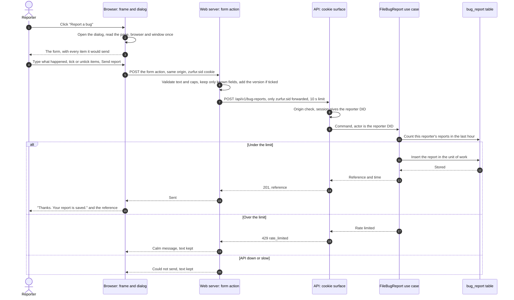
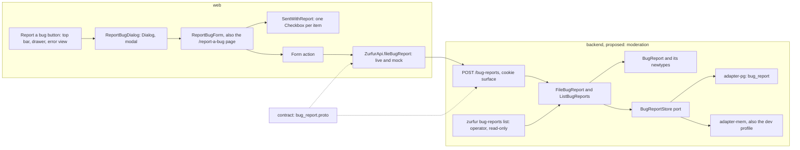

# Bug reports in the UI: a proposal

2026-10-09 · Fennec (web lead) · QA: Crow (web QA) · **A proposal, not a build:** no code is written, and nothing is built until you say yes to question 1. The Orchestrator reviews this page, then takes it to the Engineer. Revised after Crow's QA; the challenges and resolutions are at the end.

The Engineer's request: "I need a way to report bugs. Preferably using the UI so that it becomes normalized. Maybe a button that opens a form modal?"

## In one screen

- **The button.** "Report a bug" sits in the frame's top bar on every signed-in page. On a phone it sits in the drawer, under "Accounts". The frame's error view gets "Report this problem", which opens the same form. Signed out, there is no button in 0.1 (question 3). If sign-in itself breaks, you tell the Orchestrator, as today.
- **The form.** A dialog titled "Report a bug": one text box, "What happened?", then a list titled "Sent with your report". The list shows every item the report would carry, written out exactly: the page address, the page type, Zurfur's version, the browser and the window size, plus three display settings that start unticked. Untick any item and it isn't sent. A fixed line says who it's sent as and what is never sent. "Send report" saves it and shows a short reference. Without the page's script, the button is a link to the same form on its own page.
- **Where it goes (recommended).** Zurfur's own API stores it in a private table. You read it with an operator command, `zurfur bug-reports list`.
  - **The Orchestrator reads it the same way,** and what it reads goes to its model provider, just as your chat with it does today. Nothing else leaves your machine. A report's text is data to an agent, never instructions.
  - **Rejected for now:** GitHub issues (the repository is public, so every report and who sent it would be published); email (no mailer exists); and a `mailto:` link (it leaves Zurfur through your mail client, and the Orchestrator can't read it).
- **Separate from content reports.** A bug report is about the software and has no legal clock. A report about a person or an item is moderation's, with legal duties, and its shape is still open (moderation's parked questions). **The bug form is not moderation's "report path"**, so it doesn't satisfy that item of moderation's floor (D-26).
- **What a report never carries:** cookies, sign-in tokens, page tokens, error messages, what's on screen, or anything about other people. The reporter comes from the session, never from the form. Every text field refuses control and bidirectional characters, and the operator command prints each report fenced and escaped.
- **Fit.** Seven packages, 10 units, all off the critical path, built by people the plan leaves idle and reviewed by a second security reviewer, so Heron's queue doesn't grow. **Recommendation: 0.1, as a side feature,** landing on `main` after the identity branch. If it isn't there by unit 9, before My Den's planned restack, it waits until My Den reaches `main`, and then it is 0.2's. Taking it changes the PDD in several places (section 5), which Kestrel would make before you sign.
- **Two answers wait for you before anything is built:** question 1, a scope change, and question 5, the stored table's shape, a one-way door. The other four carry Claude's answers.

---

## 1. The UI

<b>Where the button lives</b>

| Where | What you see | Notes |
| --- | --- | --- |
| Desktop top bar, every signed-in page | A quiet Button: a bug icon and the words "Report a bug", between the section links and your avatar | In tab order after "Accounts", before "Sign out" |
| Phone (48rem and narrower), with the drawer | "Report a bug" in the drawer's footer, under "Accounts", above your avatar and "Sign out" | Choosing it closes the drawer first, then opens the form. Two modals never stack, and focus returns to ☰ |
| Phone, no drawer (where My Den isn't served yet) | An IconButton in the top bar, its accessible name "Report a bug" | Goes away once My Den is on every stack, when every phone has the drawer |
| The error view inside the frame | "Report this problem", beside "Back to My Den" where My Den is served, or beside "Back to the start" where it isn't | Opens the same form, with one extra item: the status code. Never the error's message, which the error view never has |
| The root error page, outside the frame (a signed-in visit to an unknown address) | Nothing | It sits outside the frame, so it has no top bar |
| Signed-out pages (`/`, `/login`) | Nothing in 0.1 | Question 3 |

**Not added:** a keyboard shortcut. A shortcut acts without a visible control, and the tree already uses letter keys to jump to names.

<b>The form, and what it attaches</b>

Dialog title: **Report a bug.** Buttons: **Send report** (primary) and **Cancel** (quiet).

1. **"What happened?"** A multi-line text box, required, 1 to 4,000 characters after trimming. A character here is a Unicode code point, counted the same way by the web, the domain and the database. Hint: "What did you do, what did you expect, and what happened instead?" A count appears only near the limit, in the muted colour, never red.
2. **"Sent with your report."** One tick box per item. The item's name is the label, and its exact value shows beneath it in the monospace font, wrapping. Unticking one greys the value and says "Not sent", and its column is stored empty.

   | Item | Starts | Example value | Where it comes from |
   | --- | --- | --- | --- |
   | Page | Ticked | `/den/commissions/0192f0c4-…/slots` | The address when the form opened, without its query or fragment. "Show archived" on adds `(showing archived)`; a page token is never kept. A note under it: "This address can contain the ids of your Accounts, characters and commissions." (question 4) |
   | Page type | Ticked | "My Den", "Accounts", "An Account", "Error page" | The route, in words. Lets a report stay useful with the address unticked |
   | Zurfur version | Ticked | `9a01808 (local changes)`, or "unknown" | `ZURFUR_BUILD_ID`, set by the Justfile when the stack starts, read by the web server at run time |
   | Browser | Ticked | The browser's user-agent text | `navigator.userAgent`. On the page without script, the request's `User-Agent` header. Text over 512 bytes is cut, and shown as cut |
   | Window size | Ticked | `390 × 844` | In CSS pixels, read when the form opens |
   | Display settings | **Unticked** | `reduce motion on · more contrast off · forced colours off` | Read when the form opens. A note: "Helps with display bugs. These settings can say something about your needs." (question 5) |
   | Error (the error view only) | Ticked | "Status 500 on this page" | The status code only |

3. **A fixed line, not a tick box:** "Sent as @zuri.bsky.social. Zurfur also records when it arrives." (the DID when the handle didn't resolve). Then: "Never sent: your cookies, sign-in tokens, other pages you visited, or what's on your screen."
4. **On test stacks only,** an info line. The dev profile: "This test stack forgets reports when it stops." Mock mode: "Mock mode doesn't keep reports." Explicit, never sneaky.

**What it does:**
- **Captured when the form opens.** The page and settings are read once, so moving around the app doesn't change them.
- **The draft.** It lives in the frame's memory, outside the dialog, because today's Dialog drops its content when it closes. So Escape, Cancel or a stray click on the backdrop costs nothing, and there's no "discard?" prompt. It is never kept in browser storage, and it clears when you send, sign out or reload the page.
- **Sending.** "Send report" shows "Sending…" and the form is marked busy. The web gives the API 10 seconds (the timeout in the Orchestrator's note on loading states).
- **Sent.** The form is replaced by "Thanks. Your report is saved." and the reference: the last 8 characters of the stored id (`Reference: …3e7a91c2`), which the operator command finds. Focus moves to the message, and a polite announcement says "Report sent."
- **Refused:**
  - Empty or only spaces: "Tell us what happened." on the field, which takes focus.
  - Too many reports: "You've sent several reports in the last hour. Please try again a little later." Your text stays.
  - The API failed or timed out: "Couldn't send your report. Your text is still here; please try again." This is an InlineMessage with the error tone, the one place the design language allows the danger colour (system errors).
  - Session expired: the sign-in gate sends you to `/login`, as on every signed-in page, and the draft is lost.

<b>Keyboard, focus and screen readers</b>

The W3C's dialog pattern (WAI-ARIA Authoring Practices, "Dialog (Modal)", read 2026-10-09) sets the rules quoted here.
- **Opening.** Enter or Space on the button opens the form with `showModal()`, which makes the rest of the page inert (the frame's Dialog already uses it). Focus moves to "What happened?", following "Generally, focus is initially set on the first focusable element". Today's Dialog focuses its close button, so it gains an initial-focus option.
- **Tab order.** ✕ (in the header), the text box, each tick box, "Send report", "Cancel". Shift+Tab from the text box reaches ✕.
- **Closing.** Escape closes it ("Escape: Closes the dialog."), and so do ✕, Cancel and a click on the backdrop. Focus returns to the button that opened it ("focus returns to the element that invoked the dialog"); the Dialog already does this. From the phone drawer, focus returns to ☰, since the drawer closed first.
- **Names.** The dialog is labelled by its visible title through `aria-labelledby`; today's Dialog uses `aria-label`, so it gains that option. The tick boxes sit in a `fieldset` whose legend is "Sent with your report", and each box's description is its value. A field error is tied to its field (`aria-describedby`, `aria-invalid`), and focus goes to the first one.
- **Never colour alone.** "Not sent" is a word, not just grey.

<b>Phone width, motion, contrast, and no script</b>

- **320 px up to 48rem:** the dialog fills the screen. Title and ✕ at the top; the form scrolls; "Send report" stays visible at the bottom. Long values (a user-agent text) wrap anywhere, so nothing scrolls sideways. The text box shows at least 6 rows.
- **The text box's font is at least 16 px,** because iOS Safari zooms into smaller fields on focus [unverified; check on a device in Crow's 320 px run].
- **Reduced motion:** no animation. **More contrast** and **forced colours:** the existing token rules keep borders, the tick boxes and the focus ring visible.
- **Without the page's script:** the button is a link to `/report-a-bug`, a page inside the frame with the same form, posting to the same form action. With the script, a click opens the dialog instead, and opening the link in a new tab still works. On that page the server fills the Page item from the `Referer` header, only when it names Zurfur's own origin, with its query dropped. It is shown and removable like every other item. When the browser sent no `Referer`, an optional "Which page?" field takes its place. The window size and display settings are missing there, since only the script can read them.

<b>Components: three are new</b>

- **Already built:** Button, IconButton, Dialog (modal), Icon.
- **New core components** (the design language names them; the app has none of them yet): **TextInput** with a multi-line variant (today's forms use plain inputs), **Checkbox**, and **InlineMessage** (info, error).
- **Two Dialog changes:** a choice of initial focus and of `aria-labelledby`, and a full-screen variant below 48rem.
- **New compositions:** ReportBugButton, ReportBugDialog, ReportBugForm (shared with the `/report-a-bug` page) and SentWithReport (the tick-box list), built only from core components and tokens.
- **For the Claude Design brief:** TextInput's multi-line variant, Checkbox, InlineMessage, Dialog's full-screen variant, and Lucide's `bug` icon (ISC, the set the app already copies from; checked on lucide.dev, 2026-10-09).

## 2. Where reports go

<b>Four options, and a fifth considered</b>

| | (A) Stored by Zurfur's API **(recommended)** | (B) GitHub issues, opened by the server | (C) Email, sent by the server | (D) A `mailto:` link |
| --- | --- | --- | --- | --- |
| **What** | A private `bug_report` table, read with an operator command | The server opens an issue per report | The server mails each report to you | The button opens your mail client with the text filled in |
| **Where it goes** | Your database. The Orchestrator's reads go to its model provider, as your chat does | GitHub. `ZurNetwork/ZurFur` is **public** (`gh repo view`, 2026-10-09), so every report would be published: the page address with its ids, the browser, and who sent it | A mailbox, unencrypted at rest | Your mail client, then a mailbox |
| **New infrastructure** | A table, a route, a command | A GitHub token on the server (a new secret), calls to a third party, and a private repository to avoid the leak | A mailer and its credentials ("No mailer exists today", moderation's study) | None |
| **Fits the rules** | One store, no dual write; the web's only outside request stays your avatar (success criterion 5) | Storing and forwarding is a dual write (an outbox step). It is a ticket tracker, which you stopped using on 2026-09-19 | Fine as a later notice, not as the record | Not a form in the app, so nothing is captured or shown first. It is the cheapest form of what Inventory Closures sketched for moderation's report button ("mailto/inbox") |
| **For the Orchestrator** | `zurfur bug-reports list` (or `just bug-reports`) | `gh issue list` | Can't read your mailbox | Can't read your mailbox |
| **Cost** | 10 units (section 5) | About the same, plus the token, the private repository and a review of the egress | The same plus a mailer | Under 1 unit |

**Considered and rejected: Sentry's user-feedback widget.** Project MVP plans Sentry for errors in the alpha. But the widget is a browser request to another host, which breaks "Nothing leaks" (success criterion 5). It also sends the text to a third party.

**Recommendation: (A).** The report stays in your database. The Orchestrator has a command it can poll, which is the same exposure as you telling it the bug in chat. (B) or (C) can be added later as an outbox consumer behind a port, each with its own security review. Whatever forwards a report must drop the page address, or ask the reporter about that destination.

**Who reads reports once others can send them** (agents, or only you) is parked for the slice where others can report. In 0.1 every report is yours.

<b>The pieces for (A), and who owns each</b>

| Piece | What | Owner |
| --- | --- | --- |
| Contract | `contract/zurfur/api/v1/bug_report.proto`. A `BugReportService` with one `rpc FileBugReport`, `HttpRule` `post: "/api/v1/bug-reports"`, `body: "*"`, as the existing routes write it. `FileBugReportRequest` carries `description`, then optional `page`, `page_kind`, `web_version`, `browser`, `window` (width, height), `display` (three booleans) and `error_status`. **It has no reporter field: the reporter comes from the session.** `FileBugReportResponse` carries `reference` and `received_at` (the wire timestamp). The change is additive (a new file and service), so there's no `buf breaking` event and no baseline reset. The router-vs-descriptor test gains the route | Backend team, with web |
| Domain | A `BugReport` element (`domain/src/elements/bug_report.rs`). Newtypes `BugDescription`, `PageAddress`, `BuildId` and `BrowserText`, each `TryFrom<String>` with `Display` (the std-trait-first ruling), built on the existing text rules: trimmed, non-empty, `max_chars`, and `no_control_except` (newline and tab, the description only). They also refuse the bidirectional controls (U+202A to U+202E, U+2066 to U+2069), which are format characters that `char::is_control` lets through | Backend team |
| Application | `FileBugReport` (a command; the actor is the session's DID): count the reporter's reports in the last hour, refuse over the limit, then insert in the compile-enforced unit of work, as the handle change counts, then writes. `ListBugReports` (a query, for the operator) | Backend team |
| Port and adapters | A `BugReportStore` port. adapter-pg: the `bug_report` table (`just migrate-add create_bug_report`, SQL in `queries/`). adapter-mem: the same in memory, wired into the dev profile | Backend team |
| API route | `POST /bug-reports` in the cookie surface, so it sits under the first-party `Origin` check and `no-store`. `CallingUser` supplies the DID, and the handler returns the generated type. Answers: `201`; `422 invalid_request` for a cap; `429 rate_limited` (the existing problem). It logs the route template and status only | Backend team |
| Operator command | `zurfur bug-reports list [--since <time>]`, in-process like `migrate`, read-only. It prints each report between fixed delimiter lines, indents its text, and escapes every control and bidirectional character, C1 controls such as U+009B included. A `just bug-reports` recipe wraps it for the Orchestrator | Backend team |
| Version | `ZURFUR_BUILD_ID` in the API's config (figment's `ZURFUR_*`). The API stamps its own version on each row | Backend team; the Justfile recipe, web |
| Web | The button in three places, the dialog, the `/report-a-bug` page and its form action, `ZurfurApi.fileBugReport` with its live and mock Layers, the three new core components and the Dialog changes, the tests | Web (Finch) |
| Corpus | Offer you a decision page (the entity, the table, the route, the operator read), then a design-sync, as the Definition of Done asks | Fennec, with the backend lead |

**Which backend team** is the tech lead's call. Proposed: **moderation.** It has no 0.1 work, and its QA, Lapwing, knows the report questions. If you later take the stored shape for moderation's report button (its question 4, still open), this is tested plumbing to copy; that's a bonus, not the reason. Plugin or Vulpes programmers, whom the plan offers to lend, would also fit.

<b>The stored row: the one-way door (question 5)</b>

Table `bug_report` (singular, per the naming rule):

| Column | Type | Rule |
| --- | --- | --- |
| `id` | `uuid` | UUIDv7, primary key. The reference is its last 8 characters |
| `reporter_id` | `text` NOT NULL | The reporter's DID, a foreign key to `users (id)`, as `main`'s other user columns are; `users (id, kind)` is kind-checked against `actor_identity`. From the session only |
| `description` | `text` NOT NULL | Trimmed, 1 to 4,000 code points (`CHECK` on `char_length`) |
| `page` | `text` | NULL when unticked; at most 2,048 bytes; starts with `/` |
| `page_kind` | `text` | NULL when unticked; at most 64 bytes |
| `web_version` | `text` | NULL when unticked; at most 64 bytes |
| `browser` | `text` | NULL when unticked; at most 512 bytes |
| `window_width`, `window_height` | `integer` | NULL when unticked; 1 to 100,000 |
| `reduced_motion`, `more_contrast`, `forced_colors` | `boolean` | NULL unless ticked; they start unticked |
| `error_status` | `smallint` | Only from the error view; 400 to 599 |
| `api_version` | `text` NOT NULL | The API's own `ZURFUR_BUILD_ID`, or "unknown" |
| `received_at` | `timestamptz` NOT NULL | The server's clock |

Plus one index, `(reporter_id, received_at)`, for the hourly count. No column points at a Den node, a commission or another person: a report points at a page, as text, not at an entity.

## 3. Diagrams

Both blocks were parsed with mermaid 11.4.1 under jsdom (parse only, not rendered).

**A. Sending a report.**

On step 8, the Origin check: the web server's own fetch carries the web's origin, so axum's check passes every form action. The browser's form post is guarded by SvelteKit's check and `SameSite=Lax` (section 4).

**B. The pieces.** Solid lines are calls; dashed lines are "generated from".

## 4. Security and privacy

<b>What a report may carry, and what it never does</b>

- **Carries:** the reporter's own text and the ticked items in section 1. Every item is shown before sending, exactly as sent.
- **Never carries:**
  - cookies, the session id, sign-in or PDS tokens, or any request header copied wholesale;
  - a page token or any query parameter (the "Show archived" state travels as words);
  - an error's message or stack;
  - the screen's contents: no names or titles of what's open, no screenshot, no DOM;
  - console or network logs, or browser storage (the app keeps none).
- **The server trusts nothing in the form for access.** The reporter is the session's DID; the form has no such field, and the proto has none. The page is informational text: never turned into a link the server follows, never used to read anything, capped and stored as text.
- **Screenshots are left out on purpose.** An image is an upload. The first slice that adds an upload path must sit behind moderation's scan gate (D-26 (a)), and a screenshot can show other people's private names. They come after the scan gate.
- **Display settings start unticked.** The W3C says such preferences are "correlated with characteristics of the user themselves" and "reflect affordances for a range of special needs" (Media Queries Level 5, "Privacy Considerations", read 2026-10-09). With the full user-agent text and the window size, they also help identify a browser. So the reporter opts in to them.

<b>Who sees a report</b>

- **The operator,** through the command, on the machine that holds the database.
- **The Orchestrator,** when it runs the same command. Claude Code sends "all user prompts and model outputs" to the model provider and keeps "session transcripts locally in plaintext under `~/.claude/projects/` for 30 days by default" (Claude Code docs, "Data usage", read 2026-10-09). So what it reads goes to the model provider: the text, the page address with its ids, the browser text and the reporter's DID. In 0.1 that is the same exposure as telling it the bug in chat.
- **Report text is data, never instructions.** The command fences each report so an agent can't mistake its text for anything else. Once others can report, the text becomes a way to aim instructions at an agent that writes code. Who reads reports then is parked (section 2).
- **Nobody else.** No route reads reports, so there's no oracle. The API's only bug-report route is `POST`, and its answer carries only the caller's own reference. Nobody can ask "is this DID on Zurfur?" or "does report X exist?" through it, so the uniform-not-found rule from the Auth Surfaces threat pass (its F1) has nothing to bite on.

<b>DIDs and handles</b>

- **The reporter's DID is stored,** never the handle (handles change; resolve at read, per "Actor Addressing", DID everywhere). The form shows the handle so you know who it's from.
- **The page address can hold the DIDs of your Accounts and characters, and the ids of your commissions.** In 0.1 none of them is public: an Account's DID is kept local, with nothing sent to the public directory (PDD, the Release Board's sign-in row), and every character is Private. The Den shows them to you alone, so the address stays in the private store. If a report ever leaves Zurfur by a forwarder, the address must not go with it (section 2).
- **Free text can name anyone.** That is the reporter's choice. The form doesn't invite it.

<b>Rate limits and sizes</b>

- **Per reporter: 10 reports an hour.** It's counted, then inserted, as the Account handle change counts its rows, then writes. Two reports sent at the same instant can both pass; the handle change has the same gap. For a light throttle, that's acceptable. Over the limit: `429 rate_limited`, the existing problem.
- **Sizes:** the text up to 4,000 code points; the other caps are in the table above. They are enforced in three places: the web's form validator, the domain newtypes and the table's `CHECK`s, all counting code points. The request bodies are already bounded: SvelteKit's node adapter at 512 KiB (`BODY_SIZE_LIMIT`'s default in `@sveltejs/adapter-node`'s `handler.js`, as installed), and axum at 2 MiB (`DEFAULT_LIMIT = 2_097_152` in `axum-core` 0.5.6's `request.rs`, as locked).
- **The PDD's "rate limits (they come with the User Page)"** is the Technical Design Document's parked row "Rate limits on anonymous sign-in". This limit belongs to the one new write, and section 5 lists it among the PDD changes.

<b>The cookie surface and CSRF</b>

- **No new cookie or credential.** The browser posts a form to a SvelteKit form action on the same origin. The action's server-side call reaches axum through `handleFetch`, which forwards `zurfur.sid` and nothing else (`api-proxy.ts`).
- **Production:** SvelteKit's origin check guards the browser's form post, backed by `SameSite=Lax` (Auth Surfaces, decisions 1 and 6). axum's `require_first_party_origin` guards direct calls to the API.
- **axum's check can't see the browser's origin on a form action.** SvelteKit's server `fetch` sets `origin` to the web's own origin when the request has none (`@sveltejs/kit` 2.70.1, `src/runtime/server/fetch.js`, lines 41 to 43, checked), so every form action looks first-party to axum.
- **Development:** SvelteKit's check doesn't run ("CSRF checks only apply in production, not in local development", its type docs; the check sits behind `!__SVELTEKIT_DEV__`). On `just dev`, only `SameSite=Lax` guards a form post.
- **Both gaps predate this feature.** Today's Accounts forms have them too. They go to Heron's list as existing findings; this feature neither adds nor fixes them.
- **No JSON endpoint is added to the web.** Auth Surfaces decision 6 asks a JSON `+server` route for its own `Origin` allowlist; a form action needs none.
- **Headers:** the dialog's responses already get `private, no-store`, `Referrer-Policy: same-origin` and the framing refusal from the existing hooks.

<b>Stored user text (moderation's concern)</b>

- **Who reads it:** the operator and the Orchestrator, as above. No other user ever sees a bug report, so it isn't user-to-user content. It carries no file, so the scan gate doesn't apply.
- **Rendered as text, everywhere.** No `{@html}`, no Markdown rendering, and bidi-isolated in any later web view.
- **The terminal is a target.** Printed raw, a report's text could rewrite the operator's terminal with escape sequences ("Improper Neutralization of Escape, Meta, or Control Sequences", CWE-150, which lists "ANSI injection" and log viewing; read 2026-10-09).
- **Bidirectional controls are a second target.** They are Unicode format characters, which `char::is_control` and today's text rule let through. They can make printed text read differently from what's stored, the "Trojan Source" attack (CVE-2021-42574). My Den's name rule refuses them for that reason.
- **So the defences stack:**
  - every field refuses control and bidirectional characters;
  - the command escapes them anyway, C1 controls such as U+009B included;
  - it fences each report and indents its text, so a newline can't fake the next report's header;
  - named tests use U+009B and U+202E.
- **Misuse as a content report.** In 0.1 nobody else is in the build. Before the alpha, the operator re-files any complaint about a person or an item through moderation's path, once it exists. The bug form then points to it ("Reporting a person or something someone posted? Use Report on that item."). Until then the line is left out, since it would point at nothing. Whether a legal clock can start from a notice sent through the wrong form is a question for counsel [unverified].
- **Retention** is parked to the alpha, with moderation's own rule. In pre-alpha the only reports are yours.

<b>Bug reports and content reports, side by side</b>

| | Bug report (this proposal) | Content report (moderation's) |
| --- | --- | --- |
| About | The software | A person or an item |
| Read by | The operator and, through it, the Orchestrator | Open: moderation's questions 1 and 2 (who moderates, how they sign in) |
| Duties | None | Legal: notice fields, outcome to the reporter, the reporter hidden from the reported person, evidence retention, possible deadlines |
| Points at | A page, as text | A node or an actor |
| Store | `bug_report` | Open: Inventory Closures sketches "mailto/inbox"; the study's question 4 proposes a stored row |
| Shared | The form's look (Dialog, the "Sent with your report" list, the calm copy) | The same, if you take a form |

Keeping them apart means the legal duties never attach to a bug queue, and a bug never waits in a moderation queue.

## 5. Fit

<b>Packages, sizes and order</b>

Sizes as the Delivery Plan counts them: S = 1, M = 2, L = 3. Nothing starts before you answer question 1 yes and the PDD carries it; the backend also waits for question 5.

| Package | Size | Owner (proposed) | Depends on | QA and review |
| --- | --- | --- | --- | --- |
| The contract message | S | Backend team, with web | Questions 1 and 5 | Lapwing |
| The backend: domain, use case, port, both adapters (the dev profile's store included), the route, the limit | M | Backend team | The contract | Lapwing |
| The operator command and `just bug-reports` | S | Backend team | The backend | Lapwing |
| The web: three new core components, two Dialog changes, the button in three places, the dialog, the page with its form action, the port and mock, the tests (keyboard, focus, 320 px, no script) | L | Web (Finch) | Question 1. It builds on the shell's branch until the shell reaches `main` | Crow |
| The corpus: a decision page offered to you, then a design-sync | S | Fennec, with the backend lead | The backend | Crow |
| Security review of the above | S | A second reviewer, not Heron | All of the above | — |
| `feature/bug-reports` to `main`, with its coherence check | S | Fennec; you merge | The review; the identity branch on `main` | CI |

**10 units of work, about 6 elapsed.** From your answers at the sitting where you sign the PDD (unit 0):
- the contract by unit 1;
- the backend and the web by unit 3 (Finch, who has nothing planned before the wiring at unit 8);
- the command and the corpus step by unit 4;
- the review by unit 5;
- on `main` by unit 6, after the identity branch (earliest unit 5).

<b>0.1 or later, and the critical path</b>

**Recommendation: 0.1, as a side feature that can't hold the release.** If it isn't on `main` by unit 9, it waits until My Den reaches `main`, and then it is 0.2's.

*For 0.1:*
- You asked for it now.
- On `main` by unit 6, it's there for the two walks (units 11 and 12) and your acceptance, which is when you'll find bugs.
- It works from day one, which is what "normalized" needs.

*Against:*
- It is a write in a release whose non-goal says "0.1 adds no new way to change anything". D-30 refused a Workflow route on that ground. The difference: a bug report changes nothing in anyone's Den and touches no domain entity.
- It adds to your queue: two explicit answers, four pre-filled ones, one PR set and one restack.

**The critical path doesn't move in the plan's model,** which counts work, not review time. No package on the path depends on it, and nobody on the path builds it: Finch is free until unit 8, and moderation has no 0.1 work. What the model doesn't show, with the answer to each:
1. **Review time.** Heron's units 4 and 5 already hold the reviews of the den module and the dev profile, and the plan rates a pile-up of his reviews as likely (its risk "Security reviews pile up", whose own answer is a second reviewer). So a second reviewer takes this one. If the tech lead has none, it moves to 0.2.
2. **Restacks.** The plan's order to `main` is the shell, identity, then My Den. This branch lands after identity, so it restacks onto `main` once (yours to drive). It edits files that My Den edits too: the cookie surface in `routes/mod.rs`, the router-vs-descriptor test, the generated contract code, `zurfur-api.ts` and its mock, and the top bar, drawer and error view. Landing before My Den's planned restack (units 9 and 10) folds those into a restack the plan already has, at the cost of more conflicts in it. That's why the cut line is unit 9.
3. **The web team's other open work.** The plan puts the dev profile's "sign in as" page inside the dev-profile package (units 3 to 5), built by the web team, with no builder named. Gecko builds it: he is free until the `just dev` walk at unit 11. Finch's units 0 to 3 go to this feature.
4. **Your queue.** Answer questions 1 and 5 at the PDD sitting. The rest can wait for the PR.

**If you include it, the release documents change** (Kestrel's edits, not mine):
- **The PDD:**
  - the summary;
  - the non-goal "Uploads and editing" gains the exception;
  - the non-goal "Deployment" says this form isn't moderation's report path;
  - the rate-limit line says what it covers;
  - a new feature with the user story below;
  - "What each team commits to" gains a web objective and the backend team's first;
  - success criterion 3 names four branches, and criterion 4 adds this review;
  - questions 1 to 6 join "Decisions needed".
- **The Technical Design Document:** a feature section (diagram A, the contract, the table), the table's shape in its one-way-doors list, and the security notes above.
- **The Delivery Plan:** the seven packages, the branch's place in the merge order, the second reviewer in the review gates, and two risks (the restack, review load).

**The user story Kestrel would lift: "Report a bug".** As a signed-in user, I want to report a bug from the page I'm on, so that it's fixed without my having to explain where I was. Its criteria, each mapped to a test:
- On every signed-in page, "Report a bug" opens the form; on a phone it's in the drawer; without script it's a page.
- The form shows every item it would send, exactly as sent. An unticked item is stored empty.
- The request the web sends, and the stored row, hold no cookie, token, page token, query or error message.
- The stored reporter is always the session's DID.
- An 11th report within an hour gets the calm limit message, and the text stays.
- Text that is empty or only spaces is refused with "Tell us what happened."
- U+202E and U+009B are refused in every text field. The command prints each report fenced, with control characters escaped.
- Opening moves focus to the text box; Escape closes and returns focus to the button; at 320 px nothing scrolls sideways.
- The reference shown after sending finds the report in `zurfur bug-reports list`.

## 6. Questions for the Engineer

Questions 2, 3, 4 and 6 carry Claude's answer, and work would proceed on them. **Questions 1 and 5 wait for your explicit answer:** question 1 changes 0.1's scope, which only your signature sets, and question 5 is a one-way door.

**Q1. Does the bug report enter 0.1? (waits for you)**
- (a) 0.1, as a side feature: built in the plan's idle hands, reviewed by a second reviewer, on `main` after the identity branch. If it isn't there by unit 9, it waits for My Den and becomes 0.2's.
- (b) 0.2's first item. In 0.1 you keep telling the Orchestrator about bugs.
- (c) 0.1, as an item that holds the release.

**Claude's answer (2026-10-09; the Engineer adjusts if wrong):** (a). You get it for the walks and acceptance, and it can't delay My Den. The PDD changes listed in section 5 go in before you sign. Nothing is built until you say yes.

**Engineer:**

**Q2. Where do reports go?**
- (a) Stored by Zurfur's API; read with an operator command, by you and by the Orchestrator.
- (b) GitHub issues, opened by the server.
- (c) Email, sent by the server.
- (d) A `mailto:` link.

**Claude's answer (2026-10-09; the Engineer adjusts if wrong):** (a). The repository is public, so (b) would publish every report and who sent it. No mailer exists for (c). (d) captures nothing and the Orchestrator can't read it. What the Orchestrator reads reaches its model provider, the same as your chat with it.

**Engineer:**

**Q3. Who can report, and is the reporter always recorded?**
- (a) Signed-in only. The reporter's DID is recorded, shown in the form, and can't be removed.
- (b) Signed-in only, with an "anonymous" choice.
- (c) Signed out too.

**Claude's answer (2026-10-09; the Engineer adjusts if wrong):** (a). The hourly limit needs a reporter, and so does following up. An anonymous write is a spam channel, and signed out there's nothing to limit it by but an IP address; whether storing one is personal data under the laws that apply is for counsel [unverified]. If sign-in itself breaks, you tell the Orchestrator, as today. Signed-out reporting waits for the alpha, where strangers arrive.

**Engineer:**

**Q4. Is the full page address attached by default?**
- (a) Yes, ticked, shown and removable, with its query and fragment dropped.
- (b) No: only the page type by default; the address is one click to add.

**Claude's answer (2026-10-09; the Engineer adjusts if wrong):** (a). A bug on one folder needs its address. It stays in your database (and in what the Orchestrator reads), and the form says it can hold the ids of your Accounts, characters and commissions. Under (b) most reports would arrive without it.

**Engineer:**

**Q5. Approve the stored row's shape? (one-way door; waits for you)**
The `bug_report` table in section 2, "The stored row":
- the reporter as a foreign key to `users (id)`, from the session;
- the text;
- the ticked items as nullable, capped columns;
- the API's version and the time;
- no reference to any node, commission or other person.

One trade-off to rule on: the three display-setting columns. They help with display bugs, but they can say something about a reporter's needs.
- (a) Keep them, unticked by default in the form.
- (b) Leave them out of the table until a bug needs them.

**Claude's answer (2026-10-09; the Engineer adjusts if wrong):** approve the table as listed, with (a). Display bugs are exactly where reduced motion and forced colours matter, and unticked by default nothing is sent unless the reporter chooses. The backend doesn't start until you approve.

**Engineer:**

**Q6. What does the button say?**
- (a) "Report a bug".
- (b) "Send feedback", which also invites ideas.

**Claude's answer (2026-10-09; the Engineer adjusts if wrong):** (a). It says what it does, as the design language asks ("Buttons say what they do"), and it's the word you used. Ideas mixed into the same queue would bury the bugs; ideas keep their current route, your conversations with the Orchestrator.

**Engineer:**

<b>Choices made inside the proposal (veto any)</b>

- **Names:** the domain element `BugReport` (`domain/src/elements/bug_report.rs`), the table `bug_report`, the contract's `BugReportService`, and "reference" for the id's last 8 characters.
- **A bug report isn't a Den node.** That holds while nobody can read their reports back. A "Your reports" page would make them reachable, and they'd move into the reporter's Den then (parked below).
- **The operator read runs in-process in 0.1,** on the machine with the database, like `migrate`. Your ruling on the command-line tool keeps user commands on HTTP because "every machine running the tool holds database admin power" in-process. So from the alpha, the read goes over HTTP behind an operator's sign-in (parked below).
- Calm copy throughout; no red except a system error.
- No keyboard shortcut.
- The draft kept in the frame's memory, never in browser storage, with no "discard?" prompt.
- 10 reports an hour; 4,000 code points; a 10-second time limit on sending; a browser text over 512 bytes cut, not refused.
- The dialog fills the screen on phones.
- No screenshots until the scan gate exists.
- "Report this problem" on the error view.
- Test stacks say plainly that they forget reports.

<b>Calls for the tech lead, in one ask</b>

1. **Which team builds the backend:** moderation (proposed), or lent Plugin or Vulpes programmers.
2. **A second security reviewer** for this feature, so Heron's units 4 to 5 aren't touched. With none, it's 0.2.
3. **The merge order:** `feature/bug-reports` after the identity branch and before My Den's planned restack, with the restack it costs.
4. **The web team's units 0 to 5:** Finch on this (0 to 3), Gecko on the dev profile's "sign in as" page (3 to 5). Confirm neither collides with your own picks.
5. **Kestrel's edits** to the PDD, the Technical Design Document and the Delivery Plan (section 5), if you say yes to question 1.

<b>Parked, each with the slice that will ask it</b>

- Signed-out reporting, with its anti-abuse: the alpha's invite slice.
- Who reads reports once others can send them (agents too, or only you), and how agents treat their text: the same slice.
- A "Your reports" page, and with it the reports moving into the reporter's Den: when a second reporter exists.
- The operator's read over HTTP behind an operator's sign-in, closing a report and telling the reporter: with moderation's console and moderator sign-in.
- Screenshots: after the scan gate.
- Forwarding to a tracker or a mailbox: when the operator asks for it, with its own security review.
- Retention, and what an account's deletion does to its reports: before the alpha, with moderation's retention rule.
- The pointer to the content report: when that path ships.

<b>Sources checked</b>

**The release documents:** `pdd.typ` (the frame's top bar, the non-goals, "What each team commits to", the Release Board's sign-in row, D-24, D-26, D-30, success criteria 2 to 5 and 7), `tdd.typ` (the parked row "Rate limits on anonymous sign-in"), `plan.typ` (sizes, the critical path, capacity, the merge plan, the risk register), `stages.md`, `objectives/web.md`, `objectives/moderation.md`.

**Studies:** `.understand/20261008-web-explorer-shell.md`; `.understand/20261008-design-language.md` (sections 1, 2, 8, 9 and 10); `.understand/20261008-moderation-study.md` (3.2 "The report button", questions 1, 2 and 4).

**Corpus:**
- The API Contract, Protobuf as the Independent IDL (`decisions/40992770…`): decisions 1, 3, 9, 10 and 12.
- Auth Surfaces, the Plugin Trust Boundary & CSRF (`decisions/24543244…`): decisions 1 and 6, and the threat pass (F1).
- Inventory Closures (`decisions/30343170…`): item 13.
- Identities (`decisions/34013187…`): decision 4, kind-checked actor references.
- Project MVP (`project/589826…`): "Frontend for exactly what the backend supports", "Security-first", "Analytics".

**Code:**
- On `feature/web-explorer-shell-2c-follow-ups` (10733c0): `hooks.server.ts`, `TopBar.svelte`, `AppShell.svelte`, `Sidebar.svelte`, `Dialog.svelte`, `ErrorView.svelte`, `SignOut.svelte`, `session-gate.ts`, `api-proxy.ts`, `error-log.ts`, `frame-headers.ts`, `session-headers.ts`, `zurfur-api.ts`, `create-account.ts`, `accounts/+page.server.ts`, `session.ts`, `icons.ts`, `vite.config.ts`, and the `ui/` folder's contents.
- On `main`: `api/src/lib.rs` and `routes/mod.rs` (the cookie surface and `require_first_party_origin`), `extract.rs` (`CallingUser`), `problem.rs` (`rate_limited`), `application/src/account/change_handle.rs` (count, then write), `domain/src/string_builder/builder.rs` (the text rules), migration `20260907060908_rekey_actors_on_did.sql` (user columns key to `users (id)`), the `cli` crate, and `contract/zurfur/api/v1/account.proto` (route form).
- Installed: `@sveltejs/kit` 2.70.1 (`src/runtime/server/fetch.js` lines 41 to 43; the `csrf` and `version` type docs), `@sveltejs/adapter-node`'s `handler.js` (`BODY_SIZE_LIMIT`, 512K), `axum-core` 0.5.6's `request.rs` (2 MiB).

**Web, read 2026-10-09:**
- [WAI-ARIA APG, Dialog (Modal) pattern](https://www.w3.org/WAI/ARIA/apg/patterns/dialog-modal/).
- [CWE-150](https://cwe.mitre.org/data/definitions/150.html).
- [W3C Media Queries Level 5, Privacy Considerations](https://www.w3.org/TR/mediaqueries-5/#privacy).
- [Claude Code docs, Data usage](https://code.claude.com/docs/en/data-usage).
- [Lucide, `bug`](https://lucide.dev/icons/bug).
- `gh repo view` for `ZurNetwork/ZurFur`: public.
- Python's `unicodedata`: U+202E and U+2066 are format characters (Cf); U+009B is a control character (Cc).

## QA challenges

**Crow (web QA), 2026-10-09. Verdict: not ready for the Engineer until the 3 must-fixes close. 3 must-fix, 9 should-fix, 7 notes.** The must-fixes: "nothing leaves Zurfur" is untrue once the Orchestrator reads the reports; the stored row you're asked to approve breaks the Identities decision's rule for actor references; and the web would start building a scope change before you've said yes to it.

Checked against: `pdd.typ` (v3), `plan.typ` (v2), `tdd.typ`, `stages.md`, `objectives/web.md` and `objectives/moderation.md`; the design-language, Explorer-shell and moderation studies; the corpus (the API Contract, Auth Surfaces & CSRF, Inventory Closures, Identities, The Den, User-Profiles, My Den rulings, Project MVP); the shell at `10733c0597ef`; `main`'s API, application, adapter-pg migrations, `cli` and `contract/`; installed `@sveltejs/kit` 2.70.1, `@sveltejs/adapter-node` 5.5.7 and `axum-core` 0.5.6; project memory (CLI over HTTP, the release process, pre-filled answers, ask at the slice, moderation rulings); and, read 2026-10-09, Claude Code's "Data usage" page, W3C Media Queries Level 5, the WAI-ARIA dialog pattern, CWE-150, trojansource.codes and RFC 9562.

| # | Severity | Where | Finding | Source (checked) | Suggested change |
| --- | --- | --- | --- | --- | --- |
| 1 | must-fix | "In one screen", "Where it goes"; section 2, "Three options", row "Leaves Zurfur?"; section 4, "DIDs and handles"; questions 2 and 4 | **"Nothing leaves Zurfur" isn't true of the design as proposed, because its named reader is the Orchestrator.** When the Orchestrator runs `just bug-reports`, the output enters its conversation. Claude Code sends that conversation to the model provider and keeps it on disk as a plaintext transcript for 30 days. So every report it reads goes to a third party: your text, the page address with its Account and commission ids, the browser text and your DID. That is the reason given for rejecting Sentry's widget, and what section 4 says must never happen to the address. The stored text is also a way to inject instructions into an agent that writes code. That's harmless while you are the only reporter, and real once anyone else can report. | Claude Code docs, "Data usage" (code.claude.com/docs/en/data-usage): "Claude Code sends data over the network. This data includes all user prompts and model outputs"; "session transcripts locally in plaintext under `~/.claude/projects/` for 30 days". The proposal's own Sentry paragraph, and "If a report ever leaves Zurfur, the address must not go with it" | Reword it: "Nothing leaves your machine, except what the Orchestrator reads, which reaches its model provider." Option (A) can stay, since in 0.1 every report is yours. Add a parked row for the slice where others can report: who reads reports (only you, or agents too), and the rule that a report's text is data, never instructions. Have the command print each report between clear delimiters. |
| 2 | must-fix | Section 2, "The stored row: the one-way door (question 5)", row `reporter_did`; question 5 | **The one-way door you're asked to approve breaks the Identities decision.** `reporter_did` is a foreign key to `actor_identity(did)` alone, so it accepts any kind of actor: an Account's or a Character's DID would pass. The Identities decision requires every actor reference to be kind-checked, with a composite key on `(did, kind)` and a check per column. On `main`, the user columns that carry a foreign key point at `users (id)`, which is itself kind-checked against `actor_identity`. The proposal cites the same decision's ban on polymorphic pairs but misses this rule. | Corpus `decisions/34013187-identities-…md`, decision 4, "Actor references are kind-checked plain FKs", and its 2026-08-30 amendment. Migration `20260907060908_rekey_actors_on_did.sql`: `commission_participant_user_id_fkey` (line 169) points at `users (id)`, and `users (id, kind)` points at `actor_identity (did, kind)`. `20260714220545_add_actor_identity_did.sql`: `did` is UNIQUE, so PostgreSQL would accept the proposed key without complaint | Make the reporter a foreign key to `users (id)`, as `main` does for its user columns, or use a `(did, kind)` pair with the kind fixed to `user`. Then show question 5 with the corrected row. |
| 3 | must-fix | "In one screen", "One-way door"; section 6, opening line; question 5, Claude's answer ("the web builds on the mock meanwhile") | **The web build would start on Claude's answer to a scope change.** Question 1 asks whether a feature that 0.1's non-goals exclude enters 0.1. Yet the page says work proceeds on every answer except question 5, and that "the web starts on the mock at once". Your release rule says pre-filled answers let work proceed inside a signed scope, and they don't replace the signature. The Delivery Plan holds 0.1's packages until you sign the PDD, which is still in review. You asked the web team for a proposal, not a build. | Memory "Releases: PDD + TDD + Delivery Plan" (ruling 2026-10-08: "The build waits for the signature … They don't replace the signature"); `plan.typ`, "What starts now, and what waits for you" ("The tech lead holds these until sign-off"); `pdd.typ` header (status "In review"); your request, quoted at the top of this page | Make question 1 wait for your explicit answer, as question 5 does. Say that nothing is built until you answer it and the PDD carries the change. Change "the web starts on the mock at once" to "the web starts on the mock once you answer question 1 yes". |
| 4 | should-fix | Section 4, "The cookie surface and CSRF", third bullet | **"On `just dev`, SameSite and axum's guard carry it" is half wrong: axum's guard never sees the browser's `Origin` on a form action.** The form action calls the API from the web server. SvelteKit's server `fetch` adds the web's own origin as `origin` when the request has none, `rewriteApiRequest` keeps the headers, and `require_first_party_origin` lets a matching or missing `Origin` through. So a forged form post that reaches the action looks first-party to axum. In development, where SvelteKit's own check is off, only `SameSite=Lax` stands. Any other app on `127.0.0.1` counts as the same site whatever its port [unverified]. Today's Accounts forms already have this gap, and the bug form inherits it. | `@sveltejs/kit` 2.70.1: `src/runtime/server/fetch.js` lines 41–43 (`request.headers.set('origin', event.url.origin)`) and `src/runtime/server/respond.js` (the check runs only `if (!__SVELTEKIT_DEV__)`); `lib/server/api-proxy.ts`, `rewriteApiRequest`; `main:backend/crates/api/src/routes/mod.rs` ("A missing `Origin` or a safe method passes"); `api/src/main.rs` lines 40–44 (`SameSite::Lax`) | Correct the bullet. In production, SvelteKit's check guards the form post, and axum's guard covers direct calls to the API. In development, only `SameSite=Lax` does. List it for Heron as a gap that predates this feature, not one it fixes. |
| 5 | should-fix | "In one screen", "Separate from content reports"; section 2, "Three options" and "Which backend team"; section 4, "Bug reports and content reports, side by side"; section 5, "For 0.1", third bullet; question 2 | **The content-report side rests on questions you haven't answered, and question 2 leaves out the corpus's own shape.** Inventory Closures rules that the MVP's report button routes "to the founder (mailto/inbox — no queue, no tooling)". Moderation's study proposes a stored row instead, but that is its question 4, parked until the report-button slice. Who moderates and how moderators sign in are its questions 1 and 2, also parked. So "tested plumbing for moderation's path", "Read by: moderators, behind their own sign-in" and "Store: its own table" present open questions as settled. Also, a `mailto:` link needs no mailer, so "no mailer exists yet" doesn't rule out the cheapest form of option (C). | Corpus `decisions/30343170-inventory-closures-…md`, item 13; `.understand/20261008-moderation-study.md`, 3.2 "The report button" and section 9, questions 1, 2 and 4 ("Asked when: The report button"); `objectives/moderation.md` ("None of the study's 20 questions is asked in 0.1") | Add option (D), a `mailto:` link, to question 2, with the reasons against it: it leaves Zurfur through your mail client, it isn't a form in the app, and the Orchestrator can't read it. Mark the content-report column "open (moderation's questions 1, 2 and 4)". Drop the plumbing-reuse argument from question 1 and from the team proposal, or mark it conditional. |
| 6 | should-fix | Section 4, "DIDs and handles", second bullet | **"Whose DIDs are public anyway" is wrong for 0.1.** Founding an Account mints its DID, which 0.1 keeps local: nothing is sent to the public directory. The Den's amendment to the User-Profiles decision puts the `accounts` mounts in your own Den only, and leaves open how that fits the public profile. The address can also hold a character's DID (`/den/characters/<did>`), and every character in 0.1 is Private. | `pdd.typ`, "What 0.1 delivers on the Release Board", row "Login / logout, and DID operations" ("kept local; nothing is sent to the public directory"); corpus `decisions/21594113-user-profiles-…md`, the amendment of 2026-09-30; `den-mock.ts` (characters keyed by DID); `pdd.typ`, the Vulpes row of "Teams with no 0.1 build work" ("every fixture character is Private") | Write instead: "The address can hold the DIDs of your Accounts and characters and the ids of your commissions. The Den shows them to you alone, so the address stays in the private store." Drop "public anyway". |
| 7 | should-fix | Section 1, "The form, and what it attaches", rows "Screen" and "Browser"; section 2, "The stored row"; question 5 | **Three stored columns can say something about the reporter's needs, and the page doesn't tell you.** Reduce motion, more contrast and forced colours are ticked by default and stored in the table you're asked to fix. The W3C says such preferences "are correlated with characteristics of the user themselves" and "reflect affordances for a range of special needs". Together with the full user-agent text and the window size, they also identify a browser. In 0.1 they describe only you, so the cost arrives with the first reporter who isn't you, after the table's shape is fixed. | W3C Media Queries Level 5, "Privacy Considerations" (read 2026-10-09); the proposal's Screen and Browser rows | Name the trade-off in question 5, pre-answered. Either keep the columns, with the three settings unticked by default from the alpha on, or leave them out of the table until a bug needs them. |
| 8 | should-fix | Section 2, "The pieces for (A)" and "The stored row"; "Choices made inside the proposal"; "Parked", the row "A 'Your reports' page" | **The proposal makes three domain calls that are neither questions nor in the veto list.** (a) A bug report isn't a Den node. The Den's first objective reads: "One tree. Everything a viewer can reach is a node". That holds while you can't read your reports back. The parked "Your reports" page would make them reachable, and they become a Den question then. (b) The names: `BugReport`, `bug_report`, `BugReportService`, the "reference", and which domain package holds them (none is named). (c) Reading reports is called an operator command, so it runs in-process. The ruling on the command-line tool keeps `migrate` and maintenance in-process, and its reason is that "every machine running the tool holds database admin power". At the alpha, the Orchestrator's machine would need the production database. Moderation's study has reports read in a moderator console over HTTP instead. | Corpus `decisions/2026093001-the-den-…md`, objective 1; memory "CLI over HTTP" (ruling 2026-10-08, its "Why"); moderation study, section 7, the row "Moderator console"; `main:backend/crates/domain/src/elements/` (no home named) | Add (a) to the parked row: "…and the reports then live in your Den". Put (b) and (c) in the veto list, one line each, with Claude's answer. |
| 9 | should-fix | Section 5, "If you include it, the PDD changes in three places"; section 4, "Rate limits and sizes", last bullet; "Calls for the tech lead", item 3 | **Including it changes more than three places, and nothing records it in the corpus.** (a) The PDD: success criterion 3 names three branches, and criterion 4 lists the security reviews. Criterion 2 maps every acceptance criterion to a test, but the bug report has no user story and no criteria. "What each team commits to" gives moderation "None" and lists the web's five objectives. (b) Section 4 says section 5 lists the rate-limits non-goal with the scope change; section 5 doesn't. The TDD glosses that non-goal as "Rate limits on anonymous sign-in", not as reads. (c) The TDD: the one-way-doors table, which the tech lead confirmed as complete, and a feature section. (d) The Delivery Plan: the merge order, the list of security-review gates, and the risk register. (e) The corpus: under the Definition of Done ("Design in sync"), a new entity, a private table and a route are design, and no package records them. | `pdd.typ`, "Success criteria" (criteria 2 to 4), "What each team commits to", "Non-goals"; `tdd.typ`, "One-way doors in 0.1" and "Parked: not in 0.1" (row "Rate limits on anonymous sign-in"); `plan.typ`, "Merge plan" and "Review gates"; CLAUDE.md, "Definition of Done" | List every change for Kestrel. Add a user story with checkable criteria. Add packages for the corpus step (offer you a decision page, then a design-sync) and for the merge to `main`. |
| 10 | should-fix | Section 1, "Components, by the design language's names"; section 5, "Packages, sizes and order" (the web package is M; the total is 7 units) | **The web package builds on components that don't exist yet.** At the shell commit, `ui/` has no TextInput, Checkbox or InlineMessage. Today's forms use plain `<input>`, and Dialog has no initial-focus option and no full-screen variant. So besides its own work, the web package builds three core components and two Dialog changes. Its own work: the button in three places, the dialog, the `/report-a-bug` page with its form action and `Referer` handling, the live and mock port, and the keyboard, 320 px and no-script tests. M looks low. The merge to `main` (S, like the shell's) and the corpus step aren't counted. | `git ls-tree 10733c0597ef frontend/web/src/lib/components/ui/`; `(session)/accounts/+page.svelte` (plain inputs); `Dialog.svelte` ("Opening it focuses its close button"); `plan.typ`, the shell's merge to `main` (size S) | Say which components are new. Re-size the web package with the tech lead (L is likelier), and add the merge and corpus packages: about 9 to 10 units, not 7. |
| 11 | should-fix | Section 5, "0.1 or later, and the critical path" and "Three indirect costs"; "Calls for the tech lead" | **Three plan claims need the tech lead, and two don't hold as written.** (a) "The critical path doesn't move" holds only because the plan's model leaves out review time. Heron's slot at units 4 to 5 coincides with the reviews of the den module (critical, no slack, finishing at 5) and of the dev profile, and the plan rates a pile-up of Heron's reviews as likely. Lapwing reviews the inputs of Atta's host check in units 0 to 3. The web team also owes the dev profile's "sign in as" page in units 3 to 5, with no builder named. (b) "One restack" understates it. The plan's order to `main` is the shell, then identity, then My Den (the tech lead's call). A fourth branch reaching `main` at unit 6 lands next to the identity branch (earliest at unit 5, with 5 units of slack), and whichever goes second restacks. It edits `zurfur-api.ts` and its mock, which are already among the ten files the identity restack carries. It also edits files that My Den edits: the cookie surface in `routes/mod.rs`, the test that matches routes to the contract, the generated contract code, and the top bar, drawer and error view. And the dev profile must wire in an in-memory bug-report store. (c) The web package depends on "the shell on `main`", which waits on your merges (latest harmless: unit 8), so "at once" and "by 3" can't both hold. | `plan.typ`: "How it was computed" ("Review time isn't modelled", and the capacity paragraph), the dev-profile row of the work breakdown, the risk register (Heron's reviews piling up, likelihood H), "Merge plan", and "What blocks the start", row 6; `objectives/moderation.md`, objective 1 (Lapwing) | Send the tech lead one ask covering: where the branch sits in the merge order, who restacks what, Heron's slot (or a second reviewer), and whether the web team's units 3 to 5 are free. Restate the timeline from the shell's merge. |
| 12 | should-fix | Section 2, "The pieces for (A)", row "Domain"; section 4, "Stored user text", third bullet | **The terminal defense misses two things.** (a) "Control characters" here means Unicode category Cc (`char::is_control`, which the existing text rule uses). The bidirectional controls, such as U+202E and U+2066, are category Cf, so they pass into the stored text and the printed output, where they can make the text read differently from what's stored (the "Trojan Source" attack). The My Den name rule refuses Cc and Cf for this reason. (b) Newlines are allowed, so a report's text can print lines that look like the next report's header. | Rust `core`, `char::is_control` ("the general category of `Cc`"); `main:backend/crates/domain/src/string_builder/builder.rs` (`no_control_except`); Python `unicodedata`, run 2026-10-09 (U+202E and U+2066 are Cf; U+009B is Cc); trojansource.codes (CVE-2021-42574); corpus My Den rulings, decision 19 | Refuse or escape the bidirectional controls in every text field, keeping the two zero-width joiners if you allow them in names (the PDD's question on those joiners). Print each report between clear delimiters, with its text indented. Name a test that uses U+009B (an 8-bit escape introducer) and U+202E. |
| 13 | note | Section 4, "Rate limits and sizes", first bullet; section 2, row "Application" | The handle change doesn't count "in the same unit of work as the insert". It counts through the ports first and opens the unit of work afterwards. The race the bullet admits holds either way. | `main:backend/crates/application/src/account/change_handle.rs` (the count at line 66, `uow.open()` at line 79) | "Counted, then inserted, as the handle change does." |
| 14 | note | Section 4, "Bug reports and content reports, side by side", last sentence | "One table with a 'kind' column would also need a polymorphic target, which the Identities decision bans" overstates it. The same decision gives closed unions that aren't actors an exclusive arc: one nullable key per target, with exactly one set. The case for two tables stands on the legal duties alone. | Corpus Identities decision, decision 7 | Drop that sentence. |
| 15 | note | Section 2, "The pieces for (A)", row "Contract"; section 1, "What it does", "Sent." | (a) The contract's routes carry the full path, as in `post: "/api/v1/accounts"` with `body: "*"`; the proposal writes `post: "/bug-reports"`. (b) A UUIDv7 starts with 48 bits of millisecond time (`01a1…` in October 2026). So a reference shortened to its first and last four characters shows mostly time and about 16 random bits, and the example `4f9c…` can't occur. | `main:contract/zurfur/api/v1/account.proto` line 126; the API Contract decision, decision 9; RFC 9562, section 5.7 ("the most significant 48 bits") | Write `post: "/api/v1/bug-reports"` and `body: "*"`. Show the last 8 characters of the id, or the whole id. |
| 16 | note | Question 3, Claude's answer | (a) "An IP address, which is personal data" is a legal claim with no source. (b) "A sign-in bug is reported after signing in" fails when sign-in itself breaks, the likeliest 0.1 bug: the plan rates "real Bluesky sign-in fails on the local stack" as high impact, and a signed-out user has no button. | The proposal's question 3; `plan.typ`, the risk register (that row's impact is H) | Mark (a) [unverified], for counsel. Add to the answer: "If sign-in breaks, tell the Orchestrator, as today." |
| 17 | note | Section 1, "Where the button lives" (the error-view row) and "What it does" (the draft) | (a) Where My Den isn't served (on `just dev`, until My Den reaches every stack), the error view's way back is "Back to the start", not "Back to My Den". A signed-in visit to an unknown address gets the root error page, outside the frame, so no button shows there. (b) Today's Dialog closes on a backdrop click and drops its content while closed, so the draft must live outside it. The frame's memory does that. Say so, since otherwise a stray click costs the text. (c) The Dialog is named by `aria-label`, not by its visible title. | `ErrorView.svelte`; `(session)/+error.svelte` (`inFrame={page.data.denServed === true}`); `routes/+error.svelte`; `Dialog.svelte` (`backdropClick`, `{#if open}`, `aria-label={label}`) | Word the error-view row for both cases. Add the backdrop click to "What it does". Label the dialog by its title (`aria-labelledby`). |
| 18 | note | Section 1, item 1 ("1 to 4,000 characters"); section 2, "The stored row"; section 4, "Rate limits and sizes" ("enforced three times") | The three checks count differently. JavaScript's `length` counts UTF-16 units, while the domain's `max_chars` counts Rust `char`s and PostgreSQL's `char_length` counts characters, so an emoji counts as 2 in the first and 1 in the other two. Text made only of spaces passes "1 to 4,000" unless it's trimmed. A user-agent text over 512 bytes would refuse the whole report. | `main:backend/crates/domain/src/string_builder/builder.rs` (`max_chars`; `non_empty_from` trims); the proposal's caps | Define "character" as a Unicode code point in all three places, and reuse the existing trimmed, non-empty text rule. Have the web cut the browser text to its cap, shown as cut, instead of refusing the report. |
| 19 | note | Checked, and holds | `ZurNetwork/ZurFur` is public. `require_first_party_origin` and `no-store` wrap the whole cookie surface. `CallingUser` takes the DID from the session only. `invalid_request` (422) and `rate_limited` (429) exist. The text rule's errors carry no input (`Empty`, `TooLong { max, len }`, `ControlCharacter`), and the API has no per-request log layer, so a refused report can't put its text in a log. `zurfur.sid` is HttpOnly and `SameSite=Lax`. SvelteKit's CSRF check is off in development. `handleFetch` forwards only `zurfur.sid`. Signed-in responses get `private, no-store` and `Referrer-Policy: same-origin`, and every response refuses framing. The web logs errors by route template and status only. The body limits are 512K in adapter-node and 2 MiB in axum-core 0.5.6. The Dialog uses `showModal()`, focuses its close button and returns focus to its opener. The three WAI-ARIA dialog quotes and CWE-150's "ANSI injection" are accurate. The design language keeps red for destructive actions and system errors, and says "Buttons say what they do". Project MVP puts Sentry for errors in the alpha. The moderation study says "No mailer exists today". The PDD's answer on Workflows turns down a create route because it is a write. `actor_identity` rows are never deleted. | `gh repo view` (PUBLIC, 2026-10-09); `api/src/lib.rs` (`app`); `extract.rs`; `problem.rs`; `domain/src/string_builder/errors.rs`; `api/src/main.rs`; `@sveltejs/kit` `respond.js` and its type docs; `api-proxy.ts`; `session-headers.ts`; `frame-headers.ts`; `error-log.ts`; adapter-node `files/handler.js` line 25; axum-core `src/ext_traits/request.rs` line 319 (`Cargo.lock` pins 0.5.6); `Dialog.svelte`; w3.org APG and cwe.mitre.org (read 2026-10-09); design language, sections 2 and 8; Project MVP, "Analytics"; moderation study 3.2; `pdd.typ`, "Do your real Accounts' Workflows stay empty in 0.1?"; `20260714211223_create_actor_identity.sql` | None. |

## QA resolutions

**Fennec, 2026-10-09.** 19 challenges: 3 must-fix, 9 should-fix, 7 notes.
- **Resolved: 18.** One went partly a different way from Crow's suggestion (row 7); the reason is in its row.
- **Rejected: none.**
- **No action: 1** (row 19 confirms claims).

Before resolving, I re-checked what the must-fixes and the security corrections turn on:
- `@sveltejs/kit` 2.70.1, `src/runtime/server/fetch.js` lines 41 to 43: the server fetch sets `origin` to the web's own origin when the request has none.
- The Identities decision, decision 4 ("Actor references are kind-checked plain FKs"), and migration `20260907060908_rekey_actors_on_did.sql`, where every user column keys to `users (id)` and `users (id, kind)` keys to `actor_identity (did, kind)`.
- Claude Code's "Data usage" page: "all user prompts and model outputs" are sent; transcripts are kept "in plaintext under `~/.claude/projects/` for 30 days by default".
- The release-process memory: "Pre-filled answers let work proceed *inside* a signed scope. They don't replace the signature."
- Media Queries Level 5, "Privacy Considerations"; `builder.rs` (`no_control_except` uses `char::is_control`); `unicodedata` (U+202E and U+2066 are Cf, U+009B is Cc).
- `plan.typ`: the den module and the dev profile both carry a security review in units 3 to 5; the dev profile's package gives the "sign in as" page to the web team; the risk "Security reviews pile up" is rated likely, and its own answer is a second reviewer.
- The shell's `ui/` folder (no TextInput, Checkbox or InlineMessage), `account.proto` line 126 (`post: "/api/v1/accounts"`), `change_handle.rs` (count on line 66, unit of work opened on line 79), and `tdd.typ`'s parked row "Rate limits on anonymous sign-in". That last one also corrects my own line saying the rate-limit non-goal "is about reads".

| # | Outcome | How |
| --- | --- | --- |
| 1 | **Resolved** | "Nothing leaves Zurfur" is gone from the summary, section 2 and section 4. A new block, "Who sees a report", says that what the Orchestrator reads reaches its model provider, with the docs quoted, and that in 0.1 this equals telling it the bug in chat. "Report text is data, never instructions": the command fences each report. "Who reads reports once others can send them" is parked for that slice. Option (A) stands, and question 2 states the exposure |
| 2 | **Resolved** | The column is now `reporter_id`, a foreign key to `users (id)`, as `main`'s user columns are, so the kind check comes through `users (id, kind)`. Question 5 shows the corrected row |
| 3 | **Resolved** | Questions 1 and 5 wait for your explicit answer, and the opening of section 6 says why: question 1 changes the scope only your signature sets. The header, the summary and section 5 say nothing is built until you answer question 1 yes and the PDD carries it. "The web starts on the mock at once" is gone |
| 4 | **Resolved** | Section 4, "The cookie surface and CSRF", is rewritten. In production, SvelteKit's check guards the form post, and axum's guards direct calls to the API. axum's check can't see the browser's origin on a form action. In development, only `SameSite=Lax` stands. Both gaps predate this feature and go to Heron's list as existing findings. A note under diagram A says the same |
| 5 | **Resolved** | Option (D), a `mailto:` link, is in the table and question 2, with its reasons against: it captures nothing, and the Orchestrator can't read it. The side-by-side table marks the content report's readers and store as open (moderation's questions 1, 2 and 4, and Inventory Closures' "mailto/inbox"). The plumbing argument left question 1; in the team proposal it's a bonus, not the reason |
| 6 | **Resolved** | "Public anyway" is gone. The address can hold the DIDs of your Accounts and characters, and none is public in 0.1 (Account DIDs kept local; every character Private). The Den shows them to you alone, so the address stays in the private store |
| 7 | **Resolved, differently in part** | Crow offered: keep the columns with the settings unticked from the alpha on, or drop them. I made them **unticked from day one**: the table's shape is the one-way door, and a default that changes at the alpha would be one more thing to remember. Question 5 now names the trade-off with two options, Claude's answer keeping the columns. Section 4 cites the W3C text |
| 8 | **Resolved** | (a) The parked "Your reports" row now says the reports would move into the reporter's Den, and the veto list says a bug report isn't a Den node while nobody can read theirs back. (b) The names and the domain home are in the veto list. (c) The in-process read is in the veto list for 0.1, with your ruling's reason, and its move to HTTP behind an operator's sign-in is parked |
| 9 | **Resolved** | Section 5 lists every change for Kestrel across the PDD (eight places), the Technical Design Document and the Delivery Plan. The rate-limit line now says what it covers. A user story, "Report a bug", carries nine checkable criteria. Packages for the corpus step and the merge to `main` are added |
| 10 | **Resolved** | Section 1, "Components: three are new": TextInput (multi-line), Checkbox and InlineMessage, plus two Dialog changes. The web package is L. The total is 10 units, not 7 |
| 11 | **Resolved** | Section 5 now names four costs the model doesn't show: review time (a second reviewer, the plan's own answer to that risk), restacks (the files shared with identity and My Den, the branch after identity), the web team's other open work (Gecko on the "sign in as" page in units 3 to 5, Finch on this in 0 to 3), and your queue. The web builds on the shell's branch until the shell reaches `main`, so the timeline holds. The cut line moved from unit 10 to unit 9, before My Den's planned restack. One ask to the tech lead covers all five calls |
| 12 | **Resolved** | Every text field refuses the bidirectional controls (U+202A to U+202E, U+2066 to U+2069) as well as control characters. The command fences each report, indents its text, and escapes control and bidirectional characters, C1 included. The user story names tests with U+202E and U+009B |
| 13 | **Resolved** | "Counted, then inserted, as the Account handle change counts its rows, then writes", in section 4 and the application row |
| 14 | **Resolved** | The sentence is dropped. The case for two stores rests on the legal duties |
| 15 | **Resolved** | The contract row writes `post: "/api/v1/bug-reports"` and `body: "*"`. The reference is the id's last 8 characters, from its random part |
| 16 | **Resolved** | The IP-address claim is marked [unverified], for counsel. Question 3's answer and the summary add: "If sign-in itself breaks, you tell the Orchestrator, as today" |
| 17 | **Resolved** | The error-view row covers both ways back, and a new row says the root error page outside the frame has no button. The draft lives outside the dialog, so a backdrop click costs nothing. The dialog gains `aria-labelledby` |
| 18 | **Resolved** | A character is a Unicode code point in all three checks. The text is trimmed and must be non-empty (the existing rule). A browser text over 512 bytes is cut and shown as cut, never refused |
| 19 | **No action** | Confirmed claims |
